# A2-1 : AI가 어떻게 학습하는지 수학으로 직접 풀어보기

## 목차

- [프로젝트 개요](#프로젝트-개요)
- [0. 큰 그림: AI는 어떻게 학습하는가](#0-큰-그림-ai는-어떻게-학습하는가)
- [학습 목표](#학습-목표)
- [프로젝트 구조](#프로젝트-구조)
- [실행 방법](#실행-방법)
- [평가 항목별 코드·결과 위치](#평가-항목별-코드결과-위치)
- [수학 준비: 이 문서를 읽기 전에](#수학-준비-이-문서를-읽기-전에)
- [1. 미적분: 수치 미분과 Gradient](#1-미적분-수치-미분과-gradient)
- [2. 선형대수: 행렬은 공간을 변형한다](#2-선형대수-행렬은-공간을-변형한다)
- [3. 최적화: 경사하강법](#3-최적화-경사하강법)
- [4. 역전파: 연쇄 법칙으로 기울기 구하기](#4-역전파-연쇄-법칙으로-기울기-구하기)
- [5. 확률·통계: 손실 함수는 어디서 왔는가](#5-확률통계-손실-함수는-어디서-왔는가)
- [결과 요약](#결과-요약)
- [용어 사전](#용어-사전)
- [참고 자료](#참고-자료)

<details>
<summary>세부 목차 펼치기 (모든 소제목)</summary>

- [프로젝트 개요](#프로젝트-개요)
  - [이 문서를 읽는 법](#이-문서를-읽는-법)
- [0. 큰 그림: AI는 어떻게 학습하는가](#0-큰-그림-ai는-어떻게-학습하는가)
  - [배경: 기호주의와 연결주의](#배경-기호주의와-연결주의)
  - [추천 학습 순서](#추천-학습-순서)
- [학습 목표](#학습-목표)
- [프로젝트 구조](#프로젝트-구조)
- [실행 방법](#실행-방법)
- [평가 항목별 코드·결과 위치](#평가-항목별-코드결과-위치)
- [수학 준비: 이 문서를 읽기 전에](#수학-준비-이-문서를-읽기-전에)
  - [1) 함수: 넣으면 하나가 나오는 규칙](#1-함수-넣으면-하나가-나오는-규칙)
  - [2) 기울기: 옆으로 1 갈 때 위로 얼마나 가나](#2-기울기-옆으로-1-갈-때-위로-얼마나-가나)
  - [3) 변수가 2개인 함수는 왜 "지형"인가](#3-변수가-2개인-함수는-왜-지형인가)
  - [4) 벡터: 숫자 묶음이자 화살표](#4-벡터-숫자-묶음이자-화살표)
  - [5) 삼각함수: sin, cos, tan](#5-삼각함수-sin-cos-tan)
  - [6) 내적: 같은 자리끼리 곱해서 더하기](#6-내적-같은-자리끼리-곱해서-더하기)
  - [7) 행렬과 행렬 곱](#7-행렬과-행렬-곱)
  - [8) 거듭제곱, e, 로그](#8-거듭제곱-e-로그)
  - [9) Σ (서메이션): 합 기호](#9-σ-서메이션-합-기호)
  - [10) 손실 함수: MSE부터](#10-손실-함수-mse부터)
  - [11) 기호 읽는 법](#11-기호-읽는-법)
- [1. 미적분: 수치 미분과 Gradient](#1-미적분-수치-미분과-gradient)
  - [한눈에 보기](#한눈에-보기)
  - [무엇을 구하는가](#무엇을-구하는가)
  - [직관: 두 점 사이의 기울기에서 한 점의 기울기로](#직관-두-점-사이의-기울기에서-한-점의-기울기로)
  - ["한 점에서의 기울기"는 모순이 아닌가?](#한-점에서의-기울기는-모순이-아닌가)
  - [전방차분, 후방차분, 중심차분](#전방차분-후방차분-중심차분)
  - [중심차분은 미분과 같은가? 왜 "차분"이라고 부르나](#중심차분은-미분과-같은가-왜-차분이라고-부르나)
  - [왜 중심차분이 더 정확한가](#왜-중심차분이-더-정확한가)
  - [h는 작을수록 좋을까?](#h는-작을수록-좋을까)
  - [2변수 함수와 Gradient](#2변수-함수와-gradient)
  - [기울기를 구하는 다른 방법들](#기울기를-구하는-다른-방법들)
  - [과제에서 할 일 (`src/calculus.py`)](#과제에서-할-일-srccalculuspy)
  - [결과와 해석](#결과와-해석)
- [2. 선형대수: 행렬은 공간을 변형한다](#2-선형대수-행렬은-공간을-변형한다)
  - [한눈에 보기](#한눈에-보기-1)
  - [무엇을 구하는가](#무엇을-구하는가-1)
  - [직관: 행렬의 열은 "기준 화살표가 어디로 가는가"](#직관-행렬의-열은-기준-화살표가-어디로-가는가)
  - [세 가지 기본 변환](#세-가지-기본-변환)
  - [행렬식(det)은 넓이가 몇 배가 되었는가](#행렬식det은-넓이가-몇-배가-되었는가)
  - [도형의 넓이는 어떻게 계산하나: 신발끈 공식](#도형의-넓이는-어떻게-계산하나-신발끈-공식)
  - [고유값과 고유벡터: 변환해도 방향이 바뀌지 않는 화살표](#고유값과-고유벡터-변환해도-방향이-바뀌지-않는-화살표)
  - [고유값은 왜 구하나: 어디에 쓰이나](#고유값은-왜-구하나-어디에-쓰이나)
  - [Power Iteration: 가장 큰 고유값을 찾는 방법](#power-iteration-가장-큰-고유값을-찾는-방법)
  - [SVD: 행렬을 "중요한 순서대로" 쪼개기](#svd-행렬을-중요한-순서대로-쪼개기)
  - [과제에서 할 일 (`src/linear_algebra.py`)](#과제에서-할-일-srclinear_algebrapy)
  - [결과와 해석](#결과와-해석-1)
- [3. 최적화: 경사하강법](#3-최적화-경사하강법)
  - [한눈에 보기](#한눈에-보기-2)
  - [무엇을 구하는가](#무엇을-구하는가-2)
  - [가장 기본적인 경사하강법: 한 걸음씩 따라가기](#가장-기본적인-경사하강법-한-걸음씩-따라가기)
  - [학습률(lr): 보폭이 결과를 바꾼다](#학습률lr-보폭이-결과를-바꾼다)
  - [데이터가 있을 때: Batch GD, 미니배치 GD, SGD](#데이터가-있을-때-batch-gd-미니배치-gd-sgd)
  - [길쭉한 골짜기 문제 (ravine, ill-conditioning)](#길쭉한-골짜기-문제-ravine-ill-conditioning)
  - [Momentum: 관성을 가진 공](#momentum-관성을-가진-공)
  - [왜 새로운 경사하강법이 계속 나오나: 지역 최솟값, 안장점, 평탄 구간](#왜-새로운-경사하강법이-계속-나오나-지역-최솟값-안장점-평탄-구간)
  - [알고리즘별 수식 정리: GD, SGD, Momentum, Adam, Newton](#알고리즘별-수식-정리-gd-sgd-momentum-adam-newton)
  - [옵티마이저의 역사: 각 알고리즘은 무엇을 고치려고 나왔나](#옵티마이저의-역사-각-알고리즘은-무엇을-고치려고-나왔나)
  - [학습률은 어떻게 고르고, 어떤 알고리즘을 쓰나](#학습률은-어떻게-고르고-어떤-알고리즘을-쓰나)
  - [여러 옵티마이저를 함께 쓰는 방법](#여러-옵티마이저를-함께-쓰는-방법)
  - [과제에서 할 일 (`src/optimizer.py`)](#과제에서-할-일-srcoptimizerpy)
  - [결과와 해석](#결과와-해석-2)
- [4. 역전파: 연쇄 법칙으로 기울기 구하기](#4-역전파-연쇄-법칙으로-기울기-구하기)
  - [한눈에 보기](#한눈에-보기-3)
  - [역전파는 무엇이고, 왜 해야 하나](#역전파는-무엇이고-왜-해야-하나)
  - [퍼셉트론: 뉴런 하나의 계산](#퍼셉트론-뉴런-하나의-계산)
  - [활성화 함수는 왜 바뀌어 왔나: 계단 함수에서 ReLU, 그리고 softmax까지](#활성화-함수는-왜-바뀌어-왔나-계단-함수에서-relu-그리고-softmax까지)
  - [신경망 구조](#신경망-구조)
  - [순전파: 입력에서 예측까지](#순전파-입력에서-예측까지)
  - [연쇄 법칙: 영향은 곱해서 전달된다](#연쇄-법칙-영향은-곱해서-전달된다)
  - [역전파 유도: 단계별로](#역전파-유도-단계별로)
  - [과제에서 할 일 (`notebooks/backprop_derivation.ipynb`)](#과제에서-할-일-notebooksbackprop_derivationipynb)
  - [결과와 해석](#결과와-해석-3)
- [5. 확률·통계: 손실 함수는 어디서 왔는가](#5-확률통계-손실-함수는-어디서-왔는가)
  - [한눈에 보기](#한눈에-보기-4)
  - [확률 분포: 값이 나올 가능성의 지도](#확률-분포-값이-나올-가능성의-지도)
  - [우도(likelihood)란? 확률과 무엇이 다른가](#우도likelihood란-확률과-무엇이-다른가)
  - [최대우도추정(MLE): 데이터를 가장 잘 설명하는 모델 찾기](#최대우도추정mle-데이터를-가장-잘-설명하는-모델-찾기)
  - [MSE 최소화 = 정규분포 가정 하의 MLE](#mse-최소화--정규분포-가정-하의-mle)
  - [Cross-Entropy 최소화 = 베르누이/카테고리 분포 가정 하의 MLE](#cross-entropy-최소화--베르누이카테고리-분포-가정-하의-mle)
  - [Softmax: 점수를 확률로 바꾸기](#softmax-점수를-확률로-바꾸기)
  - [손실 함수 고르기: 어떤 상황에, 왜 이 함수를 쓰나](#손실-함수-고르기-어떤-상황에-왜-이-함수를-쓰나)
  - [과제에서 할 일 (`notebooks/probability_loss.ipynb`)](#과제에서-할-일-notebooksprobability_lossipynb)
  - [결과와 해석](#결과와-해석-4)
- [결과 요약](#결과-요약)
- [용어 사전](#용어-사전)
- [참고 자료](#참고-자료)

</details>

## 프로젝트 개요

이 프로젝트는 AI가 어떻게 학습하고 동작하는지를 개념부터 이해한 뒤, PyTorch·TensorFlow 같은 이미 만들어진 AI 프레임워크를 쓰지 않고 **NumPy만으로** AI 학습의 핵심 함수와 알고리즘을 직접 구현한다.

계산은 NumPy로, 시각화는 Matplotlib과 Seaborn으로 진행한다. 결과 그래프는 `outputs/`에 저장한다.

### 이 문서를 읽는 법

- **처음 보는 사람, 비전공자**: 먼저 [수학 준비](#수학-준비-이-문서를-읽기-전에)에서 함수, 기울기, 지형 비유, 벡터, 삼각함수, 내적, 행렬, e와 로그, 손실 함수(MSE), 기호 읽는 법을 숫자 예시로 익힌다. 그다음 각 장의 `한눈에 보기`, `직관`, `예시`만 읽어도 흐름을 따라갈 수 있다. 수식은 건너뛰어도 된다. 모르는 말은 맨 아래 [용어 사전](#용어-사전)에서 찾는다.
- **수학을 처음부터 공부하려는 사람**: [STUDY.md](STUDY.md)에 이 과제의 공식을 공부 순서대로 모아 두었다. 공식마다 뜻, 숫자 예시, 이 문서의 해당 장, 코드 위치가 있다.
- **전공자**: 각 장 끝의 **"더 깊이 보기"**(접혀 있는 부분)를 펼치면 유도 과정과 주의할 점이 있다.
- 모든 그림은 `docs/figures/`에 있다. 이 그림들은 **개념 설명용**이라 과제 실험과는 일부러 다른 함수와 값을 사용했다. 과제 실험 결과는 `outputs/`에 따로 저장한다.

---

## 0. 큰 그림: AI는 어떻게 학습하는가

AI 모델의 학습은 아래 과정을 수천, 수만 번 반복하는 것이다.

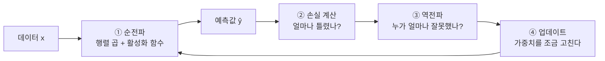

| 단계 | 하는 일 | 필요한 수학 | 이 문서의 장 |
|---|---|---|---|
| ① 순전파 | 입력에 가중치를 곱해 예측을 만든다 | 선형대수 (행렬 곱) | 2장 |
| ② 손실 계산 | 예측이 정답과 얼마나 다른지 숫자 하나로 나타낸다 | 확률·통계 (MLE) | 5장 |
| ③ 역전파 | 각 가중치가 손실에 얼마나 영향을 줬는지 계산한다 | 미적분 (미분, 연쇄 법칙) | 1장, 4장 |
| ④ 업데이트 | 손실이 줄어드는 방향으로 가중치를 움직인다 | 최적화 (경사하강법) | 3장 |

이 문서는 가장 기초가 되는 **미분(1장)** 부터 시작해서, 앞의 장에서 배운 것이 뒤의 장의 재료가 되는 순서로 진행한다.

### 배경: 기호주의와 연결주의

"컴퓨터가 똑똑하게 행동하게 하려면 어떻게 해야 하나"에 대해 AI 연구에는 크게 두 가지 생각이 있었다. 이 과제가 다루는 수학이 **어느 쪽의 수학인지** 알면 전체 그림이 더 잘 보인다.

**기호주의 (symbolism, symbolic AI)**: 사람이 아는 지식을 **기호와 규칙으로 직접 적어 넣는다.**

> 규칙 1: 체온이 38도 이상이고 기침을 하면 → 감기를 의심한다
> 규칙 2: 감기를 의심하고 증상이 7일 이상이면 → 병원 진료를 권한다

컴퓨터는 이 규칙들을 논리적으로 이어 붙여 결론을 낸다. 1970~80년대에 의사나 기술자의 지식을 규칙 수천 개로 옮긴 **전문가 시스템(expert system)** 이 대표적이다.

**연결주의 (connectionism)**: 뇌의 신경세포(뉴런)들이 **연결**되어 있는 구조에서 착안했다. 아주 단순한 계산 단위(뉴런)를 많이 연결하고, 연결의 세기(**가중치**)를 사람이 정하는 대신 **데이터를 보며 스스로 조절**하게 한다. 지식은 규칙 문장이 아니라 **수많은 숫자(가중치)** 에 흩어져 저장된다. 오늘날의 신경망과 딥러닝이 여기에 속한다.

| | 기호주의 | 연결주의 |
|---|---|---|
| 지식을 어떻게 담나 | 사람이 읽을 수 있는 규칙과 기호 | 가중치 숫자들 (행렬) |
| 어떻게 만드나 | 사람이 규칙을 직접 작성 | 데이터로 학습 (손실을 줄이도록 가중치 조절) |
| 잘하는 것 | 논리적 추론, 이유 설명, 적은 데이터 | 이미지·소리·글처럼 규칙으로 적기 어려운 패턴 인식 |
| 약한 것 | 규칙으로 다 적기 어려운 문제, 예외 처리 | 왜 그런 답을 냈는지 설명하기 어려움, 데이터가 많이 필요 |
| 예 | 전문가 시스템, 논리 프로그래밍, 체스 탐색 프로그램 | 퍼셉트론, 신경망, 딥러닝, 대형 언어 모델 |

**이 과제는 처음부터 끝까지 연결주의의 수학이다.** 위의 학습 과정 ①~④가 그대로 연결주의가 "학습한다"는 말의 뜻이다.

| 연결주의의 요소 | 이 과제에서 |
|---|---|
| 뉴런과 연결의 세기 | 퍼셉트론, 가중치 행렬 W (4장, 2장) |
| 얼마나 틀렸나 | 손실 함수, MLE (5장) |
| 각 가중치를 어느 쪽으로 고쳐야 하나 | 미분, gradient, 역전파 (1장, 4장) |
| 고치기 | 경사하강법 (3장) |

**짧은 역사: XOR 문제와 역전파**

| 시기 | 사건 |
|---|---|
| 1956 | 다트머스 회의에서 "인공지능(AI)"이라는 이름이 붙는다 |
| 1958 | 로젠블랫(Rosenblatt)의 **퍼셉트론**: 데이터로 가중치를 학습하는 뉴런 하나짜리 모델 |
| 1969 | 민스키(Minsky)와 페퍼트(Papert)의 책 *Perceptrons*: 뉴런 한 층짜리 퍼셉트론은 **XOR** 같은 간단한 문제도 풀 수 없음을 보였다. 이후 신경망 연구가 한동안 침체되는 데 영향을 주었다(얼마나 결정적이었는지는 지금도 의견이 갈린다) |
| 1970~80년대 | 기호주의의 전문가 시스템이 전성기를 맞는다 |
| 1986 | 루멜하트(Rumelhart), 힌튼(Hinton), 윌리엄스(Williams)가 **역전파**를 널리 알린다. 은닉층이 있는 신경망을 학습시킬 수 있게 되어 XOR도 풀린다. (같은 아이디어는 1974년 Werbos 등이 먼저 제안했다) |
| 2010년대 이후 | 많은 데이터와 GPU 덕분에 깊은 신경망(딥러닝)이 이미지, 음성, 언어에서 큰 성과를 내며 연결주의가 주류가 된다 |
| 현재 | 두 방식을 합치려는 **신경-기호 AI(neuro-symbolic AI)** 도 연구된다. 신경망은 보고 듣는 인식을, 기호 체계는 논리적 추론과 설명을 맡는 식이다 |

**XOR이 왜 중요했나**: XOR은 두 입력이 **서로 다를 때만 1**인 규칙이다. (0, 0) → 0, (0, 1) → 1, (1, 0) → 1, (1, 1) → 0.

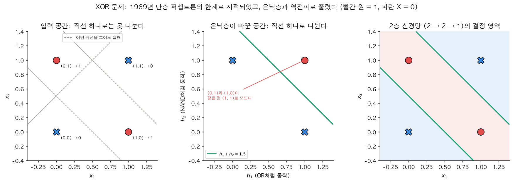

- **왼쪽**: 퍼셉트론 하나는 평면에 **직선 하나**를 긋고 한쪽을 1, 다른 쪽을 0으로 나누는 것과 같다. 하지만 1(빨강)과 0(파랑)이 대각선으로 엇갈려 있어서, 어떤 직선을 그어도 나눌 수 없다.
- **가운데**: 은닉층 뉴런 두 개를 두면, 은닉층이 공간을 **바꿔 놓는다.** h₁은 "둘 중 하나라도 1이면 1"(OR), h₂는 "둘 다 1이 아니면 1"(NAND)처럼 동작하게 가중치를 정하면 (0, 1)과 (1, 0)이 같은 점 (1, 1)로 모인다. 그러면 직선 하나로 나뉜다. 2장에서 본 "행렬은 공간을 변형한다"가 바로 이 역할이다.
- **오른쪽**: 그 결과 2층 신경망은 입력 공간을 띠 모양으로 나눠 XOR을 정확히 푼다.

이 그림의 신경망은 **입력 2개 → 은닉 2개 → 출력 1개**로, 4장 역전파 과제의 신경망과 **같은 구조**다. 여기서는 가중치를 손으로 정했지만, 실제로는 이런 가중치를 역전파와 경사하강법으로 **찾아낸다.** 1969년에 막혔던 문제를 1986년에 연 열쇠가 이 과제의 4장과 3장이다.

### 추천 학습 순서

장 번호 순서대로 읽어도 되지만, 수학이 낯설다면 **AI가 학습하는 흐름(위의 ①~④)을 따라가는 순서**가 더 이해하기 쉽다. 선형대수의 고유값·SVD는 학습 흐름과 직접 연결되지 않으므로, 어렵다면 **가장 나중에** 해도 된다.

> [!NOTE]
> 과제 명세(PDF)와 이 문서는 장 번호가 다르다. 명세는 **1 선형대수 → 2 미적분 → 3 역전파 → 4 최적화 → 5 확률·통계** 순서이고, 이 문서는 개념이 쌓이는 순서로 장을 배치했다.


| 순서 | 주제 | 무엇을 이해하나 | 이 문서 | 명세 |
|---|---|---|---|---|
| 0 | 수학 준비 | 함수, 기울기, 지형 비유, 벡터, 삼각함수(sin, cos, tan), 내적, 행렬, e와 로그, 손실 함수(MSE), 기호 읽는 법 | [수학 준비](#수학-준비-이-문서를-읽기-전에) | - |
| 1 | 미분 기초 | 기울기, 수치 미분, gradient | 1장 | 2번 |
| 2 | 퍼셉트론 | 입력 × 가중치를 더하고(가중합) 활성화 함수를 통과시키는 뉴런 하나의 계산. 필요한 행렬 곱은 2장 앞부분 | 4장 [퍼셉트론](#퍼셉트론-뉴런-하나의-계산), 2장 앞부분 | 3번 |
| 3 | 손실 함수 | 예측이 정답과 **얼마나 다른가**를 숫자 하나로 나타내기 (MSE, BCE) | [수학 준비 10)](#10-손실-함수-mse부터), 4장 순전파, 5장 | 3번, 5번 |
| 4 | 순전파 · 역전파 | 예측을 계산하고, 연쇄 법칙으로 각 가중치가 손실에 준 영향(gradient)을 거꾸로 구하기 | 4장 | 3번 |
| 5 | 경사하강법 | 구한 gradient의 반대 방향으로 가중치를 **얼마나**(학습률 × gradient) 움직일지 | 3장 | 4번 |
| 6 | MLE | 손실 함수를 **왜 그렇게** 정의하는가. MSE와 Cross-Entropy가 확률에서 나오는 이유 | 5장 | 5번 |
| 7 | 선형대수 심화 | 행렬식, 고유값, Power Iteration, SVD | 2장 | 1번 |

> [!TIP]
> 헷갈리기 쉬운 부분: **MLE는 "무엇을 틀렸다고 볼지"(손실 함수의 모양)** 를 정해 주고, **"얼마나 고칠지"는 학습률 × gradient** 가 정한다. 둘은 역할이 다르다.

## 학습 목표

이 과제를 마치면 아래 질문에 스스로 답할 수 있어야 한다.

| 주제 | 핵심 질문 | 다루는 곳 |
|---|---|---|
| 미적분 | 컴퓨터는 극한 없이 미분을 어떻게 계산하는가? gradient는 왜 등고선에 수직인가? | 1장, `src/calculus.py` |
| 선형대수 | 행렬을 곱하면 공간이 어떻게 변하고, 행렬식(det)은 그 변화와 어떤 관계인가? | 2장, `src/linear_algebra.py` |
| 선형대수 | 고유값·고유벡터는 변환에서 무엇을 뜻하고, SVD는 어떻게 데이터를 압축하는가? | 2장, `src/linear_algebra.py` |
| 최적화 | 학습률(Learning Rate)과 Momentum은 수렴에 어떤 영향을 주는가? | 3장, `src/optimizer.py` |
| 역전파 | 연쇄 법칙으로 2층 신경망의 각 가중치에 대한 기울기를 어떻게 구하는가? | 4장, `notebooks/backprop_derivation.ipynb` |
| 확률·통계 | MSE와 Cross-Entropy는 확률적으로 무엇을 뜻하며, MLE와 어떻게 연결되는가? | 5장, `notebooks/probability_loss.ipynb` |

이 과정은 이후 딥러닝 미션에서 AutoGrad(자동 미분) 엔진을 구현하는 수학적 기반이 되고, 모델이 왜 그렇게 동작하는지 해석하고 문제를 진단하는 능력으로 이어진다.

## 프로젝트 구조

```
codyssey_A2-1/
├── src/
│   ├── linear_algebra.py        # 행렬 변환 시각화, Power Iteration, SVD 이미지 압축
│   ├── calculus.py              # 중심차분 수치 미분, Gradient 시각화
│   ├── optimizer.py             # GD, SGD, Momentum, Nesterov, AdaGrad, RMSProp, Adam, Newton, 조합, 시각화
│   ├── backprop.py              # 역전파 고정 예제, 손계산 기록, NumPy 4자리 비교, 중심차분 검증
│   ├── probability.py           # 정규·베르누이 분포 그림, softmax 합 검증, MSE·CE와 MLE 확인
│   └── plot_style.py            # 공통 그림 설정 (한글 글꼴, outputs/ 저장)
├── notebooks/
│   ├── backprop_derivation.ipynb  # 역전파 수식 유도와 손계산 (계산 코드는 src/backprop.py)
│   └── probability_loss.ipynb     # 분포, softmax, MLE 유도 (계산 코드는 src/probability.py)
├── outputs/                     # 과제 실험 결과 그래프 (PNG)와 수렴 애니메이션 (GIF)
├── docs/
│   ├── A2-1.pdf                 # 과제 명세
│   └── figures/                 # README 개념 설명용 그림과 생성 스크립트
├── pyproject.toml               # uv 프로젝트 설정
├── uv.lock
├── requirements.txt             # pip 사용자용 의존성 목록
├── README.md
└── STUDY.md                     # 수학 학습 가이드 (공식, 숫자 예시, 공부 순서)
```

> [!NOTE]
> `src/`, `notebooks/`, `outputs/`의 파일은 과제를 진행하면서 채워 나간다. 제출 전에 이 구조와 실제 파일이 일치하는지 확인한다.
> 실제 구조는 `tree -I '.venv|__pycache__|.git|.ipynb_checkpoints' --dirsfirst`로 확인할 수 있다 (macOS: `sudo port install tree`).

## 실행 방법

**1. 환경 준비** (Python 3.12, [uv](https://docs.astral.sh/uv/) 사용)

```bash
uv sync
```

uv가 없다면 pip으로도 설치할 수 있다.

```bash
python -m venv .venv && source .venv/bin/activate && pip install -r requirements.txt
```

**2. 모듈 실행** (각 모듈은 실행하면 결과 그래프를 `outputs/`에 저장한다)

```bash
uv run python src/calculus.py
uv run python src/linear_algebra.py
uv run python src/optimizer.py
uv run python src/backprop.py      # 노트북과 같은 역전파 검증을 터미널에서 실행
uv run python src/probability.py   # 노트북과 같은 확률·손실 검증을 터미널에서 실행
```

**3. 노트북 실행**

```bash
uv run jupyter lab
```

VS Code에서 `.ipynb`를 열고 커널로 `.venv/bin/python`을 선택해도 된다.

**4. README 개념 그림 다시 만들기** (선택)

```bash
uv run python docs/figures/make_figures.py
```

> [!NOTE]
> 재현성을 위해 모든 스크립트는 `np.random.seed(42)`로 시드를 고정한다.

## 평가 항목별 코드·결과 위치

각 요구사항을 어느 파일의 어느 함수가 처리하는지, 결과가 어디에 있는지 정리한다. 노트북의 계산 코드는 `src/backprop.py`, `src/probability.py`에도 그대로 있어서 노트북 없이 `.py`만으로도 확인할 수 있다.

| 요구사항 | 코드 (파일 → 함수) | 노트북 위치 | 결과 |
|---|---|---|---|
| 중심차분 수치 미분, f'(3) 오차 ≤ 1e-4 | `src/calculus.py` → `numerical_derivative`, `check_derivative_at_3` | - | 오차 3.9e-11 |
| Gradient 시각화 (등고선 ⟂) | `src/calculus.py` → `numerical_gradient`, `plot_gradient_field` | - | `outputs/calculus_gradient_field.png` |
| 선형 변환과 det, 넓이 비율 오차 ≤ 1% | `src/linear_algebra.py` → `plot_transform`, `check_area_ratio` | - | 오차 0.00% |
| Power Iteration vs `np.linalg.eig` | `src/linear_algebra.py` → `power_iteration`, `verify_with_eig` | - | λ = 4.6180 |
| SVD 압축 (k = 10, 50, 100) | `src/linear_algebra.py` → `svd_compress`, `plot_svd_compression` | - | `outputs/linalg_svd_compression.png` |
| Vanilla GD lr 0.1, 100회, 원점 근처 도달 | `src/optimizer.py` → `experiment_vanilla_bowl(radius=1.0, spec_radius=0.1)` | - | 거리 1.4e-9, 반경 1·0.1 모두 통과 |
| 학습률별 수렴·발산, Momentum 비교 | `src/optimizer.py` → `experiment_learning_rates`, `experiment_momentum_bowl`, `experiment_ellipse` | - | 3장 결과와 해석 |
| 역전파 고정 예제와 손계산 기록 | `src/backprop.py` → 모듈 docstring(손계산 기록), `X`, `W1`, `B1`, `W2`, `B2`, `Y_TRUE`, `HAND_RESULTS` | `backprop_derivation.ipynb` 2절(유도), 3절(손계산 표) | 중간값 6자리, 결과 4자리 |
| 손계산 vs NumPy 소수 4자리 비교 | `src/backprop.py` → `forward`, `backward`, `compare_with_hand(decimals=4)` | 4절 "손계산과 비교 (소수점 4자리)" | 13개 값 모두 일치 |
| 역전파 중심차분 검증 | `src/backprop.py` → `gradient_check` | 5절 | 상대 오차 2.0e-11 |
| 정규분포 PDF 2종 비교 그림 | `src/probability.py` → `normal_pdf`, `plot_normal_pdfs` | `probability_loss.ipynb` 1절 | `outputs/prob_normal_pdf.png` |
| 베르누이 PMF 2종 비교 그림 | `src/probability.py` → `bernoulli_pmf`, `plot_bernoulli_pmfs` | 2절 | `outputs/prob_bernoulli_pmf.png` |
| softmax 구현, 합 = 1 (허용 오차 1e-6) | `src/probability.py` → `softmax`, `check_softmax_sum(tol=1e-6)` | 3절 | 최대 \|합 − 1\| = 1.1e-16 |
| MSE 최소화 = 정규분포 MLE 유도와 확인 | `src/probability.py` → 모듈 docstring(유도 1), `check_mse_mle` | 4절 | 두 최솟값 모두 w = 2.055 |
| CE 최소화 = 베르누이/카테고리 MLE 유도와 확인 | `src/probability.py` → 모듈 docstring(유도 2, 3), `check_bce_mle`, `check_softmax_ce_grad` | 5절 | p = 0.70, 기울기 차이 6.9e-12 |

---

## 수학 준비: 이 문서를 읽기 전에

이 장은 **중학교 수학(좌표, 일차함수, 거듭제곱, 피타고라스 정리)** 만 안다고 가정하고, 이 문서에 나오는 수학 용어를 숫자 예시로 하나씩 설명한다. 용어 자체는 바꾸지 않는다. 앞으로 자료를 찾아볼 때 같은 용어를 쓰기 때문이다. 이미 아는 내용은 건너뛰어도 된다.

### 1) 함수: 넣으면 하나가 나오는 규칙

**함수(function)** 는 숫자를 넣으면 정해진 규칙에 따라 숫자 하나를 돌려주는 규칙이다. 자판기와 같다. $f(x) = x^2$ 은 "x를 넣으면 x를 두 번 곱한 값이 나온다"는 뜻이고, $f(3)$ 은 "3을 넣었을 때 나오는 값", 즉 9다.

| 넣는 값 x | 나오는 값 f(x) = x² |
|---|---|
| −2 | 4 |
| 0 | 0 |
| 3 | 9 |

넣는 값을 가로(x), 나오는 값을 세로(y)로 해서 점을 찍고 이으면 **그래프**가 된다. $x^2$ 의 그래프는 U자 모양의 **포물선**이다.

### 2) 기울기: 옆으로 1 갈 때 위로 얼마나 가나

**기울기(slope)** 는 "가로로 1만큼 갈 때 세로로 얼마나 변하는가"이다. 두 점 (1, 2)와 (3, 8)을 지나는 직선이라면 가로로 2, 세로로 6 변했으니 기울기는 6 ÷ 2 = 3이다.

| 기울기 | 모양 |
|---|---|
| 양수 | 오른쪽으로 갈수록 **올라간다** |
| 0 | **평평하다** |
| 음수 | 오른쪽으로 갈수록 **내려간다** |

직선은 어디서나 기울기가 같지만, 곡선은 점마다 기울기가 다르다. **한 점에서의 기울기**를 구하는 것이 1장의 **미분**이다. AI 학습에서 기울기는 "어느 쪽으로 가야 손실이 줄어드는가"를 알려 주는 나침반 역할을 한다.

### 3) 변수가 2개인 함수는 왜 "지형"인가

변수가 하나인 함수는 **x 하나를 넣으면 높이 하나**가 나오므로 그래프가 **선**이다. 변수가 두 개인 함수는 **x와 y 두 개를 넣으면 숫자 하나**가 나온다. 예를 들어 $f(x, y) = x^2 + 3y^2$ 이라면

| 넣는 값 (x, y) | 계산 | 나오는 값 |
|---|---|---|
| (0, 0) | 0 + 0 | 0 |
| (2, 0) | 4 + 0 | 4 |
| (0, 1) | 0 + 3 | 3 |
| (2, 1) | 4 + 3 | 7 |

이것을 그림으로 그리려면 숫자가 세 개(x, y, 나오는 값) 필요하다. 그래서 다음처럼 생각한다.

- **x** = 지도에서 동쪽으로 간 거리
- **y** = 지도에서 북쪽으로 간 거리
- **f(x, y)** = 그 위치의 **땅 높이**

모든 위치에 높이를 세우면 **울퉁불퉁한 땅(지형)** 이 생긴다. 위 함수는 가운데 (0, 0)이 가장 낮고 바깥으로 갈수록 높아지는 **그릇 모양**이다. 이 비유 덕분에 "기울기", "내리막", "바닥" 같은 말을 그대로 쓸 수 있다.

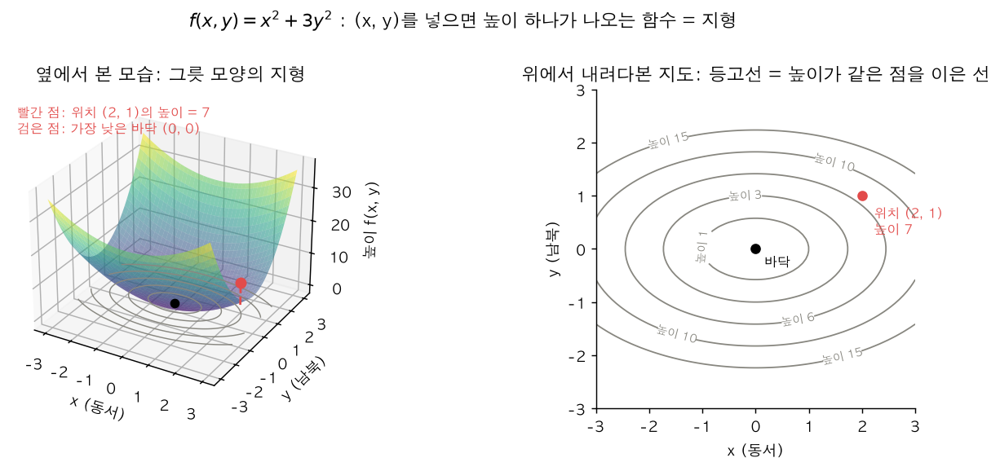

- **왼쪽**: 옆에서 본 지형. 빨간 점은 위치 (2, 1)에서 높이 7인 곳이다.
- **오른쪽**: 같은 지형을 **위에서 내려다본 지도**. 높이가 같은 점을 이은 선이 **등고선(contour line)** 이다. 등산 지도의 그 선과 같다. 선이 촘촘한 곳일수록 가파르다.

**AI와의 연결**: 모델의 손실(틀린 정도)은 가중치에 따라 달라진다. 가중치가 2개라면 "(가중치1, 가중치2)를 넣으면 손실 하나가 나오는 함수"이므로 위와 똑같이 지형으로 볼 수 있다. 그래서 **학습 = 손실 지형에서 가장 낮은 곳을 찾아 내려가는 것**이라고 말한다. 실제 모델은 가중치가 수백만 개라 그림으로 그릴 수 없지만, 생각하는 방식은 같다. 3장의 "안개 낀 산" 비유가 이것이다. 지형 전체는 볼 수 없고, 지금 서 있는 곳의 기울기만 알 수 있다는 뜻이다.

### 4) 벡터: 숫자 묶음이자 화살표

**벡터(vector)** 는 숫자 여러 개를 **순서대로** 묶은 것이다. (3, 4)는 숫자 두 개짜리 벡터다. 묶인 숫자 하나하나를 **성분(component)** 이라 한다. 순서가 중요해서 (3, 4)와 (4, 3)은 다른 벡터다. 세로로 세워 쓰기도 하며 뜻은 같다.

그림으로는 원점에서 출발해 **오른쪽으로 3, 위로 4** 가는 **화살표**다. 화살표는 **방향**과 **길이** 두 가지 정보를 갖는다.

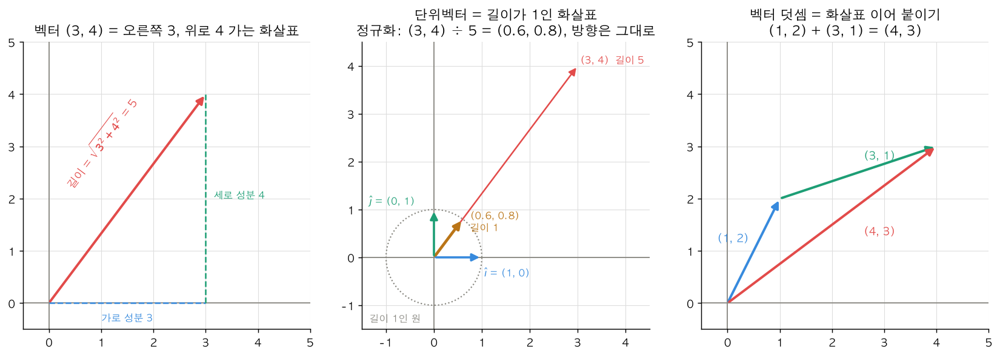

| 용어 | 쉬운 설명 | 예시 |
|---|---|---|
| **길이 (노름, norm)** | 화살표의 길이. 피타고라스 정리로 구한다. 기호는 $\lVert \mathbf{v} \rVert$ | $\lVert (3, 4) \rVert = \sqrt{3^2 + 4^2} = 5$ |
| **단위벡터 (unit vector)** | **길이가 정확히 1인** 벡터. 크기는 빼고 **방향만** 나타내고 싶을 때 쓴다. 나침반 바늘처럼 방향만 가리킨다 | (1, 0), (0.6, 0.8) |
| **정규화 (normalize)** | 벡터를 **같은 방향의 단위벡터로 바꾸는 것**. 각 성분을 길이로 나눈다 | (3, 4) ÷ 5 = (0.6, 0.8) |
| **î, ĵ** ("아이 햇", "제이 햇") | x축, y축 방향의 단위벡터. 글자 위의 ^ 모양을 **hat(모자)** 이라 부른다 | î = (1, 0), ĵ = (0, 1) |
| **스칼라 (scalar)** | 벡터가 아닌 **숫자 하나**. 벡터와 구분하려고 붙인 이름 | 3, −1, 0.5 |
| **벡터 덧셈** | 같은 자리끼리 더한다. 그림으로는 화살표를 **이어 붙이기** | (1, 2) + (3, 1) = (4, 3) |
| **스칼라배** | 모든 성분에 같은 숫자를 곱한다. 같은 방향으로 늘이거나(양수), 뒤집는다(음수) | 2 × (1, 2) = (2, 4) |

**정규화를 확인해 보면**: (0.6, 0.8)의 길이는 $\sqrt{0.36 + 0.64} = \sqrt{1} = 1$ 이다. 모든 성분을 같은 수(5)로 나눴으므로 방향은 그대로다. 사진을 축소해도 모양이 그대로인 것과 같다.

> [!NOTE]
> 모자 기호(^)는 분야마다 뜻이 다르다. 선형대수에서 **î** 는 "길이 1인 벡터"이고, 머신러닝에서 **ŷ** ("와이 햇")은 "모델의 **예측값**"이다. 4장과 5장의 ŷ은 예측값이다.

### 5) 삼각함수: sin, cos, tan

**sin(사인), cos(코사인), tan(탄젠트)** 는 **각도 하나를 넣으면 숫자 하나가 나오는 함수**다. 셋 다 같은 그림에서 나온다. 반지름이 1인 원을 그리고, 오른쪽(0도)에서 시계 반대 방향으로 각도 θ(세타)만큼 돌아간 점을 찍는다.

- **cos θ**: 그 점의 **가로 위치**. 바닥에 드리운 그림자 길이라고 생각하면 된다.
- **sin θ**: 그 점의 **세로 위치**, 즉 높이.
- **tan θ**: sin ÷ cos = **세로 ÷ 가로**. 원점에서 그 점까지 그은 선의 **기울기**다.

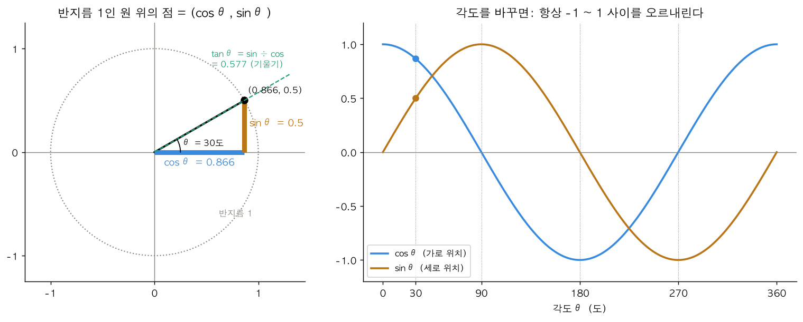

| 각도 θ | cos θ (가로) | sin θ (세로) | tan θ (기울기) |
|---|---|---|---|
| 0도 | 1 | 0 | 0 (수평) |
| 30도 | 0.866 | 0.5 | 0.577 |
| 45도 | 0.707 | 0.707 | 1 (가로 1, 세로 1) |
| 60도 | 0.5 | 0.866 | 1.732 |
| 90도 | 0 | 1 | 정의되지 않음 (수직, 0으로 나누기) |
| 180도 | −1 | 0 | 0 |

**표에서 보이는 성질**

- **항상 −1 ~ 1 사이**: cos와 sin은 반지름 1인 원 위의 좌표라서 원 밖으로 나갈 수 없다. 오른쪽 그래프처럼 각도를 바꾸면 −1과 1 사이를 물결처럼 오르내린다.
- **cos² + sin² = 1**: 가로, 세로, 반지름 1이 직각삼각형을 이루므로 피타고라스 정리가 성립한다. 30도면 0.866² + 0.5² = 0.75 + 0.25 = 1이다.
- **cos는 "얼마나 같은 방향인가"**: 0도(같은 방향)면 1, 90도(직각)면 0, 180도(반대 방향)면 −1이다. 이 성질이 바로 아래 6) 내적에서 쓰인다.

**직각삼각형으로 배우는 정의**: 학교에서는 직각삼각형의 변의 비율로 배운다. cos = 밑변 ÷ 빗변, sin = 높이 ÷ 빗변, tan = 높이 ÷ 밑변이다. 위 원 그림은 빗변을 1로 고정한 경우라서 같은 정의다. 원으로 생각하면 90도보다 큰 각도와 음수 값도 자연스럽게 다룰 수 있다.

**각도의 단위**: 이 문서는 "도"로 쓰지만, NumPy의 `np.cos`, `np.sin`은 **라디안(radian)** 이라는 단위를 받는다. 180도 = π(약 3.14) 라디안이고, `np.deg2rad(30)`처럼 바꿔서 넣는다.

**이 프로젝트에서 쓰는 곳**

$$
R(\theta) = \begin{bmatrix} \cos\theta & -\sin\theta \\ \sin\theta & \cos\theta \end{bmatrix}
\qquad
R(45°) = \begin{bmatrix} 0.707 & -0.707 \\ 0.707 & 0.707 \end{bmatrix}
$$

| 쓰는 곳 | 어떻게 쓰나 |
|---|---|
| 회전 행렬 (2장) | 위 식처럼 칸에 cos θ, sin θ가 들어간다. 점 (1, 0)을 θ만큼 돌리면 (cos θ, sin θ)로 간다. 45도면 cos, sin이 모두 0.707이라 R(45°)의 칸이 0.707, −0.707이다 |
| 원 그리기 (2장) | `unit_circle()`은 각도를 0~360도로 바꾸며 (cos θ, sin θ) 점 100개를 찍어 원을 만든다. 이 원을 행렬로 변형해 넓이 변화를 본다 |
| 내적 (수학 준비 6) | a · b = \|a\| × \|b\| × cos θ. 내적의 "그림자 길이"가 cos다 |
| 코사인 유사도 | 두 벡터 사이 각도의 cos 값. 영화 취향 예시의 0.96은 두 취향 벡터 사이 각도가 약 15도라는 뜻이다 (cos 15.4도 ≈ 0.964) |
| gradient ⟂ 등고선 확인 (1장) | 두 방향 사이 cos가 0이면 직각이다. 실제로 측정한 최대 \|cos\|가 7.1e-12였다 |

tan은 이 프로젝트에 직접 나오지 않지만, "기울기 = 세로 ÷ 가로"라는 뜻은 [2) 기울기](#2-기울기-옆으로-1-갈-때-위로-얼마나-가나)와 1장의 미분과 같은 개념이다.

### 6) 내적: 같은 자리끼리 곱해서 더하기

**내적(dot product)** 은 두 벡터의 같은 자리 성분끼리 곱한 뒤 모두 더한 **숫자 하나**다.

$$
(2, 3) \cdot (1000, 1500) = 2 \times 1000 + 3 \times 1500 = 6500
$$

**의미 1, 가중합**: 사과 2개, 배 3개를 개당 1000원, 1500원에 사면 총액이 6500원이다. "각 항목에 **중요도(가중치)** 를 곱해서 합친 값"이 내적이다. 신경망의 뉴런 하나가 하는 계산이 바로 이것이다.

**의미 2, 방향이 얼마나 같은가**: 두 화살표가 같은 쪽을 보면 내적이 양수, **직각이면 0**, 반대쪽을 보면 음수다. 1장에서 "gradient가 등고선과 직각인지" 확인할 때 쓸 수 있다.

| 예시 | 계산 | 결과 | 관계 |
|---|---|---|---|
| (1, 0) · (2, 0) | 1×2 + 0×0 | 2 | 같은 방향 |
| (1, 0) · (0, 2) | 1×0 + 0×2 | **0** | **직각** |
| (1, 0) · (−2, 0) | 1×(−2) + 0×0 | −2 | 반대 방향 |

#### 내적은 왜 구하나: 그림으로 보는 의미

두 의미는 사실 하나의 식에서 나온다. 두 화살표 사이의 각도를 θ라 하면

$$
\mathbf{a} \cdot \mathbf{b} = \lVert \mathbf{a} \rVert \times \underbrace{\lVert \mathbf{b} \rVert \cos\theta}_{\text{b의 그림자 길이}}
$$

이다. 햇빛이 a에 수직으로 내리쬔다고 생각하면, b가 a 위에 드리우는 **그림자 길이**가 $\lVert \mathbf{b} \rVert \cos\theta$ 다. 내적은 "a의 길이 × 그 그림자 길이"다. 그림자가 a와 같은 쪽이면 양수, 직각이면 그림자가 없어서 0, 반대쪽이면 음수가 된다. cos는 바로 위 [5) 삼각함수](#5-삼각함수-sin-cos-tan)에서 본 "가로 위치(그림자)"다. 각도가 0도면 1, 90도면 0, 180도면 −1이다.

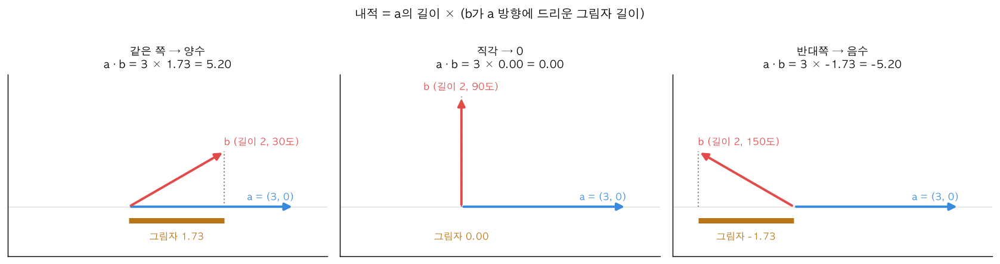

#### 내적은 어디에 쓰나

**쓰임 1, 뉴런의 계산 (4장)**: 뉴런은 입력 x와 가중치 w의 내적에 편향 b를 더한다. w = (0.5, −1), x = (2, 1), b = 0.3이면

$$
z = \mathbf{w} \cdot \mathbf{x} + b = 0.5 \times 2 + (-1) \times 1 + 0.3 = 0.3
$$

가중치가 큰 입력일수록 결과에 많이 반영된다. 즉 내적은 "어떤 입력을 얼마나 중요하게 볼지"를 계산하는 방법이고, 학습은 이 가중치를 고치는 일이다.

**쓰임 2, 얼마나 비슷한가 재기 (추천, 검색, 언어 모델)**: 영화 취향을 (액션, 로맨스, 공포) 점수로 나타내 보자.

| 사람 | 취향 벡터 | 나와의 내적 | 코사인 유사도 |
|---|---|---|---|
| 나 | (5, 1, 4) | | |
| 친구 A | (4, 0, 5) | 5×4 + 1×0 + 4×5 = **40** | **0.96** (거의 같은 취향) |
| 친구 B | (1, 5, 0) | 5×1 + 1×5 + 4×0 = **10** | **0.30** (다른 취향) |

내적이 클수록 같은 방향, 즉 비슷한 취향이다. 다만 내적은 점수를 크게 매기는 사람일수록 커지므로, 두 벡터의 길이로 나눠 **방향만 비교**한 값을 많이 쓴다. 이것이 **코사인 유사도(cosine similarity)** 다.

$$
\text{코사인 유사도} = \frac{\mathbf{a} \cdot \mathbf{b}}{\lVert \mathbf{a} \rVert \, \lVert \mathbf{b} \rVert}
= \frac{40}{6.48 \times 6.40} \approx 0.96
$$

1이면 완전히 같은 방향, 0이면 무관, −1이면 정반대다. 넷플릭스 같은 추천, 검색 엔진에서 "질문과 비슷한 문서 찾기", 단어를 벡터로 바꾼 **임베딩(embedding)** 에서 "왕과 여왕이 비슷한 단어인가" 판단이 모두 이 계산이다. ChatGPT 같은 언어 모델의 핵심 부품인 **어텐션(attention)** 도 "지금 단어와 다른 단어들이 얼마나 관련 있는가"를 내적으로 잰다.

**쓰임 3, 직각인지 확인하기 (이 프로젝트 1장)**: 내적이 0이면 직각이다. 1장에서 "gradient가 등고선과 직각인가"를 확인할 때, gradient와 등고선 방향의 코사인 값을 계산했고 최대 7.1e-12(사실상 0)가 나왔다.

**쓰임 4, 행렬 곱의 재료 (바로 다음 7))**: 행렬 곱은 내적을 여러 번 한 것이다. 그래서 신경망의 계산은 결국 엄청나게 많은 내적이다.

### 7) 행렬과 행렬 곱

**행렬(matrix)** 은 숫자를 직사각형 표로 배열한 것이다. 가로줄을 **행(row)**, 세로줄을 **열(column)** 이라 한다. 행이 2개, 열이 3개면 **2×3 행렬**이라 하고, 이 크기를 NumPy에서는 **shape** 라고 부른다.

**행렬 × 벡터는 "가중합 여러 개를 한 번에"** 하는 계산이다. 가게 두 곳의 가격표로 같은 장바구니(사과 2, 배 3)의 총액을 구해 보자. 행렬의 가로줄 하나가 가게 하나의 가격표(사과, 배)이고, 각 가로줄과 장바구니 벡터의 내적이 그 가게의 총액이다.

$$
\begin{bmatrix} 1000 & 1500 \\ 1200 & 1300 \end{bmatrix}
\begin{bmatrix} 2 \\ 3 \end{bmatrix}
=
\begin{bmatrix} 1000 \times 2 + 1500 \times 3 \\ 1200 \times 2 + 1300 \times 3 \end{bmatrix}
=
\begin{bmatrix} 6500 \\ 6300 \end{bmatrix}
$$

**행렬 × 행렬의 규칙**은 하나뿐이다.

> 결과의 **i행 j열** = 왼쪽 행렬의 **i번째 가로줄** 과 오른쪽 행렬의 **j번째 세로줄** 의 내적

$$
\begin{bmatrix} 1 & 2 \\ 3 & 4 \end{bmatrix}
\begin{bmatrix} 5 & 6 \\ 7 & 8 \end{bmatrix}
=
\begin{bmatrix} 1 \times 5 + 2 \times 7 & 1 \times 6 + 2 \times 8 \\ 3 \times 5 + 4 \times 7 & 3 \times 6 + 4 \times 8 \end{bmatrix}
=
\begin{bmatrix} 19 & 22 \\ 43 & 50 \end{bmatrix}
$$

- 오른쪽 행렬은 **위에서 아래로** 읽는다. 1번 세로줄은 (5, 7)이다.
- 가로줄 길이와 세로줄 길이가 **같아야** 곱할 수 있다. (2×**3**) × (**3**×4)처럼 안쪽 숫자가 같아야 하고, 결과는 바깥쪽 숫자인 2×4가 된다.
- **순서를 바꾸면 결과가 달라진다.** A × B ≠ B × A
- NumPy에서 행렬 곱은 `A @ B`이고, `A * B`는 **같은 칸끼리 곱하기**라서 전혀 다른 결과가 나온다.

| 용어 | 쉬운 설명 |
|---|---|
| **전치 (transpose)** $A^{\top}$ | 행과 열을 맞바꾼 것. 2×3이 3×2가 된다 |
| **단위행렬 (identity matrix)** $I$ | 대각선이 1, 나머지가 0. 곱해도 아무것도 바뀌지 않는다. 숫자의 1과 같은 역할 |
| **대각행렬 (diagonal matrix)** | 대각선에만 숫자가 있는 행렬. 축 방향으로 늘이기만 한다 |

행렬은 **공간을 늘이고, 돌리고, 미는 기계**로도 볼 수 있다. 이 관점은 2장에서 그림과 함께 다룬다.

#### 행렬 곱은 왜 필요한가

내적을 하나씩 계산해도 답은 같다. 그런데도 행렬 곱으로 묶어 쓰는 이유는 세 가지다.

**이유 1, 뉴런 여러 개를 한 번에 (4장)**: 은닉층 뉴런이 2개면 내적이 2번 필요하다. 각 뉴런의 가중치를 가로줄로 쌓아 행렬 $W_1$ 을 만들면, 두 내적이 $W_1 \mathbf{x}$ 한 번으로 끝난다. 위의 "가게 두 곳의 총액"과 같은 구조다.

$$
\underbrace{\begin{bmatrix} 0.5 & -1 \\ 0.2 & 0.8 \end{bmatrix}}_{\text{뉴런1, 뉴런2의 가중치}}
\begin{bmatrix} 2 \\ 1 \end{bmatrix}
=
\begin{bmatrix} 0.5 \times 2 + (-1) \times 1 \\ 0.2 \times 2 + 0.8 \times 1 \end{bmatrix}
=
\begin{bmatrix} 0 \\ 1.2 \end{bmatrix}
\leftarrow \text{뉴런1, 뉴런2의 결과}
$$

손글씨 숫자 사진(28×28 = 784픽셀)을 뉴런 128개에 넣으면 내적이 128번, 곱셈이 약 10만 번이다. 이것을 `W @ x` 한 줄로 쓴다.

**이유 2, 데이터 여러 개를 한 번에 (3장 미니배치)**: 사진 32장을 가로줄로 쌓아 행렬 X(32×784)를 만들면 `X @ W.T` 한 번으로 32장의 결과가 모두 나온다. 3장의 "미니배치 GD"가 데이터를 묶어서 처리하는 것이 이 계산이다.

**이유 3, 변환을 이어 붙이기 (2장)**: "45도 돌린 다음 가로로 2배 늘이기"는 늘이기 행렬 S와 회전 행렬 R을 곱한 **행렬 하나** $SR$ 로 바꿀 수 있다. 오른쪽부터 적용되므로 순서가 중요하다($SR \neq RS$). 이 성질에서 중요한 사실이 하나 나온다. 신경망 층 두 개 $W_2(W_1 \mathbf{x})$ 는 $(W_2 W_1)\mathbf{x}$, 즉 **층 하나와 똑같아진다.** 층을 아무리 쌓아도 행렬 하나로 줄어들기 때문에, 층 사이에 **활성화 함수**(4장)를 넣어 이 합쳐짐을 막아야 깊은 신경망이 의미가 있다.

**덤, 계산 속도**: GPU(그래픽 카드)는 수천 개의 곱셈을 동시에 하도록 만들어진 장치라서 행렬 곱을 매우 빠르게 계산한다. 딥러닝 계산의 대부분이 행렬 곱이라서, 계산을 행렬 곱으로 묶어 쓰는 것이 곧 학습 속도다.

### 8) 거듭제곱, e, 로그

**거듭제곱**: $2^3 = 2 \times 2 \times 2 = 8$. 0제곱은 항상 1이다($2^0 = 1$). 음수 제곱은 나누기다($2^{-1} = 1/2$).

**e (자연상수, 오일러 수)**: 약 **2.718** 인 특별한 숫자다. π(약 3.14)처럼 수학에서 자주 나와서 이름이 붙었다. $e^x$ 는 "e를 x번 곱한 것"이다. 4장의 sigmoid 함수 $\sigma(z) = \frac{1}{1 + e^{-z}}$, softmax, 5장의 정규분포에 나온다.

#### e는 어디서 나온 숫자인가: 복리 이자

원금 1원을 연 100% 이자로 맡긴다고 하자. 1년에 한 번 이자를 붙이면 2원이다. 그런데 이자를 **나눠서 자주** 붙이면 이자에도 이자가 붙어 조금 더 늘어난다.

| 1년을 몇 번으로 나누나 (n) | 계산 $(1 + \frac{1}{n})^n$ | 1년 뒤 금액 |
|---|---|---|
| 1 (1년에 한 번) | $(1 + 1)^1$ | 2.000 |
| 2 (반년마다) | $(1 + 0.5)^2$ | 2.250 |
| 12 (매달) | $(1 + \frac{1}{12})^{12}$ | 2.613 |
| 365 (매일) | $(1 + \frac{1}{365})^{365}$ | 2.715 |
| 10000 | | 2.718 |
| 끝없이 잘게 | | **e = 2.71828...** |

아무리 잘게 나눠도 2.71828...을 넘지 못한다. 이 한계값이 e다. 즉 e는 **"쉬지 않고 연속으로 자라는 것"의 기준 숫자**다. 인구 증가, 방사능 감소, 뜨거운 커피가 식는 속도처럼 "지금 양에 비례해서 변하는" 현상에 모두 e가 나온다.

#### e가 꼭 필요한 이유: 미분해도 자기 자신

$e^x$ 의 가장 중요한 성질은 **어느 점에서나 높이와 기울기가 같다**는 것이다.

$$
\frac{d}{dx} e^x = e^x
$$

x = 1에서 높이가 2.72이면 기울기도 2.72다. 2의 거듭제곱 $2^x$ 는 x = 0에서 기울기가 약 0.69, $3^x$ 는 약 1.10이다. 그 사이에서 기울기가 **정확히 1**이 되는 밑이 e(2.718...)다. 그래서 e를 밑으로 쓰면 미분할 때 지저분한 숫자가 붙지 않는다.

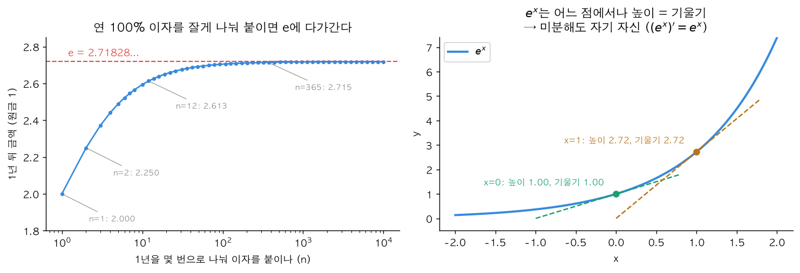

#### AI에서 e를 쓰는 곳

| 쓰는 곳 | 식 | e가 필요한 이유 |
|---|---|---|
| sigmoid (4장) | $\sigma(z) = \frac{1}{1 + e^{-z}}$ | 어떤 수든 0~1로 부드럽게 눌러 준다. 미분이 $\sigma(1 - \sigma)$ 로 깔끔해서 역전파 계산이 쉽다 |
| softmax (4장, 5장) | $\frac{e^{z_i}}{\sum_j e^{z_j}}$ | $e^z$ 는 **항상 양수**라서 음수 점수도 확률(0 이상)로 바꿀 수 있다. 점수 순서도 그대로 유지된다 |
| 정규분포 (5장) | $e^{-\frac{(x-\mu)^2}{2\sigma^2}}$ | 로그를 씌우면 e가 사라지고 **제곱**만 남는다. 이것이 MSE가 나오는 이유다 |
| 자연로그 ln | e를 밑으로 하는 로그 | e와 짝이라 $\log(e^z) = z$ 로 서로 지워진다. 미분도 $\frac{1}{x}$ 로 깔끔하다 |

정리하면 e는 "계산을 깔끔하게 만드는 숫자"다. 다른 밑(2, 10)을 써도 원리상 가능하지만, 미분할 때마다 0.69 같은 숫자가 따라붙어 식이 지저분해진다.

#### 로그: 거듭제곱을 거꾸로 묻기

**로그 (log)**: 거듭제곱을 **거꾸로** 묻는 것이다. "2를 몇 번 곱해야 8이 되나?" → 3번이므로 $\log_2 8 = 3$ 이다. 밑을 e로 쓰는 로그를 **자연로그**라 하고 $\ln$ 또는 그냥 $\log$ 로 쓴다. 이 문서의 $\log$ 는 자연로그다.

| 값 | 로그 값 (자연로그) | 의미 |
|---|---|---|
| 1 | 0 | 확신 100%면 0 |
| 0.5 | 약 −0.69 | |
| 0.01 | 약 −4.6 | 작은 확률일수록 큰 음수 |

**왜 AI에서 로그를 쓰나**: 로그는 **곱셈을 덧셈으로** 바꾼다($\log(a \times b) = \log a + \log b$). 데이터 1000개의 확률을 모두 곱하면 0에 가까운 아주 작은 수가 되어 컴퓨터가 다루기 어렵다. 로그를 씌우면 덧셈이 되어 안전하다. 확률 0.9, 0.8, 0.7의 곱은 0.504이고, 로그를 씌우면 $-0.105 - 0.223 - 0.357 = -0.685 = \log 0.504$ 로 같다. 5장의 MLE와 Cross-Entropy가 이 성질을 쓴다.

### 9) Σ (서메이션): 합 기호

**이름**: Σ는 그리스 문자 **대문자 시그마**다. 영어 Sum의 S에 해당하는 글자라서 "더하기" 기호로 쓰인다. 기호로서의 이름은 **summation**(서메이션)이고, 한국어로는 **합 기호**라고 한다. 고등학교에서는 흔히 "시그마"라고 부르지만, 이 문서에는 소문자 **σ**(시그마)가 sigmoid, 특이값, 표준편차의 뜻으로 따로 나온다. 둘을 말로 구분하기 위해 **Σ는 "서메이션" 또는 "합 기호"** 라고 부르는 편이 명확하다. 영어로는 $\sum_{i=1}^{n} x_i$ 를 "the sum of $x_i$ from i = 1 to n"처럼 읽는다. 마찬가지로 모두 곱하라는 기호 **Π**(대문자 파이)는 원주율 π와 구분하려고 "프로덕트(product)"라고 부른다(5장).

$\sum$ 는 "모두 더하라"는 기호다. 아래와 위에 적힌 숫자는 "몇 번부터 몇 번까지"라는 뜻이다.

$$
\sum_{i=1}^{3} x_i = x_1 + x_2 + x_3
$$

x = (2, 5, 8)이면 2 + 5 + 8 = 15다. 여기서 $x_i$ 의 작은 글자 i는 "i번째"를 뜻하는 번호(**인덱스, index**)다. 평균은 $\frac{1}{n}\sum_{i=1}^{n} x_i$ 로 쓴다. 다 더해서 개수로 나눈다는 뜻이다.

### 10) 손실 함수: MSE부터

**손실 함수(loss function)** 는 "예측이 정답과 얼마나 다른가"를 **숫자 하나**로 나타내는 규칙이다. 작을수록 잘 맞춘 것이다. AI의 학습은 결국 **이 숫자를 줄이는 일**이고, 3장의 경사하강법은 그 숫자를 줄이는 방법, 4장의 역전파는 그 숫자의 기울기를 구하는 방법이다. 그래서 손실 함수를 먼저 알아야 뒤의 장들이 무엇을 하려는지 보인다.

가장 기본적인 손실 함수가 **MSE(Mean Squared Error, 평균 제곱 오차)** 다. 이름을 뒤에서부터 읽으면 계산 순서가 된다.

1. **Error (오차)**: 정답 − 예측
2. **Squared (제곱)**: 오차를 제곱
3. **Mean (평균)**: 다 더해서 개수로 나눔

$$
\text{MSE} = \frac{1}{n} \sum_{i=1}^{n} (y_i - \hat{y}_i)^2
$$

($y_i$ 는 i번째 정답, $\hat{y}_i$ 는 i번째 예측, Σ는 바로 위 9)의 합 기호다.)

**숫자로 계산해 보기**: 모델이 "ŷ = 2x + 1"로 예측한다고 하자.

| x | 정답 y | 예측 ŷ = 2x + 1 | 오차 y − ŷ | 오차² |
|---|---|---|---|---|
| 1 | 4 | 3 | +1 | 1 |
| 2 | 4 | 5 | −1 | 1 |
| 3 | 9 | 7 | +2 | 4 |
| | | | 합 = **2** | 합 = 6, **MSE = 6 ÷ 3 = 2** |

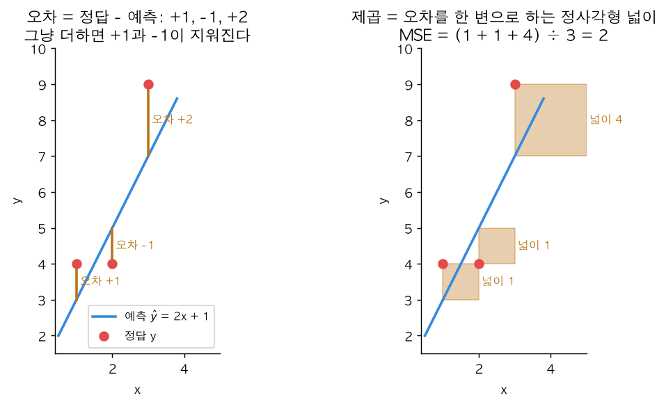

**왜 그냥 더하지 않고 제곱하나**

- **부호 때문에 지워지는 것을 막는다**: 오차를 그냥 더하면 +1과 −1이 지워진다. 극단적으로 오차가 +5, −5인 엉망인 모델도 합이 0이 되어 "완벽"해 보인다. 제곱하면 모두 양수가 된다.
- **큰 실수를 더 크게 혼낸다**: 오차 1은 1, 오차 2는 4, 오차 10은 100이 된다. 가끔 크게 틀리는 것을 특히 싫어하는 셈이다.
- **미분하기 쉽다**: $e^2$ 의 기울기는 $2e$ 로 어디서나 매끄럽다. 절댓값 $|e|$ 를 쓰는 방법(MAE)도 있지만, 0에서 뾰족하게 꺾여서 그 점의 기울기가 정해지지 않는다. 경사하강법은 기울기로 움직이므로 매끄러운 쪽이 편하다.
- **확률적인 근거가 있다**: "오차가 정규분포를 따른다"고 가정하면 MSE가 수학적으로 유도된다(5장).

**코드로는 한 줄이다**: `np.mean((y - y_hat) ** 2)`

**분류 문제에서는**: 값이 아니라 "맞다/아니다"를 맞히는 문제(4장의 XOR, 고양이/개 분류)에서는 예측이 확률(0~1)이다. 이때는 MSE 대신 **BCE / Cross-Entropy** 를 쓴다. 틀린 쪽으로 확신할수록 손실이 아주 커지는 손실 함수로, 4장 순전파에서 처음 나오고 5장에서 왜 그런 식인지 유도한다.

| 문제 종류 | 예시 | 예측 | 손실 함수 | 나오는 곳 |
|---|---|---|---|---|
| 회귀 (값 맞히기) | 집값, 온도 | 아무 숫자 | **MSE** | 3장 결과 ⑤ (선형 회귀), 5장 |
| 분류 (종류 맞히기) | XOR, 스팸 메일 | 확률 0~1 | **BCE, Cross-Entropy** | 4장, 5장 |

MSE 말고도 MAE, Huber 같은 회귀 손실이 있다. 언제 어떤 손실을 쓰는지, 분류에서 왜 MSE를 쓰지 않는지는 5장 [손실 함수 고르기](#손실-함수-고르기-어떤-상황에-왜-이-함수를-쓰나)에서 숫자와 그림으로 비교한다.

### 11) 기호 읽는 법

수식의 문자는 그 자체로 정해진 뜻이 있는 게 아니라 **이름표**다. 같은 기호가 문맥에 따라 다른 뜻일 수 있으므로, 이 문서에서 쓰는 뜻을 정리한다.

| 기호 | 읽는 법 | 이 문서에서의 뜻 | 나오는 곳 |
|---|---|---|---|
| $f(x)$ | 에프 엑스 | x를 넣었을 때 함수 f가 돌려주는 값 | 전체 |
| $f'(x)$ | 에프 프라임 | 도함수. x에서의 기울기 | 1장 |
| $h$ | 에이치 | 수치 미분에서 옆으로 움직이는 아주 작은 거리 | 1장 |
| $\partial$ | 라운드, 델 | 편미분. 여러 변수 중 하나만 움직인 기울기 | 1장, 4장 |
| $\nabla f$ | 나블라 에프 | gradient. 모든 편미분을 모은 벡터 | 1장, 3장 |
| $\lVert \mathbf{v} \rVert$ | 노름 | 벡터의 길이 | 2장 |
| $\cos\theta, \sin\theta, \tan\theta$ | 코사인, 사인, 탄젠트 | 각도 θ일 때 원 위 점의 가로 위치, 세로 위치, 기울기 | 수학 준비 5), 2장 |
| $A^{\top}$ | 에이 트랜스포즈 | 전치 행렬 | 2장, 4장 |
| $\det(A)$ | 디터미넌트 | 행렬식. 넓이가 몇 배가 되는가 | 2장 |
| $\lambda$ | 람다 | 고유값 | 2장 |
| $\sigma_i$ (아래 번호 있음) | 시그마 아이 | **특이값** (SVD) | 2장 |
| $\sigma(z)$ (괄호 있음) | 시그마 | **sigmoid 함수** | 4장 |
| $\sigma$ (정규분포에서) | 시그마 | **표준편차** (퍼진 정도) | 5장 |
| $\sum$ (대문자 Σ) | 서메이션, 합 기호 | 모두 더하라. 소문자 σ와 다른 기호다 | 전체 |
| $\mu$ | 뮤 | 평균 | 5장 |
| $\mathcal{L}(\theta)$ | 우도 엘 | 우도. 파라미터가 θ일 때 관측한 데이터가 나올 가능성 | 5장 |
| $p(y \mid x)$ | 피 와이 바 엑스 | x가 주어졌을 때 y의 확률 (조건부 확률) | 5장 |
| $\prod$ | 프로덕트 | 모두 곱하라 (Σ의 곱셈 버전) | 5장 |
| $\arg\max$, $\arg\min$ | 아그맥스, 아그민 | 값을 가장 크게/작게 만드는 입력 | 5장 |
| $\theta$ | 세타 | 모델이 학습하며 고치는 숫자 전체(파라미터). 삼각함수와 회전에서는 **각도** | 3장, 5장 / 수학 준비 5), 2장 |
| $\eta$ | 에타 | **학습률(learning rate)**. 한 걸음의 크기. 그래프와 표에서는 **lr**, 코드에서는 `lr=` 인자로 쓴다. 셋 다 같은 것이다 | 3장 |
| $\beta$ | 베타 | Momentum의 관성 세기 | 3장 |
| $W, b$ | 더블유, 비 | 가중치 행렬, 편향 | 4장 |
| $\hat{y}$ | 와이 햇 | 모델의 예측값 ($y$ 는 정답) | 4장, 5장 |
| $\odot$ | 아다마르 곱 | 같은 칸끼리 곱하기 (NumPy의 `*`) | 4장 |
| $\leftarrow$ | 대입 | 오른쪽 값을 계산해서 왼쪽에 새로 넣는다 | 3장 |
| $\approx$ | 근사 | 거의 같다 | 전체 |

> [!TIP]
> 소문자 σ(시그마)는 이 문서에서 **세 가지 뜻**으로 쓰인다. 아래 번호가 붙으면 특이값, 괄호와 함께 함수처럼 쓰이면 sigmoid, 정규분포 식에서는 표준편차다. 대문자 **Σ**는 이것들과 다른 **합 기호(서메이션)** 다.

---

## 1. 미적분: 수치 미분과 Gradient

### 한눈에 보기

> 미분은 **"한 점에서의 기울기"** 다. 컴퓨터는 극한을 계산할 수 없으니, 아주 가까운 두 점을 잡아 기울기를 계산하는 방식으로 미분을 **근사**한다. 이것이 수치 미분이다.

### 무엇을 구하는가

**기울기**란 **높이 차이 / 가로 차이** 이다.
산길을 예로 들면 가로로 1m 이동했을 때 높이가 7m 올랐다면 그 구간의 경사는 **7 / 1 = 7**이다. 이 경사가 바로 기울기이다.

AI에서 기울기가 중요한 이유는, 기울기가 **"이 값을 조금 바꾸면 결과가 얼마나, 어느 방향으로 변하는가"** 를 알려 주기 때문이다. 3장의 경사하강법은 이 정보를 이용해 손실을 줄이는 방향으로 가중치를 움직인다.

### 직관: 두 점 사이의 기울기에서 한 점의 기울기로

f(x) = x² 그래프 상에서

- x = 3 일 때 높이는 f(3) = 9
- x = 4 일 때 높이는 f(4) = 16
- 가로로 1 이동하는 동안 높이가 16 - 9 = 7 변했으므로, 두 점을 잇는 직선의 기울기는 **7 / 1 = 7**

이를 식과 맞춰보면

$$
\frac{f(x+h) - f(x)}{h}
$$

이를 자연어로 풀어보면

- x는 출발점
- h는 옆으로 얼마나 움직였는가 (가로 차이)
- f(x+h) - f(x)는 그동안 높이가 얼마나 변했나 (높이 차이)
- 이 전체는 두 점을 잇는 직선(**할선**)의 기울기

이다.

그런데 미분이란 **한 점에서의 기울기**이다.
곡선은 계속 휘니까 x = 3, 바로 이 지점의 기울기를 알고 싶다. 그런데 기울기는 점이 두 개 있어야 계산할 수 있다.

이를 계산하기 위해서 우리는 두 번째 점을 첫 번째 점에 점점 가깝게 붙인다. 즉, h를 작게 만든다.

| h | 두 번째 점 | 높이 차이 | 기울기 |
|---|---|---|---|
| 1 | x = 4 | 16 - 9 = 7 | 7 |
| 0.1 | x = 3.1 | 9.61 - 9 = 0.61 | 6.1 |
| 0.01 | x = 3.01 | 9.0601 - 9 = 0.0601 | 6.01 |

h가 작아질수록 기울기가 6에 수렴한다.

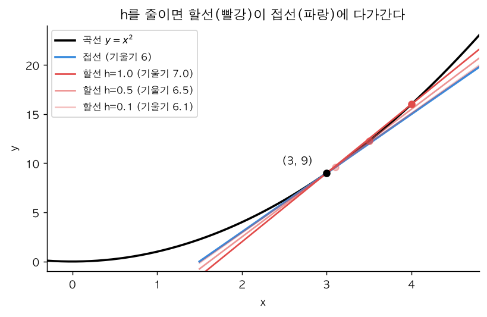

즉, 두 번째 점이 가까워질수록( $h \to 0$ ) (3, 9)와 두 번째 점을 지나는 **할선**의 기울기는, 곡선 y = x²에 (3, 9) 한 점에서만 닿는 **접선**의 기울기에 가까워진다. 이 극한값이 미분이다.

$$
f'(x) = \lim_{h \to 0} \frac{f(x+h) - f(x)}{h}
$$

$\lim_{h \to 0}$ 은 "h를 0에 **한없이 가깝게** 할 때 값이 다가가는 곳"이라는 뜻이고, 이 다가가는 값을 **극한(limit)** 이라 한다.

> **용어 정리**
> - **할선**(割線, secant line): 곡선 위의 **두 점**을 가르고 지나가는 직선
> - **접선**(接線, tangent line): 곡선에 **한 점**에서 닿기만 하는 직선. 그 기울기가 미분값이다.
> - **차분**(差分, difference): 두 점의 **값의 차이**. 이 문서에서는 h를 0으로 보내지 않고 실제 숫자로 둔 채 "값의 차이 ÷ 가로 차이"로 계산한 기울기를 뜻한다. 컴퓨터가 계산하는 것은 미분이 아니라 차분이다. 자세한 구분은 [아래](#중심차분은-미분과-같은가-왜-차분이라고-부르나)에서 다룬다.

### "한 점에서의 기울기"는 모순이 아닌가?

기울기는 "두 점 사이에서 x가 변할 때 y가 얼마나 변했나"이다. 점이 하나뿐이면 가로 차이도 0, 높이 차이도 0이라 $\frac{0}{0}$ 이 되어 계산할 수 없다. 그래서 **"한 점에서의 기울기"는 말 자체가 모순처럼 들리는 게 맞다.** 실제로 미분이 처음 등장했을 때 수학자들 사이에서도 이 점이 큰 논쟁거리였다.

이 모순은 **"한 점에서 직접 계산하지 않는다"** 는 방법으로 해결한다.

1. **두 점으로만 계산한다.** 위 표처럼 h = 1, 0.1, 0.01 … 일 때의 할선 기울기는 모두 두 점으로 구한 평범한 기울기다. h는 아무리 작아도 **0이 아니므로** 0으로 나누는 일은 없다.
2. **그 값들이 어디로 다가가는지 본다.** 7 → 6.1 → 6.01 → 6.001 … 은 6에 한없이 다가간다. 그러나 h가 0이 아닌 한 정확히 6이 되지는 않는다.
3. **다가가는 그 값(극한)을 "한 점에서의 기울기"라고 정의한다.** 즉 "한 점의 기울기"는 한 점으로 계산한 값이 아니라, **두 점을 끝없이 가깝게 할 때 두 점 기울기가 도착하는 목적지**에 붙인 이름이다.

| h | 할선 기울기 (두 점으로 계산) | 6과의 차이 |
|---|---|---|
| 1 | 7 | 1 |
| 0.1 | 6.1 | 0.1 |
| 0.01 | 6.01 | 0.01 |
| 0.001 | 6.001 | 0.001 |
| … | … | 0에 한없이 가까워짐 |
| (극한) | **6** = x = 3에서의 미분값 | |

**그림으로 보면: 확대하면 곡선도 직선처럼 보인다.** 곡선 위 한 점 주변을 계속 확대하면 휘어진 정도가 점점 보이지 않게 되고, 결국 곡선이 **직선과 거의 구별되지 않는다.** 그 직선의 기울기가 "그 점에서의 기울기"이고, 그 직선이 접선이다.

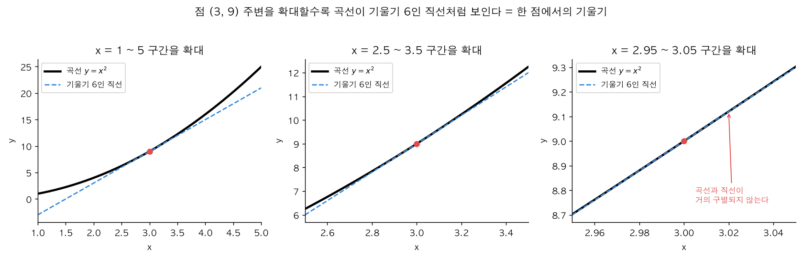

**일상의 예: 자동차 속도계.** 속도는 "이동 거리 ÷ 걸린 시간"이라 원래 두 시각이 필요하다. 그런데 속도계는 "**지금** 시속 60km"라고 한 순간의 속도를 보여 준다. 실제로는 아주 짧은 시간 동안의 이동 거리로 계산한 값이다. "지금 이 순간의 속도"가 바로 시간에 대한 미분이고, 속도계가 보여 주는 값은 아주 짧은 시간 간격으로 계산한 **차분**이다.

### 전방차분, 후방차분, 중심차분

위에서 계산한 방식은 x에서 **앞쪽(오른쪽)** 으로 h만큼 간 점을 사용했다. 이를 **전방차분(前方差分, forward difference)** 이라 한다.

$$
\text{forward difference} = \frac{f(x+h)-f(x)}{h}
$$

전방차분이 있다면 후방차분(backward difference)도 있지 않을까?
전방차분은 오른쪽에 점을 찍어 기울기를 구했으니, **왼쪽**에 점을 찍어 기울기를 구할 수도 있을 것이다.

$$
\text{backward difference} = \frac{f(x)-f(x-h)}{h}
$$

두 식 모두 **"오른쪽 점의 높이 − 왼쪽 점의 높이"를 "오른쪽 x − 왼쪽 x"로 나눈 것**이다. 다른 것은 두 번째 점을 오른쪽에 찍느냐, 왼쪽에 찍느냐뿐이다.

아래는 후방차분으로 x = 3에서 계산한 값이다. 가로와 높이 모두 **오른쪽 − 왼쪽** 순서로 뺀다.

| h | 왼쪽 점 | 가로 차이 | 높이 차이 | 기울기 |
|---|---|---|---|---|
| 1 | x = 2 | 3 - 2 = 1 | 9 - 4 = 5 | 5 |
| 0.1 | x = 2.9 | 3 - 2.9 = 0.1 | 9 - 8.41 = 0.59 | 5.9 |
| 0.01 | x = 2.99 | 3 - 2.99 = 0.01 | 9 - 8.9401 = 0.0599 | 5.99 |

> [!TIP]
> 기울기의 부호(+/−)에도 의미가 있다. 오른쪽으로 갈수록 올라가면 양수, 내려가면 음수다. 그래서 높이 차이에 절댓값을 씌우면 안 된다. 예를 들어 x = −3에서 기울기는 −6이어야 한다.

이제 두 방식을 나란히 놓아 보자.

| h | 전방차분 | 후방차분 | 두 값의 평균 | 정답 |
|---|---|---|---|---|
| 1 | 7 | 5 | 6 | 6 |
| 0.1 | 6.1 | 5.9 | 6 | 6 |
| 0.01 | 6.01 | 5.99 | 6 | 6 |

- 전방차분은 정답보다 **크게**, 후방차분은 정답보다 **작게** 나온다.
- 포물선은 접선보다 위에 있어서, 오른쪽 점을 이은 할선은 접선보다 큰 기울기를, 왼쪽 점을 이은 할선은 작은 기울기를 가진다.
- 두 오차는 크기가 비슷하고 방향이 반대라서, **평균을 내면 서로 상쇄된다.**

이 평균이 바로 **중심차분(central difference)** 이다. x를 가운데에 두고 양옆의 점 x − h와 x + h를 잇는다.

$$
\text{central difference} = \frac{1}{2}\left(\frac{f(x+h)-f(x)}{h} + \frac{f(x)-f(x-h)}{h}\right) = \frac{f(x+h)-f(x-h)}{2h}
$$

분모가 2h인 이유는 두 점 x − h와 x + h 사이의 가로 거리가 2h이기 때문이다.

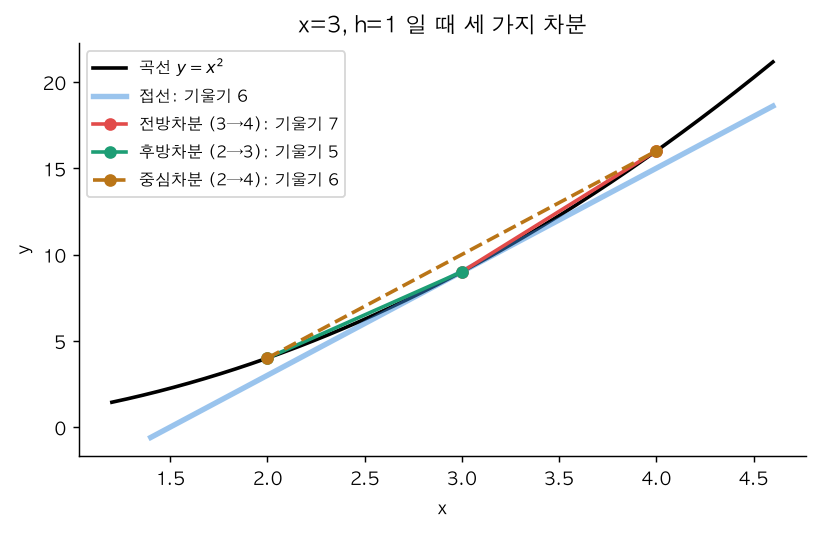

### 중심차분은 미분과 같은가? 왜 "차분"이라고 부르나

위 표에서 중심차분은 h가 1이든 0.01이든 정확히 6이 나왔다. 그러면 "중심차분 = 기울기(미분)"라고 생각하기 쉽다. 하지만 둘은 **다른 것**이고, 이번 결과는 **f(x) = x²라서 생긴 우연**이다.

**미분과 차분의 차이**

| | 미분 | 차분 |
|---|---|---|
| 뜻 | 한 점에서의 기울기 (극한값) | 실제로 떨어진 두 점으로 계산한 기울기 |
| h | 0에 한없이 가깝게 보냄 | 1, 0.1, 0.00001 같은 **실제 숫자** |
| 성격 | 구하고 싶은 **목표** | 목표에 가까운 **근사값** |

**왜 "차분"인가**: 차분(差分)의 差는 "차이"라는 뜻이다. 계산식의 분자 $f(x+h) - f(x-h)$ 가 바로 **두 점의 값의 차이(difference)** 이고, 그 차이를 가로 거리로 나눈 것이 차분으로 구한 기울기다. 영어 이름도 forward/backward/central **difference** 다. 이름이 "미분"이 아니라 "차분"인 이유는, 극한을 취하지 않고 **떨어진 두 점의 차이를 그대로** 쓰기 때문이다.

**x²에서 중심차분이 정확한 이유**: 식을 직접 풀어 보면

$$
\frac{(x+h)^2 - (x-h)^2}{2h} = \frac{(x^2 + 2xh + h^2) - (x^2 - 2xh + h^2)}{2h} = \frac{4xh}{2h} = 2x
$$

$h^2$ 이 서로 지워져서 h가 남지 않는다. 그래서 x²에서는 어떤 h를 써도 정확히 2x(x = 3이면 6)가 나온다. 포물선은 좌우가 대칭이라, 양옆의 두 점을 잇는 할선이 접선과 **정확히 평행**하기 때문이다.

**다른 함수에서는 다르다**: f(x) = x³, x = 2에서 정답(미분값)은 12다.

| h | 중심차분 | 정답과의 차이 |
|---|---|---|
| 1 | 13 | 1 |
| 0.1 | 12.01 | 0.01 |
| 0.01 | 12.0001 | 0.0001 |

같은 방식으로 풀면 x³의 중심차분은 $3x^2 + h^2$ 이 되어 $h^2$ 만큼 오차가 남는다. h를 줄이면 정답에 가까워지지만 **정확히 같지는 않다.** 그래서 중심차분은 기울기 그 자체가 아니라 **기울기를 아주 잘 흉내 내는 근사 방법**이다.

### 왜 중심차분이 더 정확한가

f(x) = x²는 위에서 본 것처럼 특별한 경우라서 중심차분이 h와 상관없이 정확히 6이 나온다. 일반적인 함수에서는 어떨까? f(x) = sin x, x = 1에서 h를 절반씩 줄여 보면 다음과 같다. 정답은 cos 1 ≈ 0.5403이다.

| h | 전방차분 오차 | 중심차분 오차 |
|---|---|---|
| 0.1 | 0.0429 | 0.00090 |
| 0.05 | 0.0213 | 0.00023 |
| 0.025 | 0.0106 | 0.000056 |

- h를 절반으로 줄이면 전방차분 오차는 **절반**으로 줄어든다.
- 같은 경우 중심차분 오차는 **4분의 1**로 줄어든다.

즉 중심차분은 같은 h에서 훨씬 정확하고, h를 줄일 때 더 빠르게 정확해진다.

### h는 작을수록 좋을까?

수학에서는 h → 0일수록 정확하지만 컴퓨터에서는 그렇지 않다. 컴퓨터는 실수를 유한한 자릿수(약 16자리)로만 저장하기 때문에, 거의 같은 두 수 f(x+h)와 f(x)를 빼면 앞자리가 모두 지워지고 **반올림 오차만 남는다.** 이를 **반올림 오차(round-off error)** 라 한다.

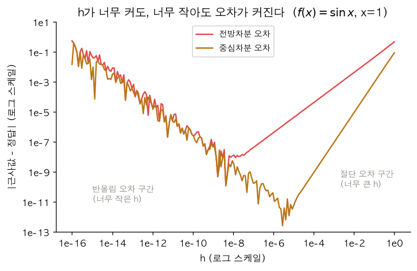

- 오른쪽(h가 큼): 할선이 접선과 달라서 생기는 **절단 오차**가 크다.
- 왼쪽(h가 너무 작음): **반올림 오차**가 커진다.
- 그래서 적당한 h가 있다. 중심차분에서는 대략 h = 1e-5 근처에서 오차가 가장 작다.

<details>
<summary><b>더 깊이 보기 (전공자용): 테일러 전개로 본 오차의 차수</b></summary>

f(x+h)와 f(x−h)를 테일러 전개하면

$$
f(x \pm h) = f(x) \pm h f'(x) + \frac{h^2}{2} f''(x) \pm \frac{h^3}{6} f'''(x) + O(h^4)
$$

전방차분은

$$
\frac{f(x+h)-f(x)}{h} = f'(x) + \frac{h}{2} f''(x) + O(h^2)
$$

이므로 오차가 $O(h)$ 이다 (1차 정확도). 중심차분은 두 전개식을 빼면 짝수 차수 항이 상쇄되어

$$
\frac{f(x+h)-f(x-h)}{2h} = f'(x) + \frac{h^2}{6} f'''(x) + O(h^4)
$$

오차가 $O(h^2)$ 이다 (2차 정확도). f(x) = x²는 $f''' = 0$ 이라 절단 오차가 0이다.

반올림 오차는 대략 $\varepsilon_{\text{mach}} |f(x)| / h$ 크기이고 ($\varepsilon_{\text{mach}} \approx 2.2 \times 10^{-16}$), 절단 오차와의 합을 최소화하면 최적의 h는 전방차분에서 $\sqrt{\varepsilon_{\text{mach}}} \approx 10^{-8}$, 중심차분에서 $\varepsilon_{\text{mach}}^{1/3} \approx 10^{-5}$ 정도가 된다. 위 그래프의 두 최저점 위치와 일치한다.

</details>

### 2변수 함수와 Gradient

변수가 x, y 두 개인 함수 f(x, y)는 **산의 지형**처럼 생각할 수 있다. (x, y)는 지도 위의 위치, f(x, y)는 그 위치의 높이다. 왜 이렇게 보는지는 [수학 준비 3)](#3-변수가-2개인-함수는-왜-지형인가)에 그림과 함께 설명했다.

- **편미분** $\frac{\partial f}{\partial x}$ : y는 고정하고 x 방향으로만 움직였을 때의 기울기
- **Gradient** $\nabla f$ : 각 방향의 편미분을 모은 벡터

$$
\nabla f(x, y) = \left( \frac{\partial f}{\partial x}, \frac{\partial f}{\partial y} \right)
$$

Gradient는 **그 지점에서 가장 가파르게 올라가는 방향**을 가리키고, 그 길이는 얼마나 가파른지를 나타낸다.

**등고선**은 높이가 같은 점들을 이은 선이다. 지도에서 산을 표현하는 그 선과 같다.

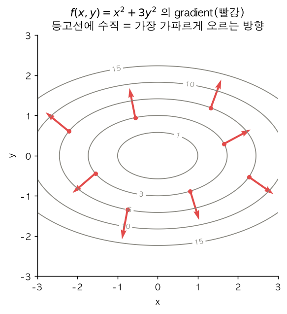

**왜 gradient는 등고선에 수직일까?** 등고선을 따라 걸으면 높이가 변하지 않는다. 즉 등고선 방향으로는 기울기가 0이다. 가장 가파르게 오르는 방향은 "높이가 전혀 변하지 않는 방향"과 정반대 성질을 가지므로, 그 방향과 **직각**을 이룬다.

<details>
<summary><b>더 깊이 보기 (전공자용): 방향 도함수와 직교성</b></summary>

단위 벡터 $\mathbf{u}$ 방향의 방향 도함수는 $D_{\mathbf{u}} f = \nabla f \cdot \mathbf{u} = \lVert \nabla f \rVert \cos\theta$ 이다. 이 값은 $\mathbf{u}$ 가 $\nabla f$ 와 같은 방향일 때 ($\theta = 0$) 최대가 된다.

등고선의 접선 방향 $\mathbf{t}$ 를 따라서는 f가 일정하므로 $\nabla f \cdot \mathbf{t} = 0$, 즉 $\nabla f \perp \mathbf{t}$ 이다.

시각화할 때 `ax.set_aspect('equal')`로 x축과 y축의 눈금 비율을 같게 하지 않으면, 실제로는 수직인 화살표가 그림에서 비스듬하게 보인다.

</details>

### 기울기를 구하는 다른 방법들

이 장에서는 **차분(수치 미분)** 으로 기울기를 구했다. 하지만 기울기를 구하는 방법은 이것만이 아니고, 실제 딥러닝은 **다른 방법을 주로 쓴다.** 크게 세 가지가 있다.

| 방법 | 어떻게 하나 | 정확도 | 속도 | 주로 쓰는 곳 |
|---|---|---|---|---|
| 수치 미분 (차분) | 두 점의 값 차이로 근사한다 | 근사값 (h에 따라 오차) | 느림 (변수마다 따로 계산) | 검산, 간단한 실험 |
| 해석적 미분 | 미분 공식을 미리 구해 두고 숫자를 넣는다 | 정확 | 빠름 | 손계산, 간단한 함수 |
| 자동 미분 | 계산을 작은 단계로 쪼개 연쇄 법칙으로 곱한다 | 정확 | 빠름 | **PyTorch, TensorFlow 등 딥러닝 학습** |

**1) 해석적 미분(analytic differentiation): 공식으로 계산하기**

위의 기울기 표에서 x²의 기울기가 항상 **2x** 라는 규칙을 찾았다. 이렇게 **미분 규칙(공식)을 먼저 구해 두고 숫자만 넣는** 방법이 해석적 미분이다. x = 3이면 2 × 3 = 6으로, 계산 한 번에 **오차 없이** 나온다. 과제에서 "해석적 미분값 6"이라고 부르는 값이 이것이다.

| 함수 | 도함수 (미분 공식) |
|---|---|
| 숫자 하나 (상수, 예: 5) | 0 (평평하다) |
| 3x (직선) | 3 |
| x² | 2x |
| x³ | 3x² |

함수가 복잡해지면 사람이 공식을 구하기 어렵고 실수하기 쉽다. 공식 구하기를 컴퓨터에게 시키는 방법(**기호 미분**, symbolic differentiation, 예: 파이썬의 SymPy)도 있지만, 식이 커지면 결과 공식이 지나치게 길어진다.

**2) 자동 미분(automatic differentiation): 작은 단계의 기울기를 곱하기**

복잡한 함수도 결국 **덧셈, 곱셈, 제곱 같은 작은 계산의 연속**이다. 작은 계산 하나하나의 기울기는 위 공식표로 이미 알고 있으니, 이것을 **연쇄 법칙**(4장)으로 곱하면 전체 기울기가 나온다.

예시: $f(x) = (2x + 1)^2$, x = 1

① **계산하면서 단계마다 기울기를 기록한다** (순전파)

| 단계 | 계산 | 값 | 이 단계의 기울기 |
|---|---|---|---|
| 1 | $u = 2x + 1$ | 3 | u는 x에 대해 **2** (직선 2x의 기울기) |
| 2 | $f = u^2$ | 9 | f는 u에 대해 **2u = 6** (u²의 기울기는 2u) |

② **기록한 기울기를 거꾸로 곱한다** (역전파)

$$
\frac{df}{dx} = \frac{df}{du} \times \frac{du}{dx} = 6 \times 2 = 12
$$

해석적 미분으로 확인하면 $f(x) = (2x+1)^2 = 4x^2 + 4x + 1$ 이므로 기울기는 $8x + 4$ 이고, x = 1에서 12다. 결과가 같다. 신경망에서 이 과정을 하는 것이 4장의 **역전파**다. 즉 **역전파는 자동 미분의 한 종류**다.

**3) 왜 딥러닝은 차분이 아니라 자동 미분을 쓰나: 계산량**

중심차분은 **변수 하나의 기울기**를 구할 때마다 함수를 **2번** (x + h에서 한 번, x − h에서 한 번) 계산해야 한다. 2변수 함수의 gradient를 구할 때 x 방향, y 방향을 따로 계산한 것처럼, 변수가 늘어나면 그만큼 계산이 늘어난다.

| 변수(파라미터) 개수 | 중심차분: 함수 계산 횟수 | 자동 미분 (역전파) |
|---|---|---|
| 2개 | 4번 | 순전파 1번 + 역전파 1번 |
| 100만 개 | 200만 번 | 순전파 1번 + 역전파 1번 |
| 수십억 개 (대형 언어 모델) | 수십억 번 이상 | 순전파 1번 + 역전파 1번 |

역전파는 파라미터가 몇 개든 **한 번 거꾸로 훑으면 모든 기울기가 한꺼번에** 나온다. 학습은 이 계산을 수만 번 반복하므로, 차분으로는 사실상 학습할 수 없다.

**4) 그럼 차분은 왜 배우나: 검산(gradient check)**

차분은 느리지만 **원리가 단순해서 틀리기 어렵다.** 그래서 역전파나 손으로 구한 공식이 맞는지 확인할 때, **같은 지점에서 중심차분으로 구한 값과 비교**한다. 두 값이 거의 같으면 공식이 맞은 것이다. 이를 **기울기 검증(gradient check)** 이라 한다.

이 과제의 흐름이 바로 이것이다.

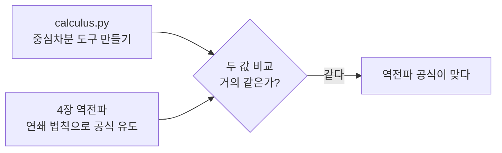

4장 끝의 "더 깊이 보기: 기울기 검증(gradient check)과 AutoGrad"에서 이어서 다루고, 이후 딥러닝 미션에서 구현할 **AutoGrad 엔진**이 위 2)의 자동 미분을 직접 만드는 것이다.

<details>
<summary><b>더 깊이 보기 (전공자용): 더 정확한 차분과 자동 미분의 두 방식</b></summary>

**고차 차분**: 점을 더 많이 쓰면 오차 차수가 높아진다. 5점 중심차분 $\frac{-f(x+2h) + 8f(x+h) - 8f(x-h) + f(x-2h)}{12h}$ 는 오차가 $O(h^4)$ 이다.

**Complex-step 미분**: $f'(x) \approx \frac{\operatorname{Im} f(x + ih)}{h}$ 는 뺄셈이 없어 반올림 오차(상쇄)가 생기지 않으므로 $h = 10^{-20}$ 처럼 매우 작은 h를 쓸 수 있다. 단, f가 복소수 입력에서 해석적이어야 한다.

**Forward mode와 reverse mode**: 자동 미분은 입력 쪽부터 기울기를 전달하는 forward mode(입력 1개당 1번 계산)와, 출력 쪽부터 거꾸로 전달하는 reverse mode(출력 1개당 1번 계산)가 있다. 딥러닝은 입력(파라미터)이 수백만 개이고 출력(손실)이 1개라서 reverse mode, 즉 역전파가 압도적으로 유리하다.

</details>

### 과제에서 할 일 (`src/calculus.py`)

- [x] 중심차분 수치 미분 함수를 구현한다.
- [x] f(x) = x², x = 3에서 수치 미분을 계산하고 해석적 미분값 6과의 오차가 **1e-4 이내**인지 확인한다.
- [x] f(x, y) = x² + y²의 등고선 그래프를 그린다.
- [x] 등고선 위 여러 점에서 gradient 방향을 화살표(`plt.quiver`)로 표시하고, 등고선에 수직인지 확인한다.
- [x] 결과 그래프를 `outputs/`에 PNG로 저장한다.

> [!TIP]
> **직접 확인해 볼 것**
> - f(x) = x²에서 중심차분이 h에 관계없이 6이 나오는 이유를 설명할 수 있는가?
> - f(x, y) = x² + y²의 gradient를 손으로 구하면 무엇인가? 그 화살표는 원점에서 바깥쪽을 향하는가, 안쪽을 향하는가?

### 결과와 해석

실행: `uv run python src/calculus.py`

**① 수치 미분 f'(3), f(x) = x²**

| 항목 | 값 |
|---|---|
| 사용한 h | 1e-5 |
| 중심차분 결과 | 6.0000000000 |
| 해석적 미분값 | 6 |
| 오차 | **3.9e-11** (기준 1e-4 → 통과) |

**h = 1e-5를 고른 이유**: 중심차분의 오차는 두 가지가 합쳐진 것이다. h가 크면 할선과 접선이 달라서 생기는 **절단 오차**(h²에 비례)가 커지고, h가 너무 작으면 거의 같은 두 수를 빼면서 생기는 **반올림 오차**(1/h에 비례)가 커진다. 두 오차의 합은 h ≈ 1e-5 근처에서 가장 작아진다. sin x, x = 1로 실험해 보면 오차가 가장 작은 h는 약 6.5e-6(오차 4.7e-12)이었고, h = 1e-5에서도 5.6e-12로 거의 같았다.

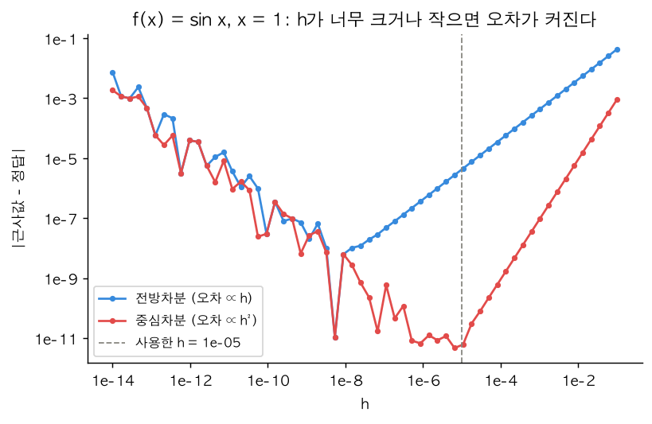

- 오른쪽(h가 큼): 전방차분(파랑)은 기울기 1, 중심차분(빨강)은 기울기 2인 직선이다. 즉 h를 10배 줄이면 오차가 전방차분은 10배, 중심차분은 100배 줄어든다.
- 왼쪽(h가 너무 작음): 두 방법 모두 반올림 오차 때문에 오차가 다시 커지고 들쭉날쭉해진다.

**f(x) = x²에서 중심차분이 h와 상관없이 6인 이유**: $\frac{(x+h)^2 - (x-h)^2}{2h} = \frac{4xh}{2h} = 2x$ 로 h가 완전히 지워지기 때문이다. 실제로 h = 1로 계산해도 6.0이 나온다. 그래서 위 오차 3.9e-11은 절단 오차가 아니라 반올림 오차뿐이다.

**② Gradient와 등고선**

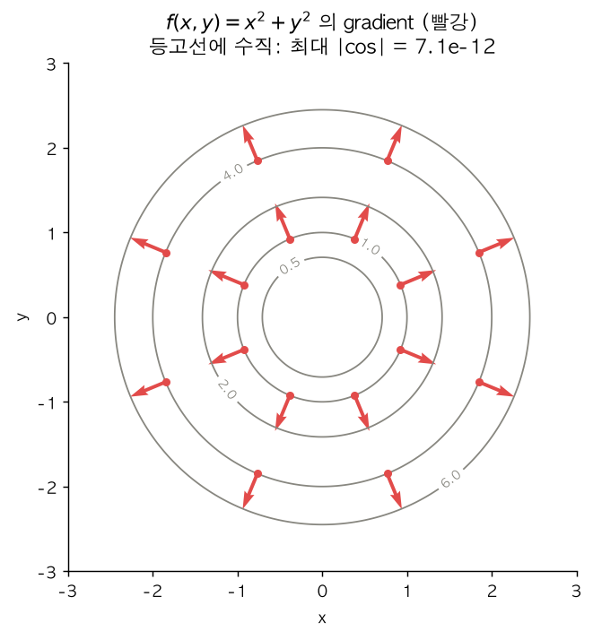

- 반지름 1, 2인 등고선 위 16개 점에서 `numerical_gradient`로 gradient를 구해 화살표로 그렸다. 방향만 보이도록 길이는 1로 맞췄다.
- 손으로 구한 gradient는 $\nabla f = (2x, 2y)$ 로, 위치 벡터 (x, y)의 2배다. 따라서 화살표는 **원점에서 바깥쪽**(오르막)을 향한다. 수치 gradient도 예를 들어 (1, 2)에서 (2.0, 4.0)으로 같았다.
- 각 점에서 gradient와 등고선 접선 방향 (−y, x)의 내적으로 cos 값을 구했더니 최대 |cos| = **7.1e-12**로 사실상 0이다. 즉 gradient는 등고선과 **수직**이다.
- `ax.set_aspect('equal')`로 x, y 눈금 비율을 같게 해야 그림에서도 수직으로 보인다.

---

## 2. 선형대수: 행렬은 공간을 변형한다

### 한눈에 보기

> 행렬을 곱한다는 것은 **공간 전체를 돌리고, 늘이고, 기울이는 것**이다. 신경망의 각 층이 하는 일도 결국 데이터가 놓인 공간을 행렬로 변형하는 것이다.

### 무엇을 구하는가

2×2 행렬 A에 2차원 점 (x, y)를 곱하면 새로운 점이 나온다.

$$
\begin{bmatrix} a & b \\ c & d \end{bmatrix}
\begin{bmatrix} x \\ y \end{bmatrix}
=
\begin{bmatrix} ax + by \\ cx + dy \end{bmatrix}
$$

점 하나가 아니라 **모든 점**에 같은 행렬을 곱하면, 공간 전체가 한꺼번에 변형된다.

### 직관: 행렬의 열은 "기준 화살표가 어디로 가는가"

평면의 기본 화살표 두 개를 생각해 보자.

- 오른쪽 화살표 (1, 0)
- 위쪽 화살표 (0, 1)

행렬 A를 곱하면 (1, 0)은 A의 **첫 번째 열** (a, c)로, (0, 1)은 **두 번째 열** (b, d)로 옮겨진다. 나머지 모든 점은 이 두 화살표를 따라 격자째로 따라간다.

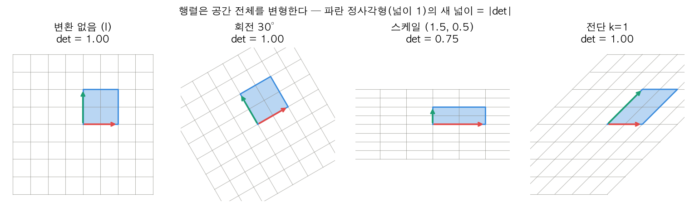

(빨간 화살표 = (1, 0)이 옮겨진 곳, 초록 화살표 = (0, 1)이 옮겨진 곳)

### 세 가지 기본 변환

| 변환 | 행렬 | 하는 일 | det |
|---|---|---|---|
| 회전 R(θ) | $\begin{bmatrix} \cos\theta & -\sin\theta \\ \sin\theta & \cos\theta \end{bmatrix}$ | 원점을 중심으로 θ만큼 돌린다 | 1 |
| 스케일링 S(sx, sy) | $\begin{bmatrix} s_x & 0 \\ 0 & s_y \end{bmatrix}$ | 가로로 sx배, 세로로 sy배 늘인다 | sx × sy |
| 전단 Sh(k) | $\begin{bmatrix} 1 & k \\ 0 & 1 \end{bmatrix}$ | 위로 갈수록 오른쪽으로 밀어 기울인다 | 1 |

### 행렬식(det)은 넓이가 몇 배가 되었는가

2×2 행렬의 행렬식은 다음과 같다.

$$
\det \begin{bmatrix} a & b \\ c & d \end{bmatrix} = ad - bc
$$

그림에서 넓이 1인 파란 정사각형이 변환 후 넓이가 얼마가 되었는지 보면, 그 값이 바로 **|det|** 이다.

- 회전: 모양이 돌아가기만 하고 넓이는 그대로 → det = 1
- 스케일 (1.5, 0.5): 가로 1.5배, 세로 0.5배 → 넓이 0.75배 → det = 0.75
- 전단: 평행사변형으로 기울어지지만 밑변과 높이는 그대로 → det = 1

중요한 점은 정사각형뿐 아니라 **원, 삼각형 등 어떤 도형이든** 넓이가 똑같이 |det|배가 된다는 것이다. 행렬은 공간 전체를 균일하게 변형하기 때문이다.

> det가 음수이면 공간이 **뒤집힌 것**(거울에 비친 것)이고, det = 0이면 공간이 **선이나 점으로 납작하게 눌린 것**이다.

### 도형의 넓이는 어떻게 계산하나: 신발끈 공식

변환 전후 도형의 넓이를 비교하려면 넓이를 계산해야 한다. 단위 원은 점 100개를 이은 다각형으로 표현하므로, 다각형의 넓이 공식인 **신발끈 공식(shoelace formula)** 을 쓴다. 꼭짓점이 순서대로 $(x_1, y_1), \dots, (x_n, y_n)$ 일 때

$$
\text{넓이} = \frac{1}{2} \left| \sum_{i=1}^{n} \left( x_i \, y_{i+1} - x_{i+1} \, y_i \right) \right|, \quad (x_{n+1}, y_{n+1}) = (x_1, y_1)
$$

꼭짓점 좌표를 엇갈려 곱하는 모양이 신발끈을 묶는 모양과 닮아서 붙은 이름이다. NumPy에서는 `np.roll`로 "다음 꼭짓점" 배열을 쉽게 만들 수 있다.

### 고유값과 고유벡터: 변환해도 방향이 바뀌지 않는 화살표

행렬을 곱하면 대부분의 화살표는 **방향이 바뀐다.** 그런데 어떤 특별한 화살표는 변환 후에도 **같은 직선 위에 남고 길이만 변한다.** 이 화살표를 **고유벡터**, 길이가 변하는 배율을 **고유값**이라 한다.

$$
A \mathbf{v} = \lambda \mathbf{v}
$$

- $\mathbf{v}$ : 고유벡터 (방향이 유지되는 화살표)
- $\lambda$ : 고유값 (그 방향으로 몇 배 늘어나는가)

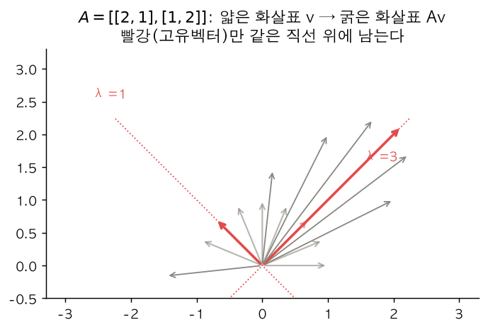

위 그림에서 회색 화살표들은 변환 후(굵은 화살표) 방향이 틀어지지만, 빨간 두 방향은 같은 직선 위에 그대로 있다. (1, 1) 방향은 3배로 늘어나고 (λ = 3), (−1, 1) 방향은 길이가 그대로다 (λ = 1).

**고유벡터는 그 변환의 "뼈대"** 라고 할 수 있다. 변환이 어떤 방향으로 공간을 가장 크게 늘이는지 알려 주기 때문이다. PCA(주성분 분석) 같은 데이터 분석 기법은 이 성질을 이용해 데이터가 가장 넓게 퍼진 방향을 찾는다.

### 고유값은 왜 구하나: 어디에 쓰이나

**한 줄 요약**: 고유값과 고유벡터는 **"이 행렬을 계속 반복해서 적용하면 결국 어떻게 되는가"** 와 **"이 데이터(행렬)의 가장 중요한 방향은 어디인가"** 라는 두 질문에 답한다.

#### 핵심 성질: 반복해서 곱하면 고유값의 거듭제곱이 된다

고유벡터 $\mathbf{v}$ 에 행렬 A를 한 번 곱하면 λ배가 된다. 두 번 곱하면 λ × λ = λ²배, n번 곱하면 **λⁿ배**다.

$$
A \mathbf{v} = \lambda \mathbf{v} \quad\Rightarrow\quad A^n \mathbf{v} = \lambda^n \mathbf{v}
$$

일반 벡터에 행렬을 100번 곱하려면 행렬 곱을 100번 해야 하지만, 고유벡터 방향으로는 **숫자 λ를 100번 곱하기만** 하면 된다. 그리고 결과는 λ의 크기만 보면 바로 알 수 있다.

| 고유값 λ | 반복하면 (λ = 1.2, 1.0, 0.8 예시) | 이름 |
|---|---|---|
| 1보다 크다 | 1 → 1.2 → 1.44 → 1.73 → … → 20번 뒤 약 38배 | **폭발 (발산)** |
| 정확히 1 | 1 → 1 → 1 → … | **유지 (안정 상태)** |
| 1보다 작다 | 1 → 0.8 → 0.64 → 0.51 → … → 20번 뒤 약 0.01배 | **소멸** |

그래서 고유값은 **행렬을 반복 적용했을 때의 "운명"** 을 알려 준다. 아래 쓰임새들은 모두 이 성질에서 나온다.

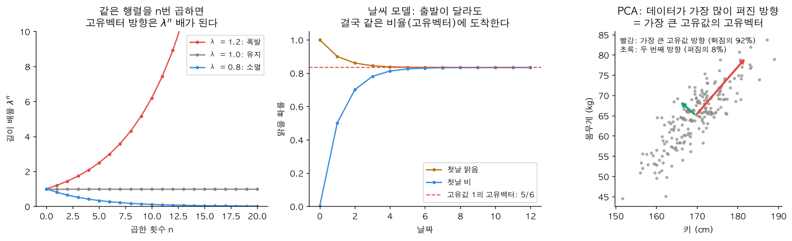

#### 쓰임 1: 장기적으로 어떤 상태에 도착하나 (날씨 예측, 구글 검색 순위)

날씨가 이런 규칙을 따른다고 하자.

- 오늘 맑으면 내일 맑을 확률 0.9, 비 올 확률 0.1
- 오늘 비가 오면 내일 맑을 확률 0.5, 비 올 확률 0.5

이 규칙을 행렬로 쓰면 "오늘의 (맑을 확률, 비 올 확률)"에 행렬을 곱해서 "내일의 확률"을 얻는다.

$$
P = \begin{bmatrix} 0.9 & 0.5 \\ 0.1 & 0.5 \end{bmatrix}, \qquad
\begin{bmatrix} \text{내일 맑음} \\ \text{내일 비} \end{bmatrix} = P \begin{bmatrix} \text{오늘 맑음} \\ \text{오늘 비} \end{bmatrix}
$$

첫날이 맑았다면 (1, 0)에서 시작해 날마다 P를 곱한다.

| 날짜 | 맑을 확률 | 비 올 확률 |
|---|---|---|
| 0 | 1 | 0 |
| 1 | 0.9 | 0.1 |
| 2 | 0.86 | 0.14 |
| 3 | 0.844 | 0.156 |
| 5 | 0.835 | 0.165 |
| … | **5/6 ≈ 0.833** | **1/6 ≈ 0.167** |

첫날이 비였어도 결국 **같은 값 (5/6, 1/6)** 에 도착한다(위 그림 가운데). 이 도착점이 바로 **고유값 1의 고유벡터**다. 실제로 P × (5/6, 1/6)을 계산하면 다시 (5/6, 1/6)이 나온다. 곱해도 변하지 않으니 λ = 1이다. 즉 "**길게 보면 1년 중 며칠이 맑은가**"는 고유벡터를 구하면 바로 알 수 있다.

**구글의 PageRank**가 같은 원리다. 사람이 웹페이지의 링크를 무작위로 계속 따라다닌다고 할 때, 오랫동안 머무는 비율이 높은 페이지일수록 중요한 페이지로 본다. 이 비율이 "링크 행렬"의 고유값 1에 해당하는 고유벡터이고, 구글은 초기에 이것을 **Power Iteration**(아래)으로 계산했다.

#### 쓰임 2: 데이터의 가장 중요한 방향 찾기 (PCA, 차원 축소)

사람 200명의 키와 몸무게를 점으로 찍으면(위 그림 오른쪽), 점들이 비스듬한 한 방향으로 길쭉하게 퍼져 있다. 키가 크면 몸무게도 대체로 크기 때문이다.

이 데이터가 **어느 방향으로 얼마나 퍼져 있는지**를 2×2 행렬로 정리한 것이 **공분산 행렬(covariance matrix)** 이다. 이 행렬의 고유벡터와 고유값은 다음을 알려 준다.

- **가장 큰 고유값의 고유벡터**(빨강): 데이터가 **가장 많이 퍼진 방향**. 여기서는 "전체적인 체격"이라는 한 방향이다.
- **고유값의 크기**: 그 방향으로 얼마나 퍼졌는지. 여기서는 빨강 방향이 전체 퍼짐의 약 90%를 차지한다.

그러면 숫자 2개(키, 몸무게) 대신 **빨강 방향의 위치 1개만으로도 대부분의 정보**를 담을 수 있다. 이렇게 중요한 방향만 남겨 숫자의 개수(차원)를 줄이는 것이 **PCA(주성분 분석, Principal Component Analysis)** 이고, **차원 축소**라고 부른다. 숫자가 수천 개인 데이터(예: 이미지)를 몇십 개로 줄여서 그림으로 보거나, 계산을 가볍게 할 때 쓴다.

#### 쓰임 3: 계산이 폭발하거나 사라지지 않는지 판단하기 (안정성)

어떤 계산이 **같은 행렬을 여러 번 곱하는 구조**라면, 고유값을 보면 그 계산이 안전한지 알 수 있다.

- **신경망의 기울기 폭발과 소실**: 층이 깊거나 같은 가중치를 반복해서 쓰는 신경망(예: RNN)은 역전파할 때 비슷한 행렬을 수십 번 곱한다. 고유값이 1보다 크면 기울기가 **폭발**하고, 1보다 작으면 0으로 **소멸**해서 학습이 안 된다. 딥러닝에서 가중치를 초기화하는 방법을 신중하게 정하는 이유 중 하나다.
- **경사하강법의 학습률**: 3장의 경사하강법도 "매 걸음 같은 수(행렬)를 곱하는 것"과 같다. 손실 지형에서 **가장 가파른 방향의 고유값이 클수록** 학습률을 작게 해야 발산하지 않는다. 3장의 "길쭉한 골짜기 문제"가 바로 방향마다 고유값이 크게 다른 경우다.
- **공학**: 다리나 건물이 잘 흔들리는 진동수(**고유진동수**)도 고유값 문제로 구한다. 바람이나 발걸음이 이 진동수와 맞으면 크게 흔들리는(공명) 위험이 있어서, 설계 단계에서 계산한다.

#### 쓰임 4: SVD의 기초

아래의 SVD도 고유값과 연결되어 있다. 행렬 $A^{\top}A$ 의 고유값에 제곱근을 씌운 것이 A의 **특이값**이다. 그래서 SVD 이미지 압축은 "**가장 큰 고유값 방향부터 남긴다**"는 PCA와 같은 아이디어다.

#### 정리, 그리고 과제에서 "가장 큰" 고유값을 구하는 이유

| 쓰임 | 행렬 | 고유값·고유벡터가 알려 주는 것 |
|---|---|---|
| 날씨, PageRank | 상태가 바뀌는 확률 행렬 | 오래 지나면 도착하는 비율 (고유값 1) |
| PCA, 차원 축소 | 공분산 행렬 | 데이터가 가장 많이 퍼진 방향과 그 크기 |
| 기울기 폭발·소실, 학습률 | 반복해서 곱해지는 행렬 | 계산이 폭발하는지, 사라지는지 |
| 건물, 다리 | 진동 방정식의 행렬 | 잘 흔들리는 진동수 |
| SVD, 이미지 압축 | $A^{\top}A$ | 중요한 성분의 순서 |

대부분의 쓰임에서 가장 중요한 것은 **가장 큰 고유값과 그 고유벡터**다. 장기적으로 살아남는 방향이고, 가장 많이 퍼진 방향이며, 폭발 여부를 결정하는 값이기 때문이다. 그래서 과제에서는 모든 고유값이 아니라 **가장 큰 것 하나를 찾는 Power Iteration**을 구현한다.

### Power Iteration: 가장 큰 고유값을 찾는 방법

아무 화살표나 하나 골라서 **행렬을 계속 곱하면** 어떻게 될까? 곱할 때마다 가장 큰 고유값의 방향 성분이 다른 성분보다 더 많이 늘어나므로, 화살표는 점점 **가장 큰 고유값의 고유벡터 방향으로 정렬**된다.

**알고리즘**

1. 임의의 벡터 $\mathbf{v}_0$ 에서 시작한다.
2. $\mathbf{w} = A \mathbf{v}_k$ 를 계산한다.
3. 길이가 무한히 커지거나 작아지지 않도록 정규화한다: $\mathbf{v}_{k+1} = \mathbf{w} / \lVert \mathbf{w} \rVert$
4. 고유값을 추정한다: $\lambda \approx \mathbf{v}_{k+1}^{\top} A \, \mathbf{v}_{k+1}$ (레일리 몫, Rayleigh quotient)
5. λ의 변화가 허용 오차(예: 1e-6)보다 작아질 때까지 2~4를 반복한다.

4번이 성립하는 이유: $\mathbf{v}$ 가 고유벡터이고 길이가 1이면 $\mathbf{v}^{\top} A \mathbf{v} = \mathbf{v}^{\top} (\lambda \mathbf{v}) = \lambda \lVert \mathbf{v} \rVert^2 = \lambda$ 이기 때문이다.

<details>
<summary><b>더 깊이 보기 (전공자용): 수렴 속도와 주의점</b></summary>

초기 벡터를 고유벡터의 선형결합 $\mathbf{v}_0 = c_1 \mathbf{u}_1 + c_2 \mathbf{u}_2$ 로 쓰면 ($|\lambda_1| > |\lambda_2|$)

$$
A^k \mathbf{v}_0 = \lambda_1^k \left( c_1 \mathbf{u}_1 + c_2 \left( \frac{\lambda_2}{\lambda_1} \right)^k \mathbf{u}_2 \right)
$$

이므로 반복마다 오차가 $|\lambda_2 / \lambda_1|$ 배씩 줄어든다. 두 고유값이 비슷할수록 느리게 수렴한다.

주의할 점

- $c_1 = 0$ 이면 (초기 벡터가 $\mathbf{u}_1$ 과 수직이면) 수렴하지 않는다. 무작위 초기화를 쓰는 이유다.
- 절댓값이 같은 고유값이 두 개 이상이면 (예: λ = 2, −2) 수렴하지 않고 진동할 수 있다.
- **고유벡터의 부호는 정해져 있지 않다.** $\mathbf{v}$ 와 $-\mathbf{v}$ 는 모두 고유벡터다. `np.linalg.eig`와 결과를 비교할 때 부호가 반대로 나와도 틀린 것이 아니므로, 부호를 맞춘 뒤 비교하거나 $|\cos\theta|$ 로 비교한다.
- `np.linalg.eig`는 고유값을 크기순으로 정렬해 주지 않는다. 최댓값을 직접 골라야 한다.

</details>

### SVD: 행렬을 "중요한 순서대로" 쪼개기

**특이값 분해(SVD, Singular Value Decomposition)** 는 어떤 행렬이든 세 행렬의 곱으로 분해한다.

$$
A = U \Sigma V^{\top}
$$

- $U$, $V$ : 회전(방향)을 나타내는 행렬
- $\Sigma$ : 대각선에 **특이값** $\sigma_1 \ge \sigma_2 \ge \dots \ge 0$ 이 크기순으로 놓인 행렬. 각 특이값은 그 성분이 얼마나 중요한지를 나타낸다.

**직관**: 이미지(행렬)를 "간단한 무늬 조각"들의 합으로 표현한다고 생각하자. 특이값이 큰 조각일수록 이미지의 큰 구조를 담고, 작은 조각은 세부 잡음을 담는다.

$$
A = \sigma_1 \mathbf{u}_1 \mathbf{v}_1^{\top} + \sigma_2 \mathbf{u}_2 \mathbf{v}_2^{\top} + \dots
$$

앞의 **k개만 남기고** 나머지를 버리면 압축된 근사 이미지가 된다.

$$
A_k = \sum_{i=1}^{k} \sigma_i \, \mathbf{u}_i \mathbf{v}_i^{\top} = U_{:, :k} \, \Sigma_{:k, :k} \, V^{\top}_{:k, :}
$$

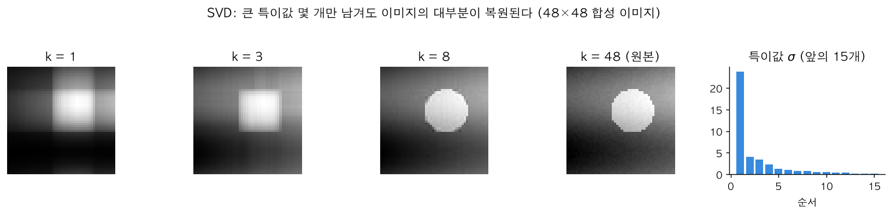

특이값 그래프를 보면 첫 몇 개만 크고 나머지는 금방 작아진다. 그래서 k가 작아도 원본에 가까운 이미지가 복원된다.

**얼마나 압축되나?** m×n 이미지를 그대로 저장하면 m × n개의 숫자가 필요하다. rank-k 근사는 $U$ 의 k개 열(m개씩), $V$ 의 k개 행(n개씩), 특이값 k개만 저장하면 되므로 k × (m + n + 1)개면 된다. 예를 들어 64×64 이미지(4,096개)에서 k = 10이면 10 × 129 = 1,290개, 약 31%만 저장하면 된다.

<details>
<summary><b>더 깊이 보기 (전공자용): 최적성과 rank의 한계</b></summary>

**Eckart–Young 정리**: 모든 rank-k 행렬 중에서 $A_k$ 가 원본과의 프로베니우스 노름 오차 $\lVert A - A_k \rVert_F$ 를 최소화한다. 그 오차는 $\sqrt{\sigma_{k+1}^2 + \dots + \sigma_r^2}$ 이다. 즉 SVD 절단은 "가장 좋은" 저랭크 근사다.

$A^{\top}A$ 의 고유값은 $\sigma_i^2$ 이고 고유벡터는 $V$ 의 열이다. 그래서 SVD는 고유값 분해와 밀접하게 연결되어 있고, PCA는 데이터 공분산 행렬의 고유값 분해(= 중심화된 데이터 행렬의 SVD)다.

m×n 행렬의 rank는 최대 $\min(m, n)$ 이다. 따라서 특이값도 최대 $\min(m, n)$ 개뿐이고, k가 그보다 크면 의미가 없다.

</details>

### 과제에서 할 일 (`src/linear_algebra.py`)

- [x] 단위 원(`theta = np.linspace(0, 2*np.pi, 100)`)에 회전 R(θ), 스케일링 S(2, 0.5), 전단 Sh(k)를 적용하고 변환 전후를 하나의 Figure에 겹쳐 그린다.
- [x] det(A)와 변환 전후 넓이 비율을 비교해 오차가 **1% 이내**인지 확인한다.
- [x] Power Iteration으로 최대 고유값과 고유벡터를 계산하고, `np.linalg.eig` 결과와 오차가 **5% 이내**인지 확인한다. (`np.linalg.eig`는 검증용으로만 사용)
- [x] 64×64 이하의 Grayscale 이미지를 SVD로 압축하고 k = 10, 50, 100의 복원 결과를 하나의 Figure에 비교한다.

> [!WARNING]
> **직접 확인해 볼 것**
> - 64×64 이미지의 특이값은 최대 몇 개인가? 그렇다면 k = 100은 어떻게 처리해야 할까? 선택한 방법과 이유를 결과에 적는다.
> - 단위 원의 넓이는 π인데, 점 100개로 만든 다각형의 넓이는 π와 정확히 같을까? 넓이 **비율**을 비교하면 이 차이가 문제가 될까?

### 결과와 해석

실행: `uv run python src/linear_algebra.py`

**① 행렬 변환과 행렬식**

| 변환 | 행렬 | det | 넓이 비율 (변환 후 / 전) | 오차 | 그림 |
|---|---|---|---|---|---|
| 회전 R(45°) | [[0.707, −0.707], [0.707, 0.707]] | 1.0000 | 1.0000 | 0.00% | [linalg_rotation.png](outputs/linalg_rotation.png) |
| 스케일링 S(2, 0.5) | [[2, 0], [0, 0.5]] | 1.0000 | 1.0000 | 0.00% | [linalg_scaling.png](outputs/linalg_scaling.png) |
| 전단 Sh(1) | [[1, 1], [0, 1]] | 1.0000 | 1.0000 | 0.00% | [linalg_shear.png](outputs/linalg_shear.png) |
| (추가) 일반 행렬 | [[2, 1], [0, 1.5]] | 3.0000 | 3.0000 | 0.00% | [linalg_general.png](outputs/linalg_general.png) |

| 회전 | 스케일링 | 전단 |
|---|---|---|
| 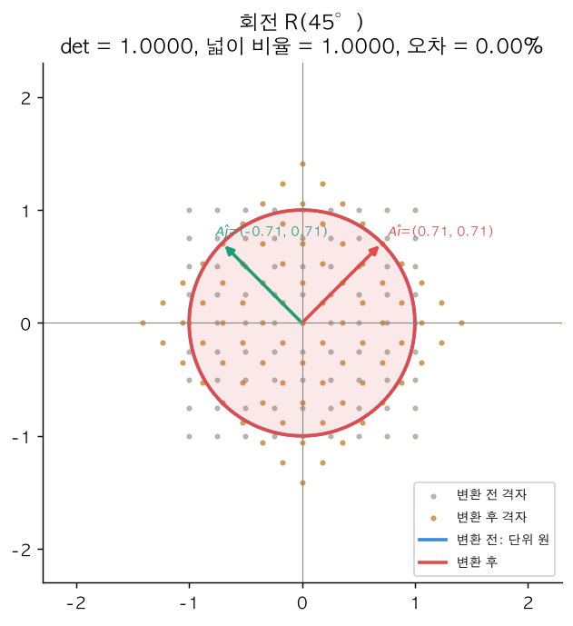 | 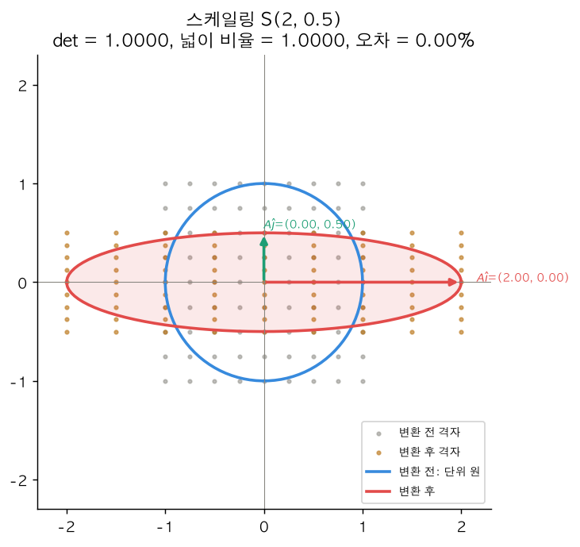 | 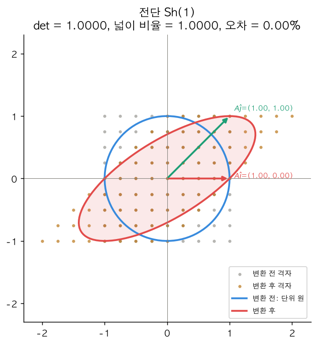 |

- 회전은 원을 그대로 돌리기만 하므로 원 모양이 유지된다. 스케일링은 가로 2배, 세로 0.5배라서 타원이 되고, 전단은 위쪽 점일수록 오른쪽으로 밀려 기울어진 타원이 된다.
- 과제의 세 변환은 모두 det = 1이라 넓이 비율이 항상 1이다. 그래서 **det ≠ 1인 경우도 확인하려고** 일반 행렬 [[2, 1], [0, 1.5]] (det = 3)을 추가했고, 넓이가 정확히 3배가 됐다.
- 그림의 빨강·초록 화살표(Aî, Aĵ)는 행렬의 1열, 2열과 같다. "행렬의 열 = 기준 벡터가 도착하는 곳"을 확인할 수 있다.

**점 100개 다각형의 넓이는 π와 같을까?** 같지 않다. 넓이는 3.13948로 π(3.14159)보다 약 0.067% 작다. 하지만 **비율**을 비교하면 문제가 되지 않는다. 행렬 변환은 다각형을 다각형으로 옮기고, 모든 다각형의 넓이를 정확히 |det|배로 바꾸기 때문이다. 같은 다각형의 변환 전후를 비교하므로 근사 오차가 분자, 분모에서 똑같이 생겨 지워지고, 남는 오차는 1e-16 수준(컴퓨터 반올림)뿐이다.

**② Power Iteration vs `np.linalg.eig`**

| 행렬 | 반복 횟수 (tol = 1e-6) | Power Iteration λ, v | `np.linalg.eig` λ, v | 고유값 오차 |
|---|---|---|---|---|
| A = [[4, 1], [1, 3]] | 21 | 4.6180, [0.8507, 0.5257] | 4.6180, [0.8507, 0.5257] | 2.3e-13 |
| B = [[2, 1], [1, 2]] | 12 | 3.0000, [0.7071, 0.7071] | 3.0000, [0.7071, 0.7071] | 2.4e-14 |
| C (3×3 대칭) | 11 | 7.2880, [0.8664, 0.4531, 0.2098] | 7.2880, [0.8664, 0.4531, 0.2098] | 1.2e-13 |

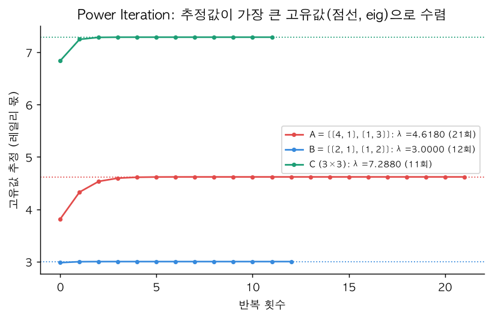

- 세 행렬 모두 기준(5%)보다 훨씬 작은 오차로 일치했다. 3×3 행렬에도 그대로 동작한다.
- **멈추는 기준을 고유값이 아니라 벡터 변화량으로 정한 이유**: 처음에는 "고유값 변화가 1e-6보다 작으면 멈춤"으로 했더니 A에서 12회 만에 멈췄고, 고유값은 정확했지만 고유벡터는 [0.8505, 0.5260]으로 4번째 자리가 틀렸다. 대칭 행렬에서는 레일리 몫(고유값 추정)이 벡터보다 훨씬 빨리 수렴하기 때문이다. 벡터 변화량 기준으로 바꾸자 고유벡터도 4자리까지 일치했다.
- 고유벡터는 v와 −v가 모두 정답이라, 비교 전에 가장 큰 성분이 양수가 되도록 부호를 맞췄다.

**③ SVD 이미지 압축**

Matplotlib에 들어 있는 공개 샘플 사진(`grace_hopper.jpg`)을 가운데를 잘라 64×64 흑백으로 줄여 사용했다. rank는 64다.

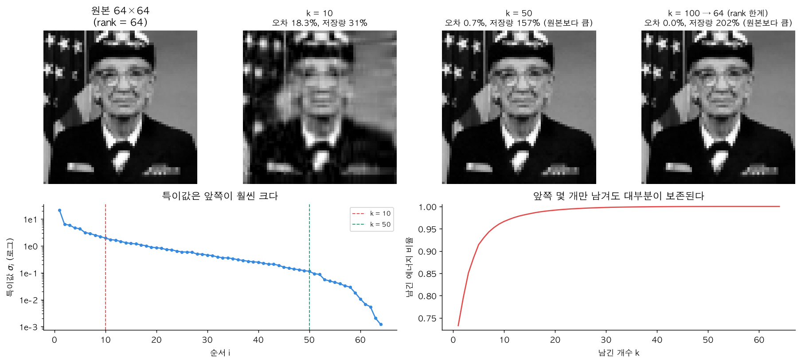

| k | 실제 사용한 k | 상대 오차 | 남긴 에너지 | 저장할 숫자 (원본 4096개 대비) |
|---|---|---|---|---|
| 10 | 10 | 18.3% | 96.6% | 1290개 (31.5%) |
| 50 | 50 | 0.66% | 99.99% | 6450개 (157.5%) |
| 100 | **64** | 0.0% | 100% | 8256개 (201.6%) |

- **k = 100 처리**: 64×64 행렬의 특이값은 최대 64개라서 100개를 남길 수 없다. `k = min(k, rank)`로 64로 줄였고, 그림 제목에 "100 → 64 (rank 한계)"로 표시했다. k = 64는 특이값을 모두 쓰므로 원본과 정확히 같다(오차 0).
- **k = 10**: 저장량은 원본의 31.5%인데 얼굴과 모자 윤곽을 알아볼 수 있다. 특이값 그래프에서 앞쪽 몇 개가 압도적으로 커서, 10개만으로 에너지의 96.6%가 남기 때문이다.
- **압축이 되는 범위**: 조각 하나에 u(64개) + v(64개) + σ(1개) = 129개의 숫자가 필요하다. 그래서 k × 129 < 4096, 즉 **k ≤ 31**일 때만 원본보다 작아진다. k = 50은 거의 완벽하게 복원되지만 저장량은 오히려 원본의 1.6배다. 이미지가 작을수록 SVD 압축의 이득이 작다.

---

## 3. 최적화: 경사하강법

### 한눈에 보기

> 안개 낀 산에서 가장 낮은 곳(손실이 최소인 곳)을 찾는다고 생각하자. 주변이 보이지 않으니 **발밑의 경사(gradient)를 느끼고, 내리막 방향으로 한 걸음씩** 내려간다. 이것이 경사하강법이다.
>
> 손실 함수를 왜 "산(지형)"으로 볼 수 있는지는 [수학 준비 3)](#3-변수가-2개인-함수는-왜-지형인가)을 참고한다.

아래는 이 장에서 다루는 Vanilla GD(파랑), Momentum(빨강), Adam(초록), Newton(주황)이 같은 골짜기(x² + 10y²)를 내려가는 모습이다. 각 방법이 왜 이렇게 움직이는지가 이 장의 내용이다. 데이터 일부만 쓰는 SGD는 데이터가 있는 문제에서만 비교할 수 있어서, 아래 결과 ⑤의 선형 회귀 애니메이션에 나온다.

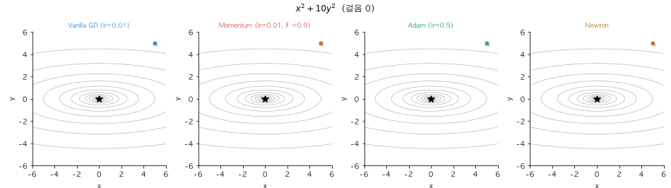

### 무엇을 구하는가

손실 함수 f를 가장 작게 만드는 위치(가중치) θ를 찾는다. 1장에서 gradient는 **가장 가파르게 오르는 방향**이었다. 그러니 그 **반대 방향**으로 가면 가장 가파르게 내려간다.

$$
\theta_{t+1} = \theta_t - \eta \, \nabla f(\theta_t)
$$

- $\theta_t$ : t번째 걸음에서의 현재 위치
- $\nabla f(\theta_t)$ : 현재 위치의 gradient (오르막 방향)
- $\eta$ (에타) : **학습률(learning rate, lr)**, 한 걸음의 크기

> [!NOTE]
> **η, 학습률, lr, learning rate는 모두 같은 것이다.** 수식에서는 η, 한국어로는 학습률, 영어로는 learning rate, 줄여서 **lr** 이라 쓴다. 이 문서의 표와 그래프 제목에 나오는 `lr = 0.1`, 코드의 `VanillaGD(lr=0.1)` 이 모두 "η = 0.1"이라는 뜻이다.
>
> **왜 "학습"률인가**: 이 업데이트 한 번이 모델이 **한 번 배우는(고치는) 것**이다. 학습률은 "gradient가 알려 준 만큼 중에서 **얼마의 비율로** 고칠까"를 정한다. 예를 들어 f(x) = x²에서 x = 3이면 gradient는 6이다. lr = 0.1이면 6 × 0.1 = **0.6만큼** 움직여 x = 2.4가 되고, lr = 0.5면 3만큼 움직여 x = 0에 바로 도착한다. 같은 gradient를 받아도 학습률에 따라 한 번에 배우는 양이 달라진다. 너무 크면 지나치게 고쳐서 오히려 망가지고, 너무 작으면 배우는 속도가 느리다. 바로 아래 "학습률: 보폭이 결과를 바꾼다"에서 숫자로 확인한다.

### 가장 기본적인 경사하강법: 한 걸음씩 따라가기

데이터, 배치, 관성 같은 것을 모두 빼면 경사하강법은 아래 네 단계를 되풀이하는 것뿐이다.

1. **출발점을 정한다.** 어디서 시작할지 정한다. 보통 아무 값(무작위)이나 쓴다.
2. **지금 위치의 기울기(gradient)를 구한다.** 1장의 미분, 또는 수치 미분으로 구한다.
3. **기울기의 반대 방향으로 조금 움직인다.** 새 위치 = 지금 위치 − 학습률 × 기울기
4. **멈출지 판단한다.** 멈추지 않으면 2번으로 돌아간다.

**왜 "반대 방향"이고, 왜 빼기인가?** 1변수로 보면 이렇다.

| 지금 위치의 기울기 | 뜻 | 내려가려면 | 수식 $x - \eta \times (\text{기울기})$ 의 결과 |
|---|---|---|---|
| 양수 (예: +6) | 오른쪽이 오르막 | 왼쪽으로 가야 한다 | 양수를 빼므로 x가 **작아진다** (왼쪽) |
| 음수 (예: −6) | 왼쪽이 오르막 | 오른쪽으로 가야 한다 | 음수를 빼므로 x가 **커진다** (오른쪽) |
| 0 | 평평하다 (바닥) | 움직일 필요가 없다 | x가 **그대로**다 |

빼기 하나로 기울기의 부호에 따라 저절로 내리막 쪽으로 가고, 바닥에 닿으면 저절로 멈춘다.

**손으로 따라가 보기**: $f(x) = (x - 3)^2$, 바닥은 x = 3이다. 기울기(도함수)는 $f'(x) = 2(x - 3)$ 이다. 출발점 x = 0, 학습률 η = 0.1로 시작한다.

| 걸음 | 지금 x | 기울기 2(x − 3) | 이동량 −0.1 × 기울기 | 새 x |
|---|---|---|---|---|
| 1 | 0 | −6 | +0.6 | 0.6 |
| 2 | 0.6 | −4.8 | +0.48 | 1.08 |
| 3 | 1.08 | −3.84 | +0.384 | 1.464 |
| 4 | 1.464 | −3.072 | +0.307 | 1.771 |
| 5 | 1.771 | −2.458 | +0.246 | 2.017 |
| … | … | … | … | … |
| 10 | 2.597 | −0.805 | +0.081 | 2.678 |

- 기울기가 음수라 x는 계속 **오른쪽**(바닥 쪽)으로 간다.
- 바닥에 가까워질수록 기울기가 작아져서 **걸음도 저절로 작아진다.** 따로 속도를 줄이라고 하지 않아도 된다.
- 바닥까지 남은 거리(3 − x)는 매 걸음 0.8배가 된다(3 → 2.4 → 1.92 → …). 이 0.8이 아래 [학습률](#학습률lr-보폭이-결과를-바꾼다) 절의 "곱해지는 수 1 − 2η"다.

**언제 멈추나 (멈춤 조건)**: 바닥에 정확히 도착하는 경우는 드물어서, 보통 다음 중 하나를 만족하면 멈춘다.

| 멈춤 조건 | 예 | 의미 |
|---|---|---|
| 기울기가 충분히 작다 | \|기울기\| < 0.001 | 거의 평평한 곳, 즉 바닥 근처에 왔다 |
| 위치나 손실이 거의 안 변한다 | 이번 걸음의 변화량 < 1e-6 | 더 가도 나아지지 않는다 (Power Iteration의 멈춤 조건과 같은 생각) |
| 정해 둔 횟수를 다 썼다 | 100회, 1000회 | 시간 제한. 이 과제의 실험은 대부분 이 방식이다 |

위 예제에서 "|기울기| < 0.001"로 멈추면 39걸음 만에 멈춘다(그때 x ≈ 2.9995).

**코드로 쓰면** 몇 줄이다. `src/optimizer.py`의 `VanillaGD.step()`과 `optimize()`가 이 반복을 구현한 것이다.

```python
x = 0.0                      # 1. 출발점
lr = 0.1                     # 학습률
for step in range(1000):     # 정해 둔 횟수까지
    grad = 2 * (x - 3)       # 2. 지금 위치의 기울기
    if abs(grad) < 1e-3:     # 4. 거의 평평하면 멈춤 (움직이기 전에 확인)
        break
    x = x - lr * grad        # 3. 반대 방향으로 이동
# step = 39, x ≈ 2.9995
```

**변수가 여러 개일 때**도 똑같다. x 하나 대신 위치 벡터 θ = (x, y, …)를 쓰고, 기울기 대신 gradient 벡터 ∇f를 쓰면 된다. 변수마다 자기 방향의 기울기만큼 따로 움직인다. 예를 들어 f(x, y) = x² + y²에서 (5, 5)의 gradient는 (10, 10)이고, η = 0.1이면 새 위치는 (5 − 1, 5 − 1) = (4, 4)다.

> [!NOTE]
> 여기까지는 **손실 함수가 식으로 주어져 있고 데이터가 없다.** 실제 머신러닝에서는 손실이 "데이터 N개 각각의 손실의 평균"이라, gradient를 구할 때 **데이터를 몇 개 쓰느냐**에 따라 Batch GD, 미니배치 GD, SGD로 나뉜다. 이것은 아래 [데이터가 있을 때](#데이터가-있을-때-batch-gd-미니배치-gd-sgd) 절에서 다룬다.

### 학습률(lr): 보폭이 결과를 바꾼다

f(x) = x²에서 생각해 보자. gradient는 2x이므로 한 번 업데이트하면

$$
x_{t+1} = x_t - \eta \cdot 2 x_t = (1 - 2\eta) \, x_t
$$

즉 매 걸음마다 x에 **(1 − 2η)를 곱하는 것**과 같다.

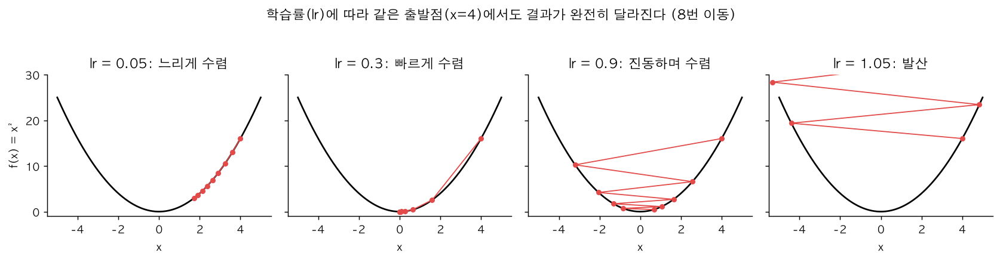

| 학습률 lr (η) | 곱해지는 수 (1 − 2η) | 결과 |
|---|---|---|
| 0.05 | 0.9 | 조금씩 줄어든다 → 느리게 수렴 |
| 0.3 | 0.4 | 빠르게 줄어든다 → 빠르게 수렴 |
| 0.9 | −0.8 | 부호가 바뀌며 줄어든다 → 진동하며 수렴 |
| 1.05 | −1.1 | 부호가 바뀌며 커진다 → **발산** |

곱해지는 수의 **절댓값이 1보다 작으면** 0으로 수렴하고, 1보다 크면 발산한다.

- 보폭이 너무 작으면: 안전하지만 너무 오래 걸린다.
- 보폭이 너무 크면: 골짜기를 넘어 반대편으로 튀고, 심하면 점점 더 멀어진다.

### 데이터가 있을 때: Batch GD, 미니배치 GD, SGD

지금까지는 손실 함수가 x² + y²처럼 식으로 주어졌다. 머신러닝에서는 손실이 **데이터로부터** 계산된다. 데이터를 모두 써서 gradient를 계산하는 것이 가장 직접적인 방법이다. 실제 손실 함수는 데이터 N개 각각의 손실 $\ell_i$ 의 평균이다.

$$
L(\theta) = \frac{1}{N} \sum_{i=1}^{N} \ell_i(\theta), \qquad \nabla L(\theta) = \frac{1}{N} \sum_{i=1}^{N} \nabla \ell_i(\theta)
$$

데이터가 100만 개라면 **한 걸음 내딛기 위해 100만 개를 모두 계산**해야 한다. 이 방식을 SGD와 구분할 때 **배치 경사하강법(Batch GD)** 또는 그냥 GD라고 부른다.

데이터를 몇 개 쓰느냐에 따라 세 가지로 나뉜다.

| 이름 | 한 걸음에 쓰는 데이터 | 특징 |
|---|---|---|
| **Batch GD** (배치 경사하강법, full-batch) | N개 **전부** | gradient가 정확하다. 데이터가 많으면 한 걸음이 매우 비싸다 |
| **미니배치 GD** (mini-batch GD) | 무작위 **B개** (1 < B < N, 예: 32, 64) | 둘의 절충. 실제 딥러닝은 거의 이 방식이다 |
| **SGD** (확률적 경사하강법, 좁은 뜻) | 무작위 **1개** | 한 걸음이 가장 싸지만 가장 많이 흔들린다 |

> [!NOTE]
> 실무와 딥러닝 라이브러리에서는 **미니배치 GD도 보통 "SGD"라고 부른다**(예: PyTorch의 `torch.optim.SGD`). 이 문서와 코드도 그 관례를 따라 `SGD(batch_size=B)` 하나로 세 가지를 모두 표현한다. B = 1이면 좁은 뜻의 SGD, 1 < B < N이면 미니배치 GD, B = N이면 Batch GD와 같다.

**SGD(Stochastic Gradient Descent, 확률적 경사하강법)** 는 매 걸음 데이터 중 **무작위로 B개만 뽑아서** gradient를 **추정**한다. 이 B개 묶음을 **미니배치(mini-batch)**, B를 **배치 크기(batch size)** 라 한다.

$$
\theta_{t+1} = \theta_t - \eta \, \frac{1}{B} \sum_{i \in \text{미니배치}} \nabla \ell_i(\theta_t)
$$

**비유**: 전국 여론을 알고 싶을 때 5천만 명 전원에게 묻는 대신(GD), 무작위로 1000명만 뽑아 묻는 것(SGD)과 같다. 결과에 오차는 있지만 훨씬 빠르고, 여러 번 반복하면 평균적으로 정답 방향을 가리킨다.

| | GD (배치) | SGD (미니배치) |
|---|---|---|
| 한 걸음에 쓰는 데이터 | N개 전부 | B개 (예: 16, 32, 64) |
| 한 걸음의 계산량 | 크다 | N/B배 작다 |
| gradient | 정확한 값 | 잡음이 섞인 추정값 |
| 경로 | 매끄럽다 | 흔들린다 |
| 최솟값 근처 | 정확히 멈춘다 | 학습률이 고정이면 근처에서 계속 흔들린다 |

- 업데이트 식 자체는 GD와 같다. 달라지는 것은 **gradient를 어떻게 구하느냐** 하나뿐이다.
- 데이터 전체를 한 번 다 쓰는 것을 **1 에폭(epoch)** 이라 한다. N = 200, B = 16이면 약 12.5걸음이 1 에폭이다.
- 잡음은 단점만 있는 게 아니다. 아래 [안장점](#왜-새로운-경사하강법이-계속-나오나-지역-최솟값-안장점-평탄-구간)에서 멈춰 버리는 것을 **흔들어서 빠져나오게** 돕기도 한다.
- 실제 딥러닝은 거의 항상 미니배치 SGD에 Momentum이나 Adam을 함께 쓴다.

### 길쭉한 골짜기 문제 (ravine, ill-conditioning)

영어로는 **ravine**(좁고 깊은 골짜기) 또는 **narrow valley** 라고 부르고, 수학적으로는 **ill-conditioned problem**(조건이 나쁜 문제, 조건수가 큰 문제)이라 한다. 방향마다 가파른 정도(2장의 고유값)가 크게 다른 지형을 말한다. 가장 가파른 방향과 가장 완만한 방향의 고유값 비율을 **조건수(condition number)** 라 하고, 이 값이 클수록 골짜기가 길쭉하다. 아래 x² + 10y²의 조건수는 10이다.

f(x, y) = x² + 10y²처럼 한 방향이 다른 방향보다 훨씬 가파른 함수를 생각해 보자. 각 방향의 업데이트는

$$
x_{t+1} = (1 - 2\eta) \, x_t, \qquad y_{t+1} = (1 - 20\eta) \, y_t
$$

- y 방향은 가파르기 때문에 η가 조금만 커도 $|1 - 20\eta| > 1$ 이 되어 발산한다. 그래서 η를 작게 써야 한다.
- 그런데 η를 작게 하면 완만한 x 방향은 아주 느리게 움직인다.
- 그 사이 값에서는 가파른 y 방향으로 **왔다 갔다(지그재그)** 하면서 x 방향으로는 조금씩만 나아간다.

실제 딥러닝의 손실 함수는 이런 길쭉한 골짜기가 많다. 이 문제를 줄이기 위해 Momentum이 등장한다.

### Momentum: 관성을 가진 공

경사하강법이 "매 걸음 발밑 경사만 보고 걷는 사람"이라면, Momentum은 **언덕을 굴러 내려가는 공**이다. 공은 이전에 움직이던 방향으로 계속 가려는 **관성(속도)** 을 가진다.

$$
v_{t+1} = \beta \, v_t + \nabla f(\theta_t), \qquad \theta_{t+1} = \theta_t - \eta \, v_{t+1}
$$

- $v$ : 속도. 지난 gradient들을 누적한 값
- $\beta$ : 관성의 세기 (보통 0.9). 이전 속도를 얼마나 유지할지 정한다.

**왜 길쭉한 골짜기에서 유리한가?**

- 지그재그 방향(y): gradient의 부호가 매번 바뀌므로, 누적하면 **서로 상쇄**되어 진동이 줄어든다.
- 꾸준한 방향(x): gradient가 계속 같은 방향이므로, 누적되어 **점점 빨라진다.**

<details>
<summary><b>더 깊이 보기 (전공자용): 조건수, 표기 차이, Adam과 Newton</b> (쉬운 설명과 숫자 예시는 아래 "알고리즘별 수식 정리")</summary>

**조건수**: 2차 함수 $f = \frac{1}{2}\theta^{\top} H \theta$ 에서 경사하강법이 안정하려면 $\eta < 2 / \lambda_{\max}(H)$ 여야 하고, 수렴 속도는 조건수 $\kappa = \lambda_{\max} / \lambda_{\min}$ 에 좌우된다. $f = x^2 + 10y^2$ 은 $H = \text{diag}(2, 20)$, $\kappa = 10$ 이다.

**Momentum 표기**: $v \leftarrow \beta v - \eta \nabla f,\ \theta \leftarrow \theta + v$ 로 쓰는 표기도 있다. η가 상수이면 두 표기는 같은 경로를 만든다. 정상 상태에서 유효 학습률은 대략 $\eta / (1 - \beta)$, β = 0.9이면 10배다. 그래서 Momentum은 등방형 함수(x² + y²)에서는 오히려 지나쳐서 진동할 수 있다.

**Adam (보너스)**: Momentum(1차 모멘트)과 RMSProp(2차 모멘트, 방향별 보폭 조절)을 결합한다.

$$
m_t = \beta_1 m_{t-1} + (1-\beta_1) g_t, \quad
s_t = \beta_2 s_{t-1} + (1-\beta_2) g_t^2
$$

$$
\hat{m}_t = \frac{m_t}{1-\beta_1^t}, \quad
\hat{s}_t = \frac{s_t}{1-\beta_2^t}, \quad
\theta_{t+1} = \theta_t - \eta \frac{\hat{m}_t}{\sqrt{\hat{s}_t} + \epsilon}
$$

**Newton Method (보너스)**: 2차 미분(Hessian)까지 사용해 $\theta \leftarrow \theta - H^{-1} \nabla f$ 로 업데이트한다. 2차 함수에서는 한 번에 최솟값에 도착하지만, 파라미터가 n개이면 n×n Hessian을 계산하고 역행렬을 구해야 해서 대규모 모델에서는 비용이 너무 크다.

</details>

### 왜 새로운 경사하강법이 계속 나오나: 지역 최솟값, 안장점, 평탄 구간

지금까지 본 함수(x² + y², x² + 10y²)는 **바닥이 하나뿐인 그릇 모양**이었다. 이런 함수를 **볼록 함수(convex function)** 라 하며, 경사하강법이 학습률만 적당하면 반드시 바닥에 도착한다. 하지만 신경망의 손실 지형은 볼록하지 않아서 다음과 같은 함정이 있다. GD, SGD, Momentum, Adam 같은 알고리즘이 계속 새로 제안되는 이유가 바로 이 함정들과 앞의 길쭉한 골짜기 때문이다.

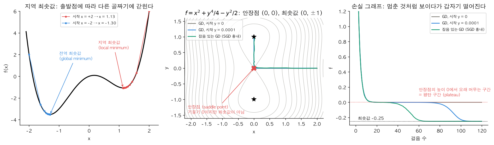

**1) 지역 최솟값 (local minimum)**

주변보다는 낮지만 **전체에서 가장 낮은 곳(전역 최솟값, global minimum)은 아닌** 바닥이다. 왼쪽 그림의 $f(x) = x^4 - 3x^2 + x$ 에서 x = 2에서 출발한 GD는 x = 1.13의 얕은 골짜기(높이 −1.07)에 갇히고, x = −2에서 출발하면 더 깊은 x = −1.30(높이 −3.51)에 도착한다. 경사하강법은 **발밑의 기울기만 보므로** 바닥에 닿으면 그곳이 전체에서 가장 낮은지 알 수 없다.

**2) 안장점 (saddle point)**

**기울기가 0인데 최솟값이 아닌 점**이다. 말 안장처럼 한 방향으로는 바닥이고 다른 방향으로는 꼭대기다. 가운데 그림의 $f = x^2 + y^4/4 - y^2/2$ 는 (0, 0)이 안장점이다. x 방향으로는 가장 낮고, y 방향으로는 가장 높다. 진짜 최솟값은 (0, ±1)이다.

- y = 0에서 출발한 GD(회색)는 안장점에 도착한 뒤 **영원히 멈춘다.** gradient가 정확히 0이라 움직일 이유가 없기 때문이다.
- y = 0.0001에서 출발한 GD(파랑)는 결국 빠져나가지만, 안장점 근처에서는 기울기가 아주 작아서 **오래 머문다.**
- 매 걸음 작은 잡음을 섞은 GD(초록, SGD 흉내)는 잡음이 y 방향으로 밀어 주어 **더 빨리 빠져나간다.**

**3) 평탄 구간 (plateau)**

기울기가 거의 0인 넓고 평평한 지역이다. 오른쪽 손실 그래프에서 손실이 0 근처에서 한참 **멈춘 것처럼 보이다가 갑자기 떨어지는** 구간이 안장점 근처의 평탄 구간이다. 실제 학습에서도 손실 그래프가 한동안 평평하다가 갑자기 내려가는 경우가 많다.

> [!NOTE]
> 수백만 차원인 신경망에서는 "모든 방향으로 바닥"인 지역 최솟값보다, "어떤 방향으로는 바닥이고 어떤 방향으로는 꼭대기"인 **안장점이 훨씬 흔하다**고 알려져 있다(Dauphin et al., 2014). 그래서 실제로는 지역 최솟값보다 안장점과 평탄 구간이 학습을 느리게 만드는 주범으로 꼽힌다.

**문제마다 나온 해결 아이디어**

| 문제 | 해결 아이디어 | 대표 알고리즘 |
|---|---|---|
| 데이터가 너무 많아 한 걸음이 비싸다 | 일부만 보고 추정한다 | **SGD**, 미니배치 SGD |
| 길쭉한 골짜기에서 지그재그 (ill-conditioning) | 관성으로 진동을 상쇄하고 꾸준한 방향은 가속한다 | **Momentum**, Nesterov |
| 방향마다 기울기 크기가 크게 다르다 | 방향별로 보폭을 따로 조절한다 | AdaGrad, RMSProp, **Adam** (보너스) |
| 안장점, 평탄 구간 | 잡음이나 관성으로 밀고 나간다 | SGD의 잡음, Momentum |
| 지역 최솟값 | 잡음, 학습률 조절, 여러 번 다른 곳에서 시작 | SGD, 학습률 스케줄 |
| 1차 기울기만으로는 휘어진 정도를 모른다 | 2차 미분(휘어짐)까지 쓴다 | **Newton Method** (보너스) |

한 가지 알고리즘이 모든 지형에서 가장 좋지는 않다. 이 과제의 실험에서도 둥근 그릇(x² + y²)에서는 Vanilla GD가 Momentum보다 빨랐고, 길쭉한 골짜기에서 학습률이 작을 때만 Momentum이 빨랐다. 그래서 문제에 맞는 알고리즘과 학습률을 고르는 것 자체가 실험의 대상이 된다.

### 알고리즘별 수식 정리: GD, SGD, Momentum, Adam, Newton

다섯 알고리즘은 모두 "**다음 위치 = 지금 위치 − (얼마나) × (어느 방향으로)**" 라는 같은 틀을 가진다. 차이는 **방향과 보폭을 무엇으로 정하느냐** 뿐이다. 각 수식이 실제로 무엇을 하는지 보기 위해, 모두 같은 문제에서 한두 걸음을 손으로 계산해 본다.

> **공통 예제**: $f(x, y) = x^2 + 10y^2$, 시작점 $\theta_0 = (5, 5)$
>
> gradient는 $\nabla f = (2x, 20y)$ 이므로 시작점에서 $g_0 = (10, 100)$ 이다. y 방향이 x 방향보다 10배 가파르다.

#### 1) Vanilla GD (경사하강법)

$$
\theta_{t+1} = \theta_t - \eta \, \nabla f(\theta_t)
$$

| 기호 | 뜻 |
|---|---|
| $\theta_t$ | t번째 걸음의 위치 (파라미터) |
| $\nabla f(\theta_t)$ | 그 위치의 gradient. **데이터 전체**로 계산한다 |
| $\eta$ | 학습률 (보폭) |

**계산 (η = 0.01)**

- 1걸음: $(5, 5) - 0.01 \times (10, 100) = (5 - 0.1,\ 5 - 1) = (4.9,\ 4.0)$
- 2걸음: gradient $(9.8, 80)$ → $(4.9 - 0.098,\ 4.0 - 0.8) = (4.802,\ 3.2)$

gradient가 큰 y 방향으로는 크게(1.0), 작은 x 방향으로는 조금만(0.1) 움직인다. **보폭이 gradient 크기에 그대로 비례**한다.

#### 2) SGD (확률적 경사하강법)

$$
\theta_{t+1} = \theta_t - \eta \, \underbrace{\frac{1}{B} \sum_{i \in \mathcal{B}_t} \nabla \ell_i(\theta_t)}_{\text{미니배치로 추정한 gradient}}
$$

| 기호 | 뜻 |
|---|---|
| $\ell_i$ | i번째 데이터 하나의 손실. 전체 손실은 $L = \frac{1}{N}\sum_i \ell_i$ |
| $\mathcal{B}_t$ | t번째 걸음에서 무작위로 뽑은 데이터 묶음 (미니배치) |
| $B$ | 미니배치 크기 |

업데이트 식은 GD와 같고, **gradient를 구하는 방법만** 다르다.

**계산 (데이터 4개, B = 2)**: 데이터 4개의 gradient가 각각 2, 4, 6, 8이라 하자 (1변수).

| 사용한 데이터 | gradient |
|---|---|
| GD: 4개 전부 | (2 + 4 + 6 + 8) / 4 = **5** (정확한 값) |
| SGD: {2, 8}을 뽑음 | (2 + 8) / 2 = 5 |
| SGD: {2, 4}를 뽑음 | (2 + 4) / 2 = 3 |
| SGD: {6, 8}을 뽑음 | (6 + 8) / 2 = 7 |

뽑을 때마다 값이 3, 5, 7처럼 **흔들리지만 평균은 정확한 값 5**다. 계산은 절반만 했다. 이 흔들림이 SGD 경로가 흔들리는 이유다.

#### 3) Momentum

$$
v_{t+1} = \beta \, v_t + \nabla f(\theta_t), \qquad \theta_{t+1} = \theta_t - \eta \, v_{t+1}
$$

| 기호 | 뜻 |
|---|---|
| $v_t$ | 속도. 지난 gradient들을 쌓은 값. 처음에는 0 |
| $\beta$ | 관성 계수 (보통 0.9). 이전 속도를 몇 % 유지할지 |

**계산 (η = 0.01, β = 0.9)**

- 1걸음: $v_1 = 0.9 \times (0, 0) + (10, 100) = (10, 100)$, 위치 $(5, 5) - 0.01 \times (10, 100) = (4.9,\ 4.0)$ → 처음에는 GD와 같다.
- 2걸음: gradient $(9.8, 80)$, $v_2 = 0.9 \times (10, 100) + (9.8, 80) = (18.8,\ 170)$, 위치 $(4.9 - 0.188,\ 4.0 - 1.7) = (4.712,\ 2.3)$

같은 2걸음에서 GD는 (4.802, 3.2), Momentum은 (4.712, 2.3)이다. 지난 속도가 더해져서 **같은 방향으로 계속 가면 점점 빨라진다.** 반대로 gradient 부호가 바뀌면(지그재그) 지난 속도와 상쇄되어 흔들림이 줄어든다.

#### 4) Adam (Adaptive Moment Estimation, 보너스)

$$
\begin{aligned}
m_t &= \beta_1 m_{t-1} + (1 - \beta_1)\, g_t && \text{(gradient의 평균 = 방향, Momentum 역할)} \\
s_t &= \beta_2 s_{t-1} + (1 - \beta_2)\, g_t^2 && \text{(gradient 제곱의 평균 = 방향별 크기)} \\
\hat{m}_t &= \frac{m_t}{1 - \beta_1^t}, \quad \hat{s}_t = \frac{s_t}{1 - \beta_2^t} && \text{(처음에 0에서 시작한 치우침 보정)} \\
\theta_{t+1} &= \theta_t - \eta \, \frac{\hat{m}_t}{\sqrt{\hat{s}_t} + \epsilon}
\end{aligned}
$$

| 기호 | 뜻 |
|---|---|
| $g_t$ | t번째 걸음의 gradient |
| $m_t$ | gradient의 이동 평균 (1차 모멘트). "평균적으로 어느 쪽인가" |
| $s_t$ | gradient **제곱**의 이동 평균 (2차 모멘트). "그 방향의 기울기가 평소에 얼마나 큰가" |
| $\beta_1, \beta_2$ | 이동 평균의 관성 (보통 0.9, 0.999) |
| $\epsilon$ | 0으로 나누지 않도록 더하는 아주 작은 수 (1e-8) |
| $g_t^2$, $\sqrt{\cdot}$, ÷ | 모두 **성분별로** 계산한다 |

**계산 (η = 0.5, 첫 걸음 t = 1)**

| 단계 | x 방향 | y 방향 |
|---|---|---|
| gradient $g_1$ | 10 | 100 |
| $m_1 = 0.1 \times g_1$ | 1 | 10 |
| $s_1 = 0.001 \times g_1^2$ | 0.1 | 10 |
| $\hat{m}_1 = m_1 / (1 - 0.9)$ | 10 | 100 |
| $\hat{s}_1 = s_1 / (1 - 0.999)$ | 100 | 10000 |
| $\sqrt{\hat{s}_1}$ | 10 | 100 |
| $\hat{m}_1 / \sqrt{\hat{s}_1}$ | **1** | **1** |
| 이동량 $0.5 \times 1$ | 0.5 | 0.5 |

새 위치는 $(5 - 0.5,\ 5 - 0.5) = (4.5,\ 4.5)$ 이다. GD는 gradient가 10배 큰 y 방향으로 10배 크게 움직였지만, Adam은 **각 방향의 gradient를 그 방향의 평소 크기로 나누므로** 두 방향 모두 같은 0.5만큼 움직인다. 가파른 방향은 보폭을 줄이고 완만한 방향은 키우는 셈이라, 길쭉한 골짜기에서 원점을 향해 거의 곧게 내려간다. 이렇게 방향마다 보폭을 따로 조절하는 것을 **적응적 학습률(adaptive learning rate)** 이라 한다. ($s_t$ 로 나누는 부분만 따로 쓰면 RMSProp이다.)

#### 5) Newton Method (보너스)

$$
\theta_{t+1} = \theta_t - H(\theta_t)^{-1} \, \nabla f(\theta_t), \qquad
H = \begin{bmatrix} \frac{\partial^2 f}{\partial x^2} & \frac{\partial^2 f}{\partial x \partial y} \\ \frac{\partial^2 f}{\partial y \partial x} & \frac{\partial^2 f}{\partial y^2} \end{bmatrix}
$$

| 기호 | 뜻 |
|---|---|
| $H$ | **Hessian**. 2차 미분(기울기의 기울기)을 모은 행렬. 지형이 방향별로 **얼마나 휘었는지** 나타낸다 |
| $H^{-1}$ | H의 역행렬. 코드에서는 역행렬을 직접 구하지 않고 연립방정식 $H d = \nabla f$ 를 풀어 $d$ 만큼 이동한다 |

학습률 η가 없다. 휘어진 정도로 보폭을 자동으로 정하기 때문이다.

**계산**: $f = x^2 + 10y^2$ 는 $\frac{\partial^2 f}{\partial x^2} = 2$, $\frac{\partial^2 f}{\partial y^2} = 20$, 나머지는 0이라 $H = \begin{bmatrix} 2 & 0 \\ 0 & 20 \end{bmatrix}$ 이다.

$$
H^{-1} \nabla f = \left( \frac{10}{2},\ \frac{100}{20} \right) = (5,\ 5), \qquad \theta_1 = (5, 5) - (5, 5) = (0,\ 0)
$$

**한 걸음 만에 최솟값**에 도착했다. gradient(기울기)를 휘어진 정도(2차 미분)로 나누면 "이 기울기가 0이 되려면 얼마나 가야 하는가"가 나오기 때문이다. 1변수로 보면 $x^2$ 에서 x = 5의 기울기는 10, 휘어진 정도는 2이므로 10 ÷ 2 = 5만큼 가면 바닥이다. 2차 함수에서는 항상 한 걸음에 끝나고, 일반 함수에서도 최솟값 근처에서는 매우 빠르다. 대신 파라미터가 n개면 Hessian이 n × n개라서 계산이 매우 비싸다.

#### 한눈에 비교

| 알고리즘 | 업데이트 식 | 기억하는 상태 | 하이퍼파라미터 | 한 걸음 비용 | 위 예제의 첫 걸음 |
|---|---|---|---|---|---|
| Vanilla GD | $\theta - \eta \nabla f$ | 없음 | η | gradient 1번 (데이터 전체) | (4.9, 4.0) |
| SGD | $\theta - \eta \nabla f_{\mathcal{B}}$ | 없음 | η, B | gradient 1번 (데이터 B개) | 미니배치에 따라 흔들림 |
| Momentum | $v \leftarrow \beta v + \nabla f$, $\theta - \eta v$ | 속도 v | η, β | gradient 1번 | (4.9, 4.0), 이후 가속 |
| Adam | $\theta - \eta\, \hat{m} / (\sqrt{\hat{s}} + \epsilon)$ | m, s, 걸음 수 t | η, β₁, β₂, ε | gradient 1번 + 성분별 계산 | (4.5, 4.5) |
| Newton | $\theta - H^{-1} \nabla f$ | 없음 | 없음 | gradient + **Hessian + 연립방정식** | (0, 0) |

코드는 `src/optimizer.py`의 `VanillaGD`, `SGD`, `Momentum`, `Adam`, `Newton` 클래스에 있고, 각 클래스의 `step()` 메서드가 위 업데이트 식을 그대로 옮긴 것이다.

### 옵티마이저의 역사: 각 알고리즘은 무엇을 고치려고 나왔나

위에서는 알고리즘을 하나씩 따로 봤다. 실제로는 **앞선 방법의 문제를 다음 방법이 고치는** 순서로 발전했다. 순서를 알면 Adam 같은 식이 왜 그렇게 생겼는지 이해할 수 있다.

#### 연표

| 연도 | 알고리즘 | 제안자 | 직전 방법의 무엇을 고쳤나 | 남긴 문제 |
|---|---|---|---|---|
| 1847 | **경사하강법 (GD)** | 코시 (Cauchy) | 기울기 반대 방향으로 내려가는 기본 아이디어 | 길쭉한 골짜기에서 지그재그, 학습률 하나로 모든 방향을 다뤄야 함 |
| 1951 | **확률적 근사 → SGD** | 로빈스, 먼로 (Robbins, Monro) | 정확한 gradient 대신 잡음 섞인 추정값으로도 수렴함을 보임 | 경로가 흔들림 |
| 1964 | **Momentum** (heavy ball) | 폴랴크 (Polyak) | 관성으로 지그재그를 줄이고 꾸준한 방향은 가속 | 관성 때문에 바닥을 지나쳐 출렁임 |
| 1983 | **Nesterov 가속** | 네스테로프 (Nesterov) | "갈 곳을 미리 보고" gradient를 계산해 덜 지나침 | 학습률은 여전히 모든 방향에 하나 |
| 2011 | **AdaGrad** | 두치, 해잔, 싱어 (Duchi, Hazan, Singer) | 방향마다 보폭을 따로: 지금까지 gradient가 컸던 방향은 작게 | 누적합이 계속 커져 보폭이 0으로 줄어들고 학습이 멈춤 |
| 2012 | **RMSProp** | 틸먼, 힌튼 (Tieleman, Hinton) | 누적합 대신 **최근 평균(이동 평균)** 을 써서 보폭이 0으로 줄지 않게 함 | 관성이 없어 좁은 골짜기에서 흔들림 |
| 2014 | **Adam** | 킹마, 바 (Kingma, Ba) | RMSProp + Momentum + 치우침 보정 | 일부 문제에서 일반화 성능이 SGD보다 낮고, 수렴이 보장되지 않는 예가 있음 |
| 2017~2019 | **AMSGrad, AdamW** | Reddi 외 / Loshchilov, Hutter | Adam의 수렴 문제 보완 / 가중치 감쇠(weight decay)를 Adam과 분리 | |
| 2019 이후 | Lookahead, RAdam, Muon 등 | | 조합, 초기 안정화, 행렬 구조 활용 | 지금도 연구 중 |

뉴턴법은 이 계보와 따로, 17세기 뉴턴·랩슨의 방정식 풀이법에서 왔다. 앞서 본 Levenberg–Marquardt(1944, 1963)는 GD와 뉴턴법을 섞은 방법이다.

> [!NOTE]
> RMSProp은 논문이 아니라 2012년 힌튼의 온라인 강의(Coursera) 슬라이드로 처음 소개되었다. 슬라이드에는 제자 틸먼(Tieleman)의 미발표 연구로 적혀 있다. 코시의 1847년은 강의 자료 등에서 흔히 인용되는 연도다.

#### 두 갈래의 계보

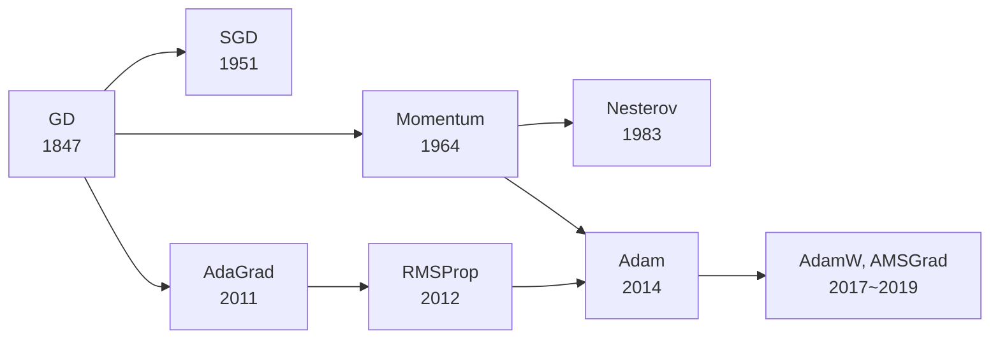

- **관성 계열** (Momentum → Nesterov): "지난 이동 방향을 기억해서" 지그재그를 줄인다.
- **적응적 학습률 계열** (AdaGrad → RMSProp): "방향마다 보폭을 다르게" 해서 길쭉한 골짜기를 다룬다.
- **Adam**은 두 갈래가 만난 지점이다. RMSProp의 방향별 보폭에 Momentum의 관성을 더했다.

#### 차이를 수식으로: 직전 방법에서 무엇이 바뀌었나

**Momentum → Nesterov**: gradient를 구하는 **위치**만 다르다.

$$
\text{Momentum: } v \leftarrow \beta v + \nabla f(\theta), \qquad
\text{Nesterov: } v \leftarrow \beta v + \nabla f(\underbrace{\theta - \eta\beta v}_{\text{관성으로 갈 곳}})
$$

Momentum은 "지금 위치"의 기울기를 보고, Nesterov는 "관성으로 어차피 갈 곳"의 기울기를 미리 본다. 바닥을 지나칠 것 같으면 그곳의 기울기가 이미 반대를 가리키므로 **미리 브레이크**를 건다. (코드는 같은 효과를 내면서 현재 위치의 gradient만 쓰는 형태 $\theta \leftarrow \theta - \eta(g + \beta v)$ 로 구현했다.)

**GD → AdaGrad**: 방향마다 지금까지 gradient 제곱의 **누적합** $G$ 로 나눈다.

$$
G \leftarrow G + g^2, \qquad \theta \leftarrow \theta - \eta \frac{g}{\sqrt{G} + \epsilon}
$$

자주 크게 움직인 방향은 G가 커서 보폭이 작아지고, 드물게 움직인 방향은 보폭이 크다. 그래서 드물게 나오는 특성(희소 데이터)에 강하다. 하지만 G는 **더하기만 하므로 계속 커지고**, 보폭 $\eta/\sqrt{G}$ 는 결국 0에 가까워진다.

**AdaGrad → RMSProp**: 누적합을 **이동 평균**으로 바꾼 것 하나뿐이다.

$$
\text{AdaGrad: } G \leftarrow G + g^2, \qquad
\text{RMSProp: } s \leftarrow \rho\, s + (1 - \rho)\, g^2 \quad (\rho = 0.9)
$$

이동 평균은 오래된 값을 점점 잊으므로(매 걸음 0.9배) 커지기만 하지 않는다. 그래서 보폭이 0으로 줄어들지 않는다. 이름의 RMS(Root Mean Square)는 "제곱의 평균에 제곱근"이라는 뜻으로, 분모 $\sqrt{s}$ 를 가리킨다.

**RMSProp → Adam**: 분자의 $g$ 를 Momentum처럼 **이동 평균 $m$** 으로 바꾸고, 처음 몇 걸음의 치우침을 보정한다.

$$
\text{RMSProp: } \theta \leftarrow \theta - \eta \frac{g}{\sqrt{s} + \epsilon}, \qquad
\text{Adam: } \theta \leftarrow \theta - \eta \frac{\hat{m}}{\sqrt{\hat{s}} + \epsilon}
$$

이름 Adam(Adaptive **Moment** estimation)의 "모멘트"가 바로 이 $m$(1차 모멘트, 평균)과 $s$(2차 모멘트, 제곱의 평균)다.

#### 실험: 같은 학습률에서 계보를 따라가 보기

같은 행에서는 같은 학습률을 써서, 알고리즘의 차이만 보이게 했다.

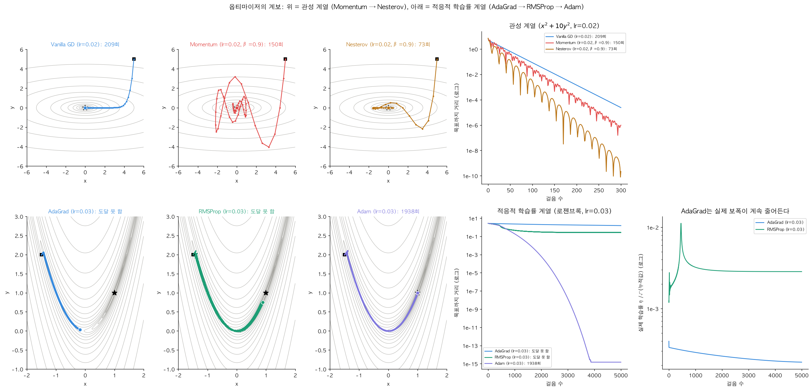

| 계열 | 문제 (학습률) | 알고리즘 | 목표 반경 1e-3 도달 |
|---|---|---|---|
| 관성 | x² + 10y² (lr 0.02) | Vanilla GD | 209걸음 |
| | | Momentum (1964) | 150걸음 |
| | | Nesterov (1983) | **73걸음** |
| 적응적 학습률 | 로젠브록 (lr 0.03) | AdaGrad (2011) | 5000걸음 안에 도달 못 함 (골짜기 중간 (−0.18, 0.03)에서 멈춤) |
| | | RMSProp (2012) | 도달 못 함 (골짜기를 따라 (0.89, 0.75)까지 갔지만 그 근처에서 멈춤) |
| | | Adam (2014) | **1938걸음** |

- **Momentum → Nesterov**: Momentum은 원점을 크게 지나쳐 출렁였다. Nesterov는 미리 브레이크를 걸어 출렁임이 훨씬 작고, 절반의 걸음으로 도착했다.
- **AdaGrad → RMSProp**: 오른쪽 아래 그래프가 핵심이다. AdaGrad의 실제 보폭(η/√G)은 걸음마다 **계속 줄어들어**, 골짜기 바닥을 반도 못 가고 거의 멈췄다. RMSProp은 보폭이 일정한 수준에서 유지되어 골짜기를 따라 훨씬 멀리 갔다.
- **RMSProp → Adam**: RMSProp은 관성이 없어서, 좁은 골짜기의 양쪽 벽 사이를 매 걸음 왔다 갔다 하며 (0.89, 0.75) 근처에서 더 나아가지 못했다. Adam은 분자의 이동 평균 $m$ 이 이 왕복을 상쇄하고 골짜기 방향의 꾸준한 기울기만 남겨, 끝까지 도착했다. **"RMSProp에 Momentum을 더한다"는 Adam의 설계 이유**가 그대로 보인다.

> [!NOTE]
> 이 결과는 "나중에 나온 방법이 항상 더 좋다"는 뜻이 아니다. 3장 실험처럼 둥근 그릇에서는 Vanilla GD가 Momentum보다 빨랐고, 학습률을 각자에게 맞게 따로 고르면 순위가 바뀌기도 한다. 각 방법은 **특정한 문제**를 고치려고 나왔고, 그 문제가 있는 지형에서 효과가 드러난다.

### 학습률은 어떻게 고르고, 어떤 알고리즘을 쓰나

> [!IMPORTANT]
> **모든 문제에 통하는 "좋은 학습률"이나 "가장 좋은 알고리즘"은 없다.** 학습률을 수식으로 정확히 구할 수 있는 것은 이 과제처럼 손실이 2차 함수일 때뿐이다. 실제 신경망에서는 아래의 이론을 감으로 삼고, **실험(학습률 탐색)으로 찾는다.** 아래의 알고리즘 선택표도 정답이 아니라 널리 쓰이는 경험칙이다.

#### 1) 이론: 2차 함수에서 학습률의 한계

1변수 $f(x) = x^2$ 에서 GD는 매 걸음 x에 $(1 - 2\eta)$ 를 곱했다. 여기서 2는 $x^2$ 의 **휘어진 정도**(2차 미분)다. 일반적으로 휘어진 정도가 $\lambda$ 인 방향에서는 매 걸음 $(1 - \eta\lambda)$ 가 곱해진다. 변수가 여러 개면 방향마다 휘어진 정도가 다르고, 그 값들이 Hessian의 **고유값** $\lambda_{\min}, \dots, \lambda_{\max}$ 다(2장의 고유값이 여기서 다시 나온다).

모든 방향에서 $|1 - \eta\lambda| < 1$ 이어야 수렴하므로, 결국 **가장 가파른 방향($\lambda_{\max}$)이 학습률의 상한을 정한다.**

| 알고리즘 | 수렴 조건 (2차 함수) | 의미 |
|---|---|---|
| Vanilla GD / SGD | $0 < \eta < \dfrac{2}{\lambda_{\max}}$ | 가장 가파른 방향에서 튕겨 나가지 않을 만큼 |
| Vanilla GD 최적값 | $\eta^* = \dfrac{2}{\lambda_{\min} + \lambda_{\max}}$ | 가장 완만한 방향과 가장 가파른 방향의 줄어드는 속도를 맞춘 값 |
| Momentum (β) | $0 < \eta < \dfrac{2(1 + \beta)}{\lambda_{\max}}$ | 관성 때문에 GD보다 더 큰 학습률까지 버틴다 (β = 0.9면 약 1.9배) |
| Adam | 이런 식의 경계가 없다 | 한 걸음의 크기가 대략 η로 제한되어 쉽게 발산하지 않는다. 대신 η가 크면 최솟값 근처에서 η 크기로 계속 흔들린다 |
| Newton | 학습률이 없다 | 휘어진 정도로 보폭을 스스로 정한다 |

이 과제의 두 문제에 대입하면 다음과 같다.

| 문제 | Hessian 고유값 | 조건수 | GD 한계 | GD 최적 | Momentum 한계 |
|---|---|---|---|---|---|
| $x^2 + 10y^2$ | 2, 20 | 10 | 0.1 | 0.0909 | 0.19 |
| 선형 회귀 (x는 0~4) | 0.469, 11.80 | 25.1 | 0.170 | 0.163 | 0.322 |

3장 결과 ②의 "x² + y²에서 lr > 1이면 발산"도 같은 식이다. x² + y²의 고유값은 2, 2이므로 한계는 2/2 = 1이다.

#### 2) 실험: 학습률 탐색 (learning rate sweep)

학습률을 로그 간격으로 40~50개 바꿔 가며, 각 알고리즘이 수렴할 때까지 몇 걸음이 걸리는지 쟀다. 세로 점선은 위 표의 이론값이다.

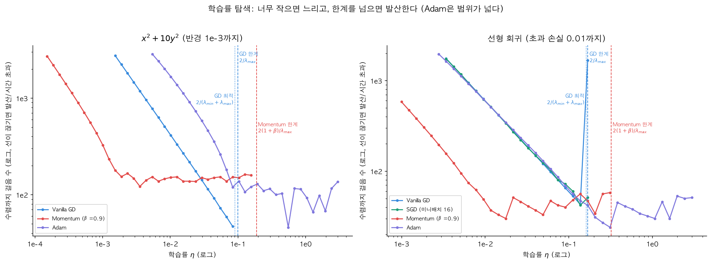

| 문제 | 알고리즘 | 수렴한 학습률 범위 | 가장 빠른 학습률 (걸음 수) |
|---|---|---|---|
| $x^2 + 10y^2$ | Vanilla GD | 0.0015 ~ 0.084 | 0.084 (47걸음) |
| | Momentum (β = 0.9) | 0.0002 ~ 0.158 | 넓은 범위에서 약 120~150걸음으로 비슷함 |
| | Adam | 0.0054 ~ 3 (탐색 끝까지) | 0.56 (46걸음) |
| 선형 회귀 | Vanilla GD | 0.0034 ~ 0.169 | 0.138 (43걸음) |
| | SGD (미니배치 16) | 0.0034 ~ 0.169 | 0.138 (42걸음) |
| | Momentum (β = 0.9) | 0.001 ~ 0.314 | 0.018 (30걸음) |
| | Adam | 0.0028 ~ 3 (탐색 끝까지) | 0.31 (24걸음) |

(범위의 아래쪽 끝은 "최대 걸음 수 안에 도착하지 못한" 경계라서, 걸음을 더 주면 더 작은 학습률도 결국 수렴한다. 위쪽 끝은 발산 경계다.)

- **GD의 실험 결과가 이론과 일치한다.** 발산 경계는 이론값(0.1, 0.170) 바로 아래에서 끝났다. 가장 빠른 학습률도 경계 근처, 즉 이론 최적값(0.091, 0.163) 근처였다. 선형 회귀에서 경계에 너무 가까운 0.169는 오히려 진동이 오래 남아 느려졌다(오른쪽 그래프의 위로 솟은 점).
- **GD와 SGD는 곡선이 거의 같다.** 같은 학습률이면 걸음 수가 비슷하다. 차이는 한 걸음의 비용(데이터 200개와 16개)이다.
- **Momentum은 학습률에 덜 민감하다.** 작은 학습률에서 GD보다 훨씬 빠르고, 넓은 범위에서 걸음 수가 비슷하다. 대신 이 문제들은 쉬워서, 가장 빠른 경우만 비교하면 GD와 큰 차이가 없다. β = 0.9는 조건수가 수백~수천인 실제 신경망을 기준으로 정한 값이라, 이렇게 쉬운 문제에서는 관성이 너무 커서 출렁임이 생긴다.
- **Adam은 수렴 범위가 가장 넓다.** 탐색한 가장 큰 학습률(3)까지 발산하지 않아서, 수렴 범위가 수백 배에 걸친다. "학습률을 대충 정해도 일단 학습은 된다"는 점이 실무에서 Adam을 기본값으로 많이 쓰는 이유다.

#### 3) 실무에서 학습률을 정하는 방법

1. **시작값**: 아래 표의 흔한 기본값에서 시작한다.
2. **로그 간격으로 탐색**: 1e-4, 3e-4, 1e-3, 3e-3, 1e-2, … 처럼 몇 배씩 바꿔 가며 짧게 학습해 본다. 학습률은 "0.01과 0.02"보다 "0.01과 0.1"의 차이가 의미 있으므로 **곱하기 간격**으로 찾는다.
3. **손실 곡선으로 판단**: 손실이 커지거나 `nan`이 되면 → 줄인다(발산). 손실이 아주 천천히 줄면 → 키운다. 손실이 내려가다 들쭉날쭉 멈추면 → 학습률을 점점 줄인다.
4. **학습률 스케줄**: 처음에는 크게, 나중에는 작게 쓴다(step decay, cosine decay). 처음 몇 걸음은 작게 시작해 키우는 **warmup**도 많이 쓴다. SGD와 Adam이 최솟값 근처에서 흔들리던 문제(3장 결과 ⑤, ⑥)를 줄여 준다.

| 알고리즘 | 흔한 시작 학습률 | 다른 하이퍼파라미터 |
|---|---|---|
| SGD | 0.01 ~ 0.1 | 미니배치 32 ~ 256 |
| SGD + Momentum | 0.01 ~ 0.1 | β = 0.9 |
| Adam | 0.001 (1e-3), 또는 3e-4 | β₁ = 0.9, β₂ = 0.999, ε = 1e-8 |
| Newton (소규모 문제) | 없음 | 필요하면 감쇠(damping) |

> [!TIP]
> **학습률보다 먼저 데이터를 정규화하자.** 위 선형 회귀에서 x(0~4)를 평균 0으로 옮기기만 해도 조건수가 25.1에서 1.38로, 표준화(평균 0, 표준편차 1)하면 1.0이 된다. 지형이 둥근 그릇이 되면 어떤 알고리즘이든 큰 학습률로 빨리 수렴한다. 입력 특성들의 크기와 위치가 제각각이면 손실 지형이 길쭉해지기 때문이다. 딥러닝에서 입력 정규화와 Batch Normalization을 쓰는 이유 중 하나다.

#### 4) 어떤 상황에 어떤 알고리즘을 쓰나 (경험칙)

| 상황 | 자주 쓰는 선택 | 이유 |
|---|---|---|
| 데이터가 적고(수천 개 이하) 파라미터도 적은 매끄러운 문제 (예: 작은 선형·로지스틱 회귀) | 전체 데이터 GD, 또는 Newton 계열(L-BFGS 등 준뉴턴법) | 한 걸음이 싸고, 2차 정보를 쓰면 몇 걸음에 끝난다 |
| 데이터가 매우 많음 (수십만 개 이상) | 미니배치 SGD 계열 | 한 걸음마다 전체를 볼 수 없다 |
| 딥러닝, 처음 시도할 때 | **Adam** (또는 AdamW), lr = 1e-3 | 학습률에 덜 민감하고 대부분의 문제에서 무난하게 학습된다 |
| 이미지 분류 CNN처럼 최종 성능(일반화)이 중요한 큰 모델 | **SGD + Momentum** (β = 0.9) + 학습률 스케줄 | 잘 조정하면 Adam보다 시험 데이터 성능이 좋은 경우가 많다고 알려져 있다 |
| 텍스트, 추천처럼 대부분이 0인 희소(sparse) 특성 | Adam, AdaGrad | 드물게 나오는 특성은 gradient를 받을 기회가 적다. 방향별로 보폭을 키워 주는 적응적 방법이 유리하다 |
| 특성마다 크기가 크게 다름 (길쭉한 지형) | 먼저 정규화, 그다음 Momentum 또는 Adam | 지형 자체를 둥글게 만드는 것이 가장 효과적이다 |
| 파라미터 수가 매우 큼 (수백만 이상) | 1차 방법 (SGD, Momentum, Adam) | Newton은 Hessian이 너무 크다 (n²개) |

이 과제의 실험도 같은 결론을 보여 준다. 둥근 그릇에서는 Vanilla GD로 충분했다(결과 ③). 길쭉한 골짜기와 휘어진 골짜기에서는 Momentum과 Adam이 유리했고(결과 ④, ⑥), 데이터가 많을 때는 SGD가 계산량을 크게 줄였다(결과 ⑤). 파라미터가 2개뿐일 때는 Newton이 압도적이었다.

### 여러 옵티마이저를 함께 쓰는 방법

앞에서 본 것처럼 한 알고리즘이 모든 지형, 모든 단계에서 가장 좋지는 않다. 그래서 **여러 옵티마이저를 조합하는 방법**도 연구되어 왔다. 크게 네 가지 방식이 있다.

| 방식 | 대표 방법 | 어떻게 하나 |
|---|---|---|
| **바꾸기** (순서대로) | SWATS (Keskar & Socher, 2017) | Adam으로 시작해서, 조건이 맞으면 SGD로 갈아탄다. "Adam은 초반에 빠르지만 후반에는 SGD가 일반화를 더 잘한다"는 관찰에서 나왔다 |
| | AdaBound (Luo et al., ICLR 2019) | Adam의 방향별 학습률에 위아래 한계를 두고 그 한계를 점점 좁혀서, Adam에서 SGD로 **부드럽게** 넘어간다 |
| | Adam → L-BFGS (과학 계산용 신경망, PINN) | Adam으로 대략 내려간 뒤, 휘어진 정도를 쓰는 준뉴턴법 L-BFGS로 정밀하게 마무리한다 |
| **감싸기** | Lookahead (Zhang, Lucas, Hinton, Ba, NeurIPS 2019) | 아무 옵티마이저나 안쪽에서 k걸음 먼저 가 보게 하고, 바깥의 "느린 가중치"가 그 도착점 쪽으로 일부만 따라간다. "k steps forward, 1 step back" |
| | Ranger (2019) | RAdam(Adam의 변형)을 Lookahead로 감싼 것 |
| | SWA (Izmailov et al., 2018) | SGD가 지나간 여러 지점의 가중치를 평균 낸다 |
| **나누기** (동시에) | Muon + AdamW (Jordan et al., 2024) | 은닉층의 가중치 행렬에는 Muon, 임베딩·출력층·편향에는 AdamW를 쓴다. 최근 대형 언어 모델 학습에서 쓰인다 |
| **섞기** (한 식 안에서) | Levenberg–Marquardt (고전적 방법) | 감쇠값 λ로 GD와 Newton 사이를 오간다. 손실이 잘 줄면 Newton 쪽으로, 안 줄면 GD 쪽으로 간다 |
| | Adam 자체 | Momentum(관성)과 RMSProp(방향별 보폭)을 합친 것이다 |

위 연구들이 보고한 성능 향상은 각 논문의 주장이다. 이 과제에서는 그중 세 가지를 단순한 형태로 직접 구현해, 지금까지 쓴 함수들에서 확인했다.

| 클래스 (`src/optimizer.py`) | 방식 | 업데이트 |
|---|---|---|
| `Lookahead(inner, k, α)` | 감싸기 | 안쪽 옵티마이저로 매 걸음 이동하고, k걸음마다 $\theta_{\text{slow}} \leftarrow \theta_{\text{slow}} + \alpha(\theta_{\text{fast}} - \theta_{\text{slow}})$, $\theta_{\text{fast}} \leftarrow \theta_{\text{slow}}$ |
| `LevenbergMarquardt(f, λ)` | 섞기 | $d = (H + \lambda I)^{-1} \nabla f$ 를 시도해서, 손실이 줄면 받아들이고 λ ÷ 10 (Newton 쪽), 늘면 버리고 λ × 10 (GD 쪽) |
| `SwitchOptimizer(first, second, n)` | 바꾸기 | 처음 n걸음은 first로, 그 뒤는 second로 이동 |

`LevenbergMarquardt`가 왜 GD와 Newton 사이인지는 식에서 바로 보인다. λ가 0이면 $d = H^{-1}\nabla f$ 로 Newton이고, λ가 아주 크면 $H$ 는 무시되어 $d \approx \nabla f / \lambda$, 즉 **학습률이 1/λ인 GD**가 된다. 원래 Levenberg–Marquardt는 최소제곱 문제에서 Gauss–Newton과 GD를 섞는 방법이고, 여기서는 같은 아이디어를 일반 Hessian에 적용했다.

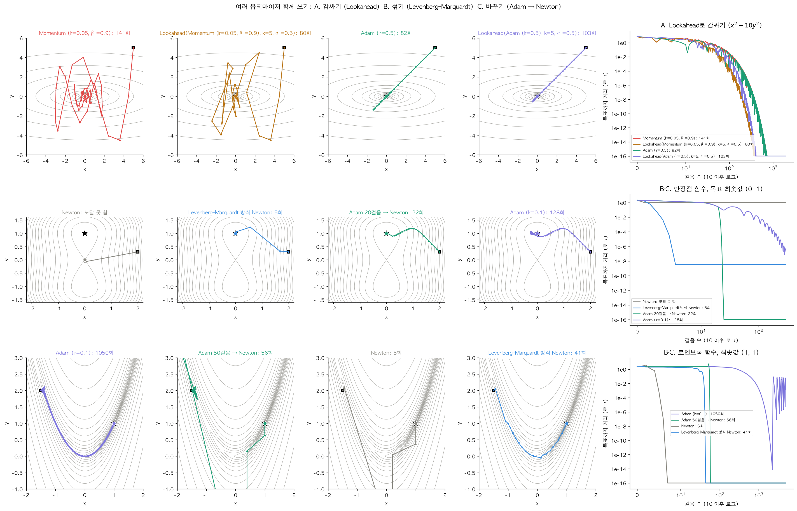

**A. 감싸기: Lookahead** (x² + 10y², 시작 (5, 5), 목표 반경 1e-3)

| 옵티마이저 | 도달 걸음 | Lookahead로 감쌌을 때 |
|---|---|---|
| Momentum (lr 0.05, β 0.9) | 141 | **80** (빨라짐) |
| Adam (lr 0.5) | 82 | 103 (느려짐) |

Lookahead는 안쪽 옵티마이저가 **흔들릴 때** 그 흔들림의 평균 쪽으로 끌어당겨 도움이 된다. Momentum은 원점 주변을 크게 출렁였기 때문에 효과가 컸다. 반대로 Adam은 이미 원점을 향해 곧게 내려가고 있었다. 이런 경우에는 k걸음마다 절반만 따라가는 것이 그냥 브레이크가 되어 느려졌다. 로젠브록 함수에서도 Adam을 감싸면 1050걸음에서 1588걸음으로 느려졌다. 즉 Lookahead는 **흔들림을 줄이는 대신 꾸준한 이동은 늦추는** 거래다.

**B. 섞기: Levenberg–Marquardt, C. 바꾸기: Adam → Newton** (안장점 함수 $f = x^2 + y^4/4 - y^2/2$, 시작 (2, 0.3), 목표 최솟값 (0, 1))

| 옵티마이저 | 결과 |
|---|---|
| 순수 Newton | **안장점 (0, 0)으로 가서 멈춤** (최솟값 도달 못 함) |
| Levenberg–Marquardt 방식 Newton | **5걸음** 만에 (0, 1) |
| Adam 20걸음 → Newton | 22걸음 만에 (0, 1) |
| Adam 단독 (lr 0.1) | 128걸음 |

이 실험이 조합의 이유를 가장 잘 보여 준다. **Newton은 "기울기가 0인 곳"을 찾아가는 방법이라, 그곳이 최솟값인지 안장점인지 구별하지 못한다.** 시작점 근처에서는 y 방향 Hessian 값(3y² − 1)이 음수, 즉 위로 볼록한 꼭대기 모양이다. 그래서 Newton은 오히려 그 꼭대기 쪽인 안장점으로 한 번에 뛰어들었다.
- **Levenberg–Marquardt**는 손실이 늘어나는 걸음을 거절하고 λ를 키워 GD처럼 내리막으로 간다. 바닥 근처에 오면 λ를 줄여 Newton의 속도로 마무리한다.
- **Adam → Newton**은 Adam이 먼저 안장점에서 먼, 최솟값 근처의 골짜기까지 데려다준다. 그 뒤 Newton이 2걸음 만에 끝낸다.

**로젠브록 함수** (시작 (−1.5, 2))에서는 Adam 단독 1050걸음, Adam 50걸음 → Newton 56걸음, Levenberg–Marquardt 41걸음, 순수 Newton 5걸음이었다. 이 함수는 안장점이 없어서 순수 Newton도 잘 동작했고, 가장 빨랐다. 하지만 첫 걸음에 그림 밖까지 크게 뛰었다가 돌아왔다. Levenberg–Marquardt는 걸음 수가 더 많은 대신 손실이 늘어나는 걸음을 하지 않아서, 골짜기를 벗어나지 않고 안전하게 내려갔다.

**정리**

- 조합은 "각 알고리즘의 약점을 다른 알고리즘이 메우는 것"이다. Newton의 약점(먼 곳, 안장점)은 GD나 Adam이 메우고, GD·Adam의 약점(바닥 근처에서 느림, 흔들림)은 Newton이나 평균 내기가 메운다.
- 하지만 공짜는 아니다. Lookahead가 Adam을 느리게 만든 것처럼, 조합이 항상 더 좋지는 않다. 바꾸는 시점(n), 감싸는 비율(k, α), λ 같은 **새 하이퍼파라미터**도 생긴다.

### 과제에서 할 일 (`src/optimizer.py`)

- [x] `VanillaGD`, `Momentum` 클래스를 구현한다.
- [x] (추가) `SGD` 클래스를 구현하고, 선형 회귀에서 GD, SGD, Momentum을 비교한다.
- [x] (보너스) `Adam`, `Newton` 클래스를 구현하고 GD, Momentum과 수렴 속도를 비교한다.
- [x] (추가) 학습률 탐색으로 알고리즘별 수렴 범위를 재고, 이론적 한계(2/λmax 등)와 비교한다.
- [x] (추가) `Nesterov`, `AdaGrad`, `RMSProp`을 구현하고, 역사 순서대로 직전 방법과 비교한다.
- [x] (추가) 여러 옵티마이저 조합(`Lookahead`, `LevenbergMarquardt`, `SwitchOptimizer`)을 구현하고 단독 사용과 비교한다.
- [x] f(x, y) = x² + y²에 lr = 0.1로 100회 반복해 원점 근처(반경 0.1 이내)에 도달하는지 확인한다. (판정 반경은 `experiment_vanilla_bowl(radius=1.0, spec_radius=0.1)` 인자로 바꿀 수 있고, 평가 기준 반경 1과 명세 반경 0.1을 모두 출력한다.)
- [x] 수렴 경로를 등고선 위에 점선으로 그린다.
- [x] lr = 0.5 이상에서 경로가 발산하는지 그래프로 확인한다.
- [x] Momentum(β = 0.9)과 Vanilla GD의 경로를 하나의 Figure에 겹쳐 그린다.
- [x] f(x, y) = x² + 10y²에서 두 옵티마이저를 비교해 Momentum의 이점을 확인한다.

> [!WARNING]
> **직접 확인해 볼 것**
> - 위 표의 "곱해지는 수 (1 − 2η)"에 η = 0.5를 넣으면 얼마인가? 그렇다면 x² + y²에서 lr = 0.5일 때 정말 발산할까? 발산이 시작되는 lr은 어디부터인가? 이론값과 실험 결과를 함께 적는다.
> - x² + 10y²에서 지그재그를 보려면 lr이 어떤 범위여야 할까? y 방향의 곱해지는 수 (1 − 20η)로 계산해 보고, 실험에 쓸 lr을 고른 이유를 적는다.
> - x² + y²에서 Vanilla GD와 Momentum 중 어느 쪽이 100회 후 원점에 더 가까운가? 결과가 예상과 다르다면 그 이유는?

### 결과와 해석

실행: `uv run python src/optimizer.py` (시작점은 모두 (5, 5))

**① Vanilla GD, f = x² + y², lr = 0.1, 100회**

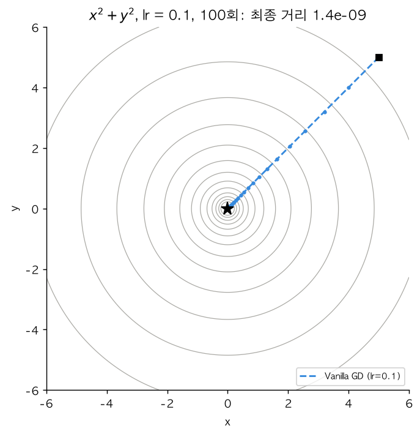

최종 위치는 (1.02e-9, 1.02e-9), 원점까지 거리 **1.4e-9**로 평가 기준(반경 1)과 과제 명세 기준(반경 0.1)을 모두 통과했다. 매 걸음 좌표에 1 − 2 × 0.1 = 0.8이 곱해지므로 100회 후 5 × 0.8¹⁰⁰ ≈ 1e-9이 되어 이론값과 같다. 반경 1e-3 안에는 40회 만에 들어갔다.

**② 학습률에 따른 수렴과 발산 (20회)**

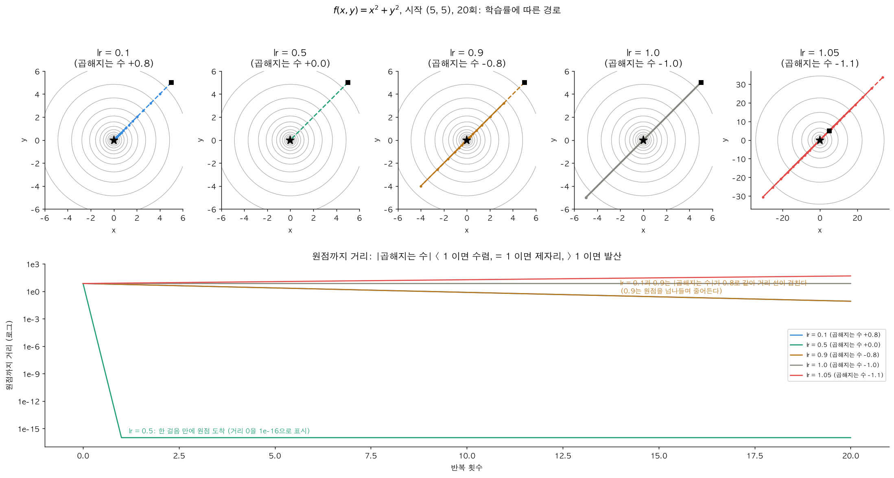

| lr | 곱해지는 수 (1 − 2·lr) | 20회 후 원점까지 거리 | 결과 |
|---|---|---|---|
| 0.1 | +0.8 | 0.0815 | 같은 쪽에서 부드럽게 수렴 |
| 0.5 | **0.0** | 0 | **한 걸음 만에 원점 도착** |
| 0.9 | −0.8 | 0.0815 | 원점을 넘나들며 수렴 |
| 1.0 | −1.0 | 7.07 (처음과 같음) | (5, 5)와 (−5, −5)를 영원히 왕복 |
| 1.05 | −1.1 | 47.6 | 넘나들며 점점 멀어짐 → **발산** |

- **이론**: |1 − 2·lr| < 1, 즉 **0 < lr < 1**이면 수렴하고, lr = 1이면 제자리 진동, **lr > 1이면 발산**한다.
- **과제 명세와 다른 점**: 명세는 "lr = 0.5 이상에서 발산"이라고 하지만, x² + y²에서 lr = 0.5는 곱해지는 수가 0이라 오히려 **가장 빠른** 학습률이다. 실험에서도 한 걸음 만에 원점에 도착했다. 발산은 lr > 1부터 시작하며, lr = 1.05로 확인했다. (손실을 ½(x² + y²)로 정의해 gradient가 (x, y)인 경우라면 경계가 lr = 2로 바뀐다.)
- lr = 0.1과 0.9는 곱해지는 수의 크기가 0.8로 같아서 거리는 똑같이 줄지만, 0.9는 원점을 넘나든다.

**애니메이션**: 다섯 학습률을 한 그림에 겹치면 번잡해서 학습률마다 칸을 나눴다. 모두 같은 점 (5, 5)에서 출발하고, 발산하는 1.05만 멀리 나가므로 칸마다 축 범위를 경로에 맞췄다. 0.5(초록)는 한 걸음에 원점에 도착하고, 0.9(주황)는 원점을 넘나들며 줄고, 1.0(회색)은 같은 두 점을 영원히 왕복하고, 1.05(빨강)는 넘나들 때마다 멀어진다.

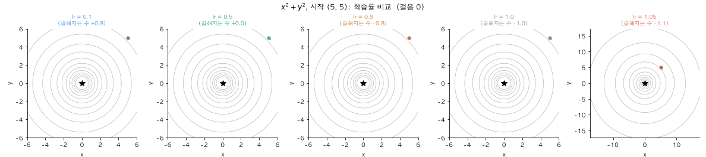

**③ Momentum vs Vanilla GD, f = x² + y², lr = 0.1, 100회**

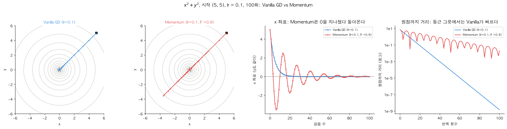

| 옵티마이저 | 100회 후 위치 | 원점까지 거리 |
|---|---|---|
| Vanilla GD | (1.0e-9, 1.0e-9) | 1.4e-9 |
| Momentum (β = 0.9) | (−0.0143, −0.0143) | 2.0e-2 |

두 경로는 모두 (5, 5)와 원점을 잇는 대각선 위에 있어서 한 그림에 그리면 겹친다. 그래서 경로를 칸으로 나누고, 세 번째 칸에 **걸음에 따른 x 좌표**를 따로 그렸다. Vanilla GD(파랑)는 0으로 곧게 줄어들고, Momentum(빨강)은 0을 지나쳐 음수로 갔다가 돌아오기를 반복하며 줄어든다.

둥근 그릇에서는 **Vanilla GD가 훨씬 더 가깝다.** Momentum은 속도가 쌓여 실효 보폭이 최대 lr / (1 − β) = 1.0까지 커지므로, 원점을 지나쳐 반대편으로 갔다가 돌아오는 출렁임이 생긴다. 이 출렁임은 한 걸음에 약 √β ≈ 0.95배씩만 줄어서, 매 걸음 0.8배씩 줄어드는 Vanilla보다 느리다. Momentum은 모든 경우에 빠른 방법이 아니라, 아래처럼 **길쭉한 골짜기에서 작은 학습률을 쓸 수밖에 없을 때** 이점이 있다.

**④ 타원형 함수 f = x² + 10y² (반경 1e-3 도달 반복 수)**

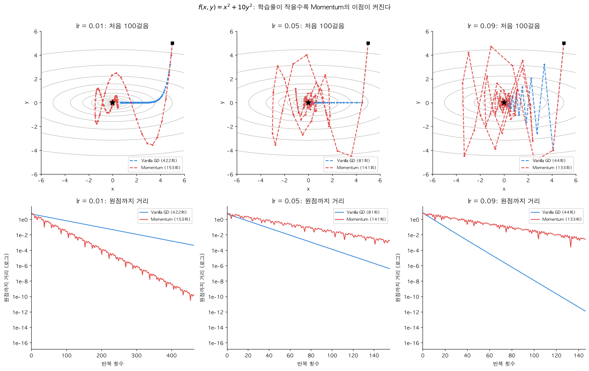

**애니메이션** (경로가 겹치지 않도록 방법마다 칸을 나눴다. 네 칸은 같은 지형, 같은 축 범위다): 같은 학습률(0.01)에서 Vanilla GD(파랑)는 완만한 x 방향으로 느리게 기어가고, Momentum(빨강)은 크게 출렁이면서도 먼저 원점에 도착한다. Adam(초록, lr 0.5)은 방향별로 보폭을 맞춰 원점을 향해 거의 직선으로 내려가고, Newton(주황)은 2차 함수의 바닥을 계산해 한 걸음 만에 원점으로 뛴다.


| lr | x 곱해지는 수 | y 곱해지는 수 | Vanilla GD | Momentum | 빠른 쪽 |
|---|---|---|---|---|---|
| 0.01 | 0.98 | 0.80 | 422회 | **153회** | Momentum (2.8배) |
| 0.05 (명세 예시) | 0.90 | **0.00** | **81회** | 141회 | Vanilla |
| 0.09 | 0.82 | −0.80 | **44회** | 133회 | Vanilla |

- **지그재그가 생기는 lr 범위**: y 방향 곱해지는 수 1 − 20·lr이 음수이면서 절댓값이 1보다 작아야 하므로 **0.05 < lr < 0.1**이다. 그래서 지그재그를 보기 위해 lr = 0.09를 골랐고, 그림 오른쪽 위에서 Vanilla(파랑)가 y 방향으로 왔다 갔다 하는 것을 확인했다.
- **명세 예시(lr = 0.05)와 다른 점**: lr = 0.05에서는 y 방향 곱해지는 수가 정확히 0이라 y가 첫 걸음에 0이 된다. 그래서 지그재그가 생기지 않고, Vanilla는 x축을 따라 곧게 내려간다.
- **Momentum의 이점이 드러나는 경우 (lr = 0.01)**: 가파른 y 방향 때문에 학습률을 작게 잡으면 완만한 x 방향이 매 걸음 0.98배밖에 줄지 않아 Vanilla는 422회가 걸린다. Momentum은 같은 방향의 gradient를 누적해 x 방향으로 가속하므로 153회 만에 도착한다.
- **결론**: 실제 딥러닝처럼 가파른 방향 때문에 학습률을 크게 올릴 수 없는 상황에서 Momentum이 유리하다. 학습률이 이미 충분히 크면, 관성이 만드는 출렁임 때문에 오히려 느려질 수 있다.

**⑤ (추가) GD vs SGD vs Momentum (+ Adam, Newton): 데이터가 있는 문제**

x² + y² 같은 함수에는 "데이터"가 없어서 SGD를 비교할 수 없다. 그래서 **선형 회귀** y = 2x + 1 + 잡음(N = 200개, x는 0~4)을 만들고, 기울기 w와 절편 b를 MSE([수학 준비 10)](#10-손실-함수-mse부터))로 학습했다. x가 0을 중심으로 하지 않아서 w와 b가 서로 얽히고, 손실 지형은 비스듬한 **길쭉한 골짜기**가 된다. 시작점은 (w, b) = (0, 4), 300걸음이다. 정답(최소제곱 해)은 (1.9902, 1.0526)이다.

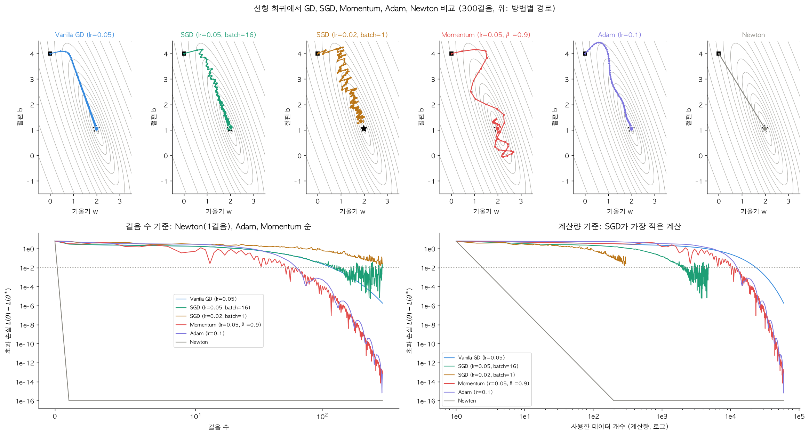

**애니메이션** (방법마다 칸을 나눴다): GD(파랑)는 매끄럽게, SGD(초록, 주황)는 미니배치마다 방향이 조금씩 달라 흔들리며(배치 1인 주황이 가장 심하다), Momentum(빨강)은 관성으로 골짜기를 크게 휘돌며 내려간다. Adam(보라)은 처음에 두 방향으로 같은 보폭을 내딛어 위로 둥글게 돌아간 뒤 골짜기를 따라 내려가고, Newton(회색)은 첫 걸음에 바로 ★로 뛴다.

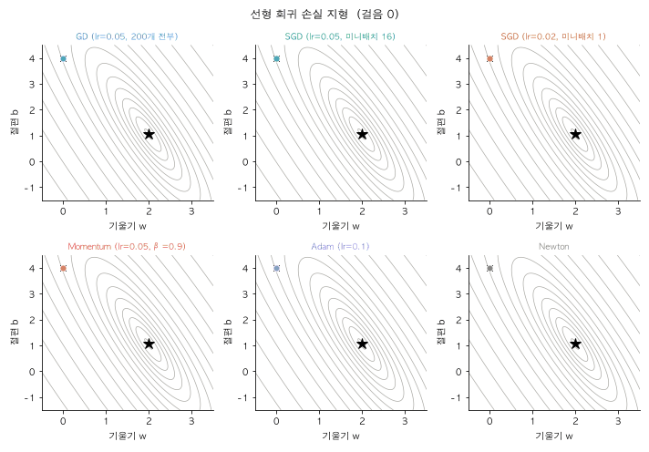

| 옵티마이저 | 초과 손실 < 0.01 도달 | 그때까지 사용한 데이터 | 300걸음 후 초과 손실 |
|---|---|---|---|
| GD (lr = 0.05, 매 걸음 200개 전부) | 119걸음 | 23,800개 | 1.8e-6 |
| SGD (lr = 0.05, 미니배치 16) | 124걸음 | **1,984개** | 9.6e-3 (흔들림) |
| SGD (lr = 0.02, 미니배치 1) | 300걸음 안에 도달 못 함 | - | 2.8e-2 (흔들림 큼) |
| Momentum (lr = 0.05, β = 0.9, 전부 사용) | 52걸음 | 10,400개 | 7.4e-14 |
| Adam (lr = 0.1, 전부 사용) | 63걸음 | 12,600개 | 6.3e-14 |
| Newton (Hessian 사용, 전부 사용) | **1걸음** | 200개 | 0 |

- **걸음 수 기준(아래 왼쪽 그래프)**: MSE는 θ에 대한 2차 함수라 Newton이 한 걸음에 정답에 도착한다. 1차 방법 중에서는 Momentum(52걸음)과 Adam(63걸음)이 GD(119걸음)보다 두 배 이상 빠르다. 비스듬한 골짜기에서 Momentum은 관성으로, Adam은 방향별 보폭 조절로 지그재그를 줄이기 때문이다.
- **계산량 기준(아래 오른쪽 그래프)**: 미니배치 16인 SGD는 GD와 걸음 수가 비슷하지만, 한 걸음에 데이터 16개만 쓰므로 **계산량은 약 12분의 1**이다. 데이터가 수백만 개인 실제 딥러닝에서 SGD를 쓰는 이유가 이것이다.
- **SGD의 대가**: gradient가 추정값이라 경로가 흔들리고(위쪽 SGD 칸), 학습률이 고정이면 정답 근처에서 멈추지 못하고 계속 흔들린다. 미니배치가 작을수록(배치 1) 더 크게 흔들린다. 실제로는 학습이 진행될수록 학습률을 줄이는 **학습률 스케줄**을 함께 쓴다.

**⑥ (보너스) Adam, Newton Method**

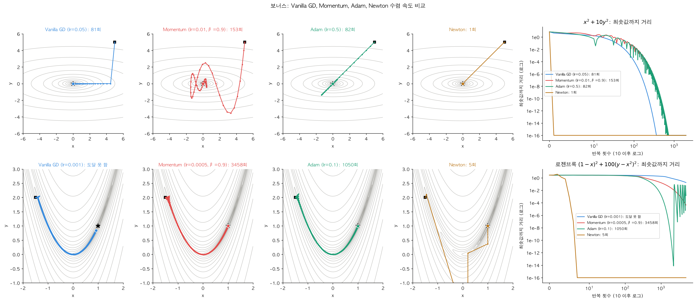

| 함수 (시작점) | Vanilla GD | Momentum | Adam | Newton |
|---|---|---|---|---|
| x² + 10y² (5, 5) | 81회 (lr 0.05) | 153회 (lr 0.01) | 82회 (lr 0.5) | **1회** |
| 로젠브록 (−1.5, 2) | 5000회 안에 도달 못 함 (lr 0.001) | 3458회 (lr 0.0005) | 1050회 (lr 0.1) | **5회** |

(최솟값에서 반경 1e-3 안에 처음 들어간 반복 수. 학습률은 각 방법이 발산하지 않는 범위에서 골랐다.)

- **로젠브록 함수** $(1-x)^2 + 100(y - x^2)^2$ 는 바나나처럼 **휘어진** 좁은 골짜기다. 골짜기 바닥이 매우 평평해서 GD는 바닥에 내려온 뒤 거의 움직이지 못한다(5000회 후 (0.919, 0.845)). 골짜기 벽은 가파르기 때문에 학습률을 키우면 발산한다. 길쭉한 골짜기 문제의 극단적인 예다.
- **Adam**은 방향마다 gradient 크기로 나눠 보폭을 맞추므로, 가파른 벽 방향과 평평한 바닥 방향의 속도가 비슷해진다. 그래서 학습률을 GD보다 100배 크게 쓰고도 발산하지 않고 1050회 만에 도착했다. 다만 학습률이 고정이라 최솟값 근처에서 조금씩 흔들리는 모습도 보인다(아래 줄 오른쪽 거리 그래프의 톱니).
- **Newton**은 2차 미분(Hessian)으로 지형의 휘어진 정도를 알고 있어서, 2차 함수에서는 1걸음, 로젠브록에서도 5걸음 만에 도착했다. 대신 한 걸음마다 n×n Hessian을 계산하고 연립방정식을 풀어야 한다. 파라미터가 2개면 쉽지만, 100만 개면 Hessian 칸이 1조 개라 신경망에는 쓰기 어렵다. 또 첫 걸음에서 그림 밖(y < −1)까지 크게 뛰었다가 돌아오는 것처럼, 최솟값에서 먼 곳에서는 엉뚱한 방향으로 갈 수 있다.
- **정리**: 1차 방법(GD, Momentum, Adam)은 한 걸음이 싸지만 걸음 수가 많고, 2차 방법(Newton)은 걸음 수가 적지만 한 걸음이 매우 비싸다. 딥러닝이 1차 방법, 특히 Adam과 미니배치 SGD를 주로 쓰는 이유다.

**애니메이션 (로젠브록)**: 5000걸음을 그대로 넣으면 GIF가 너무 커져서, 걸음 번호를 1, 2, 3, …, 5000까지 **로그 간격**으로 골라 보여 준다(제목의 걸음 수가 점점 빠르게 늘어난다). 1차 방법들은 같은 골짜기 바닥을 지나가서 한 그림에서는 겹치므로, 방법마다 칸을 나눴다. 세 1차 방법은 처음에 골짜기 벽을 따라 바닥으로 내려온 뒤 휘어진 바닥을 따라 아주 천천히 (1, 1)로 기어가고, Newton(주황)은 몇 번 크게 뛰어 5걸음 만에 도착한다.

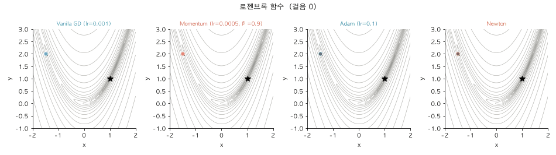

**⑦ (추가) 모든 경사하강법을 두 지형에서 비교하기**

앞의 실험들은 방법을 3~4개씩 골라 비교했다(①~④는 x² + 10y², ⑥은 4가지 방법, [계보 실험](#실험-같은-학습률에서-계보를-따라가-보기)은 관성 계열과 적응적 계열을 각각 다른 지형에). 여기서는 **Vanilla GD, Momentum, Nesterov, AdaGrad, RMSProp, Adam, Newton 7가지를 x² + 10y²와 로젠브록 두 지형 모두에서** 돌렸다. 코드는 `src/optimizer.py`의 `experiment_all_optimizers`다. SGD는 데이터가 없는 함수라서 뺐다(⑤에서 비교).

**공정하게 비교하는 방법**: 로젠브록은 시작점 근처가 매우 가팔라서, GD는 lr 0.002보다 크면 발산하고(lr 0.005에서 이미 nan) Adam은 lr 0.001 이하에서는 너무 느리다. 학습률을 하나로 맞추면 어떤 방법은 발산하고 어떤 방법은 멈춰서 비교가 안 된다. 그래서 **방법마다 학습률 13개(0.0001 ~ 1)를 모두 시험해, 가장 빨리 수렴한 학습률로** 비교했다. "각 방법이 최선을 다했을 때"의 비교다.

**수렴의 기준**: 최솟값 반경 1e-3 안에 **들어간 뒤 끝까지 머문** 첫 걸음이다. ①~⑥은 "처음 들어간 걸음"을 셌는데, 학습률이 크면 최솟값을 스쳐 지나갔다가 다시 멀어지는 경우가 있어서 여기서는 더 엄격한 기준을 썼다. 그래서 ⑥과 숫자가 다를 수 있다. 예를 들어 Adam은 로젠브록에서 lr 0.1로 1050걸음에 반경 안을 지나가지만, 그 뒤 계속 머물지는 못한다.

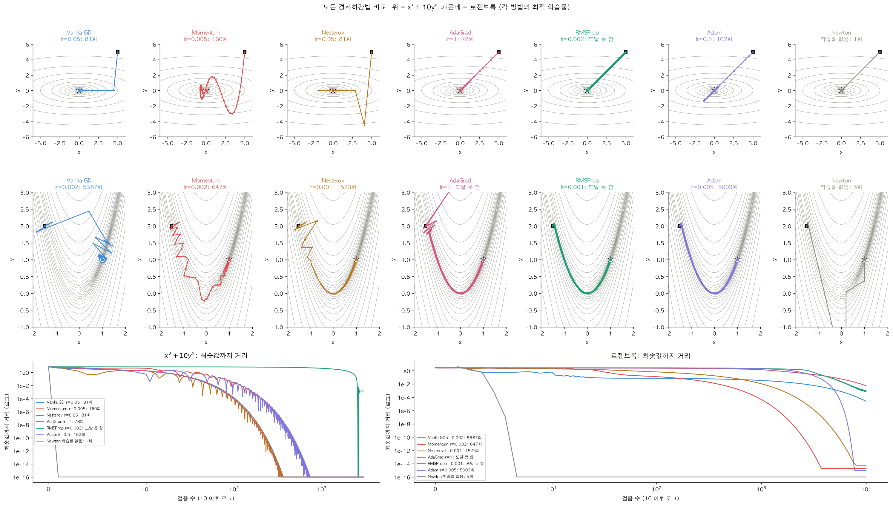

| 방법 | x² + 10y² (최대 3000걸음) | | | 로젠브록 (최대 10000걸음) | | |
|---|---|---|---|---|---|---|
| | 최적 lr | 수렴 걸음 | 수렴한 lr 개수 | 최적 lr | 수렴 걸음 | 수렴한 lr 개수 |
| Vanilla GD | 0.05 | 81 | 5 / 13 | 0.002 | 5387 | 1 / 13 |
| Momentum (β 0.9) | 0.005 | 160 | **9 / 13** | 0.002 | **647** | 4 / 13 |
| Nesterov (β 0.9) | 0.05 | 81 | 8 / 13 | 0.001 | 1573 | 3 / 13 |
| AdaGrad | 1 | 78 | 3 / 13 | - | 수렴 못 함 (최종 거리 5.5e-3) | 0 / 13 |
| RMSProp | - | 수렴 못 함 (최종 거리 1.4e-3) | 0 / 13 | - | 수렴 못 함 (최종 거리 1.1e-3) | 0 / 13 |
| Adam | 0.5 | 162 | 7 / 13 | 0.005 | 5003 | 5 / 13 |
| Newton | (학습률 없음) | **1** | - | (학습률 없음) | **5** | - |

"수렴한 lr 개수"는 13개 후보 중 몇 개로 수렴했는지다. 많을수록 **학습률을 대충 골라도 된다**는 뜻이다. 아래 그림은 학습률마다 수렴 걸음 수를 칸으로 그린 것이다(회색 = 수렴 못 함).

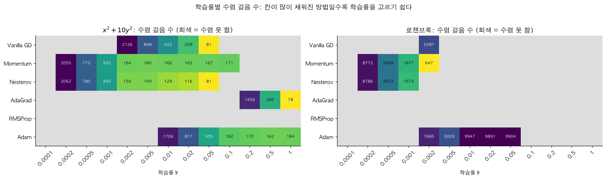

**해석**

- **Newton이 압도적이다 (1걸음, 5걸음).** 지형의 휘어짐(Hessian)을 직접 계산해서 보폭을 정하기 때문이다. 하지만 변수가 n개면 n×n 행렬을 계산하고 풀어야 해서, 변수가 수백만 개인 딥러닝에서는 쓸 수 없다. 1차 방법들과는 체급이 다른 비교다.
- **x² + 10y²처럼 단순한 2차 지형에서는, 학습률만 잘 고르면 Vanilla GD도 빠르다 (81걸음).** 최적 학습률에서는 GD와 Nesterov가 같고, Momentum과 Adam은 오히려 두 배쯤 느리다. Momentum과 Adam의 장점은 "최고 속도"가 아니라 **학습률을 대충 골라도 잘 된다**는 것이다. Momentum은 lr 0.002 ~ 0.1 넓은 범위에서 160~171걸음으로 거의 일정했다(9 / 13).
- **로젠브록처럼 휘어진 좁은 골짜기에서는 관성이 결정적이다.** Momentum이 647걸음으로 1차 방법 중 가장 빨랐고, Vanilla GD(5387걸음)보다 8배 빨랐다. 골짜기 바닥이 아주 완만해서 기울기가 작은데, 관성이 속도를 쌓아 그 구간을 빠르게 지나가기 때문이다. GD는 13개 학습률 중 **딱 하나(0.002)** 에서만 수렴했다. 그보다 크면 발산하고, 작으면 10000걸음 안에 도착하지 못한다.
- **Nesterov가 Momentum보다 느린 경우도 있다.** x² + 10y²에서는 Nesterov가 2배 빨랐지만, 로젠브록에서는 Momentum이 더 빨랐다(647 vs 1573). Nesterov는 출렁임을 줄이는 대신 그만큼 속도도 덜 쌓인다. 어느 쪽이 빠른지는 지형에 따라 다르다.
- **RMSProp은 두 지형 모두 반경 1e-3 안에 머물지 못했다.** RMSProp은 기울기를 "최근 기울기 크기"로 나누므로, 바닥 근처에서도 한 걸음의 크기가 대략 학습률만큼으로 유지된다. 그래서 최솟값 주변을 학습률 크기의 진폭으로 계속 맴돈다. 실제로 x² + 10y²에서 최종 거리가 lr 0.002일 때 1.4e-3, lr 0.02일 때 1.4e-2, lr 0.2일 때 0.14로 **학습률에 정확히 비례**했다. 더 작은 학습률은 바닥까지 가는 데 걸음이 너무 많이 든다. 실무에서 학습률을 점점 줄이는 **학습률 스케줄**을 함께 쓰는 이유다.
- **AdaGrad는 지형에 따라 극과 극이다.** x² + 10y²에서는 lr 1로 78걸음, 1차 방법 중 가장 빨랐다. 짧은 거리라 누적값이 덜 쌓였기 때문이다. 반면 로젠브록에서는 긴 골짜기를 지나는 동안 누적값이 계속 커져 실제 보폭이 0에 가까워졌고, 10000걸음 뒤에도 (0.9975, 0.9951)에 멈춰 있었다. [계보 실험](#실험-같은-학습률에서-계보를-따라가-보기)에서 본 "AdaGrad는 오래 학습하면 멈춘다"와 같은 현상이다.
- **학습률을 고르기 가장 쉬운 것은 Momentum, 그다음이 Adam이었다.** 수렴한 학습률 개수를 두 지형에서 합치면 Momentum 13개(9 + 4), Adam 12개(7 + 5), Nesterov 11개, GD 6개, AdaGrad 3개, RMSProp 0개다. Adam은 어느 지형에서도 가장 빠르지는 않지만, 적응적 학습률 계열 중 **두 지형 모두에서 수렴한 유일한 방법**이다. 특히 lr 0.01 ~ 1처럼 큰 학습률에서도 x² + 10y²를 안정적으로 풀었다. "처음 시도할 때 Adam"이라는 경험칙([어떤 상황에 어떤 알고리즘을 쓰나](#4-어떤-상황에-어떤-알고리즘을-쓰나-경험칙))은 이런 무난함에서 나온다.

**한계**: 학습률 후보가 0.05 다음이 0.1처럼 듬성듬성해서 진짜 최적 학습률은 그 사이에 있을 수 있다. 또 시작점 하나, 함수 두 개에서의 결과라서 모든 문제에 일반화할 수는 없다. 다른 하이퍼파라미터(β, Adam의 β₁·β₂)는 기본값으로 고정했다.

---

## 4. 역전파: 연쇄 법칙으로 기울기 구하기

### 한눈에 보기

> 신경망이 틀렸을 때, 각 가중치가 **"그 실수에 얼마나 책임이 있는가"** 를 출력 쪽에서부터 거꾸로 따라가며 계산하는 방법이 역전파다. 그 계산 도구가 미분의 **연쇄 법칙**이다.

### 역전파는 무엇이고, 왜 해야 하나

**어디에 들어가나**: [0장의 학습 4단계](#0-큰-그림-ai는-어떻게-학습하는가) 중 ③이다.

| 단계 | 하는 일 | 결과물 |
|---|---|---|
| ① 순전파 | 입력으로 예측을 계산 | 예측 ŷ |
| ② 손실 계산 | 예측과 정답을 비교 ([수학 준비 10)](#10-손실-함수-mse부터)) | 손실 L (숫자 하나) |
| **③ 역전파** | **모든 가중치 각각에 대해 "이 가중치를 조금 바꾸면 손실이 얼마나 변하나"를 계산** | **gradient** (가중치 개수만큼의 숫자) |
| ④ 업데이트 | gradient의 반대 방향으로 학습률만큼 이동 (3장) | 새 가중치 |

헷갈리기 쉬운 점: **역전파는 가중치를 고치지 않는다.** 역전파는 "어느 쪽으로 얼마나 고치면 좋은지"(gradient)를 **계산만** 하고, 실제로 고치는 것은 3장의 경사하강법이다. 역전파 = 나침반 만들기, 경사하강법 = 나침반 보고 걷기다.

**왜 필요한가: gradient를 구하는 다른 방법은 너무 느리다**

경사하강법을 쓰려면 **모든 가중치의 기울기**가 필요하다. 1장에서 배운 중심차분으로도 구할 수 있다. 가중치 하나를 +h, −h만큼 움직여 손실을 두 번 계산하면 된다. 문제는 가중치마다 이것을 따로 해야 한다는 것이다.

| 신경망 크기 | 가중치 수 | 중심차분 (순전파 횟수) | 역전파 |
|---|---|---|---|
| 이 과제의 2-2-1 신경망 | 9개 ($W_1$ 4 + $b_1$ 2 + $W_2$ 2 + $b_2$ 1) | 18번 | 순전파 1번 + 역방향 1번 |
| 손글씨 숫자 분류 정도 | 약 10만 개 | 약 20만 번 | 순전파 1번 + 역방향 1번 |
| 대형 언어 모델 | 수천억 개 | 수천억 번 이상 | 순전파 1번 + 역방향 1번 |

역방향 계산은 순전파 2번 정도의 비용이 든다. 그래서 가중치가 몇 개든 역전파는 **순전파 약 3번 분량**으로 모든 gradient를 한꺼번에 얻는다. 가중치 10만 개면 중심차분보다 수만 배 빠르다. 게다가 중심차분은 h 때문에 생기는 근사 오차가 있지만(1장), 역전파는 수식으로 계산하므로 **정확한 값**이다. 역전파가 없었다면 딥러닝은 계산 시간 때문에 불가능했다.

**왜 "거꾸로" 가나**: 손실 L은 신경망의 **맨 끝**에서 계산된다. 출력 쪽 가중치가 L에 주는 영향은 바로 구할 수 있고, 그 앞쪽 가중치의 영향은 "앞쪽 → 뒤쪽 → L"의 영향을 곱해서(연쇄 법칙) 구한다. 뒤쪽에서 이미 계산한 값을 앞쪽에서 **재사용**하므로 같은 계산을 반복하지 않는다. 회사에서 프로젝트가 실패했을 때, 최종 보고서를 만든 팀의 책임부터 따지고, 그 팀에 자료를 넘긴 팀의 책임은 "넘긴 자료가 보고서에 얼마나 반영됐나"를 곱해서 따지는 것과 같다.

**이 과제에서 확인한 것**: 역전파로 구한 gradient와 중심차분으로 구한 gradient의 차이는 최대 **2.0e-11**이었다(결과와 해석 참고). 둘이 같은 것을 구한다는 확인이자, 역전파 코드가 맞다는 검증이다. 1장의 [기울기를 구하는 다른 방법들](#기울기를-구하는-다른-방법들)에서 다룬 reverse mode 자동 미분이 바로 이 역전파다.

### 퍼셉트론: 뉴런 하나의 계산

신경망의 가장 작은 단위는 **퍼셉트론(perceptron)**, 즉 뉴런 하나다. 뉴런 하나는 두 가지 일만 한다.

1. **가중합**: 입력마다 중요도(가중치 w)를 곱해서 모두 더하고, 편향 b를 더한다. 이는 벡터의 내적이다.
2. **활성화**: 그 결과를 활성화 함수(예: sigmoid)에 통과시켜 출력을 만든다.

$$
z = w_1 x_1 + w_2 x_2 + b = \mathbf{w} \cdot \mathbf{x} + b, \qquad a = \sigma(z)
$$

**예시**: 입력 $x = (2, 3)$, 가중치 $w = (0.5, -1)$, 편향 $b = 1$ 이면

$$
z = 0.5 \times 2 + (-1) \times 3 + 1 = -1, \qquad a = \sigma(-1) \approx 0.269
$$

뉴런 여러 개를 나란히 놓으면 가중치 벡터들이 행(row)으로 쌓여 **행렬** $W$ 가 되고, 가중합 여러 개를 $W x$ 한 번으로 계산할 수 있다. 이것이 **층(layer)** 이고, 층을 쌓은 것이 신경망이다.

### 활성화 함수는 왜 바뀌어 왔나: 계단 함수에서 ReLU, 그리고 softmax까지

1958년 로젠블랫의 퍼셉트론은 활성화 함수로 **계단 함수(step function)** 를 썼다. 가중합 z가 0 이상이면 1, 아니면 0을 내는 "예/아니오" 스위치다.

$$
\text{step}(z) = \begin{cases} 1 & (z \ge 0) \\ 0 & (z < 0) \end{cases}
$$

여기서 출발해 활성화 함수가 바뀌어 온 이유는 **서로 다른 두 가지 문제** 때문이다. 둘을 구분해야 흐름이 정확히 보인다.

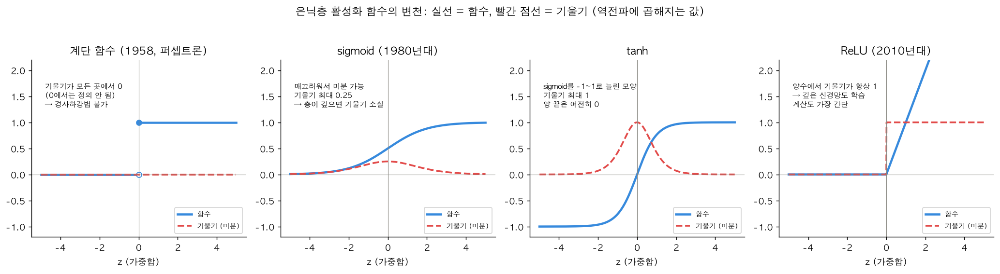

**문제 1. 표현력: 층이 하나면 직선 하나밖에 못 긋는다**

퍼셉트론 하나는 평면에 직선 하나를 긋고 양쪽을 0과 1로 나누는 것과 같다. 그래서 0장의 [XOR](#배경-기호주의와-연결주의)처럼 직선으로 나눌 수 없는 문제는 풀 수 없다. 이것은 계단 함수 때문이 아니라 **층이 하나뿐이어서** 생긴 한계다. 해결책은 **층을 쌓는 것**(은닉층)이다.

단, 층을 쌓으려면 층 사이에 **곡선(비선형) 활성화 함수**가 꼭 있어야 한다. 활성화 없이 직선 계산만 쌓으면 아무리 쌓아도 직선 하나와 같기 때문이다.

$$
\text{1층: } h = 2x, \quad \text{2층: } y = 3h \quad\Rightarrow\quad y = 3 \times 2x = 6x
$$

행렬로도 같다. $W_2 (W_1 x) = (W_2 W_1) x$ 이고, $W_2 W_1$ 은 행렬 **하나**다(2장의 행렬 곱 = 변형을 연달아 하기). 층 사이의 활성화 함수가 공간을 **휘게** 만들어야 층을 쌓는 의미가 생긴다.

**문제 2. 학습 불가능: 계단 함수는 기울기가 0이다**

계단 함수는 평평한 두 선으로 되어 있어서, 0이 아닌 모든 곳에서 **기울기가 0**이다(0에서는 끊어져 있어 기울기를 정의할 수 없다). 4장의 역전파는 각 단계의 기울기를 **곱해서** 전달하는데, 중간에 0이 하나라도 있으면 전체가 0이 된다.

$$
\frac{\partial L}{\partial W_1} = \cdots \times \underbrace{\text{step}'(z_1)}_{= 0} \times \cdots = 0
$$

그러면 "가중치를 어느 쪽으로 고쳐야 손실이 줄어드나"를 전혀 알 수 없다. 0장 XOR 그림처럼 사람이 손으로 정해 주면 계단 함수로 만든 2층 신경망도 XOR을 풀 수 있다. 하지만 그런 가중치를 **데이터로 찾아낼 방법이 없었다.** (원래 퍼셉트론은 경사하강법 대신 "틀리면 그 입력 쪽으로 가중치를 조금 옮긴다"는 자체 학습 규칙을 썼는데, 이 규칙은 층이 하나일 때만 쓸 수 있다.)

**해결: sigmoid.** 계단 함수의 모양은 유지하면서 모서리를 **매끄럽게 편** 함수가 sigmoid다. 0과 1 사이를 부드럽게 오가므로 모든 곳에서 기울기가 0이 아니다. 1986년 역전파가 널리 쓰이면서, 은닉층이 있는 신경망을 경사하강법으로 학습시키는 표준 조합이 되었다. 이 과제의 4장 신경망도 sigmoid를 쓴다.

**새 문제: 기울기 소실 (vanishing gradient)**

sigmoid의 기울기는 **최대 0.25**다(그림의 빨간 점선). 역전파는 층마다 이 기울기를 곱하므로, 층이 깊어질수록 앞쪽 층에 전달되는 기울기가 급격히 작아진다.

| 층 수 | 곱해지는 기울기의 최대값 0.25ⁿ |
|---|---|
| 1 | 0.25 |
| 5 | 0.00098 |
| 10 | 0.00000095 (약 100만 분의 1) |

앞쪽 층의 가중치가 거의 고쳐지지 않아 깊은 신경망이 잘 학습되지 않았다. 2장 [고유값](#고유값은-왜-구하나-어디에-쓰이나)에서 본 "1보다 작은 수를 계속 곱하면 소멸한다"와 같은 현상이다.

**해결: ReLU.** $\text{ReLU}(z) = \max(0, z)$ 는 음수면 0, 양수면 그대로 내보낸다. 양수 쪽 기울기가 **항상 1**이라 층을 많이 쌓아도 기울기가 줄어들지 않는다. 계산도 가장 간단해서 2010년대 이후 깊은 신경망의 은닉층에서 기본으로 쓰인다. (음수 쪽은 기울기가 0이라, 그쪽으로만 가는 뉴런은 학습이 멈추는 문제가 있다. 이를 보완한 Leaky ReLU, GELU 같은 변형도 있다.) tanh는 sigmoid를 −1~1로 늘린 모양으로, 기울기가 최대 1이라 sigmoid보다 낫지만 양 끝은 여전히 0이다.

**softmax는 어디에 들어가나: 출력층**

위의 변천은 **은닉층**의 이야기다. **출력층**은 "어떤 답을 원하느냐"에 따라 함수를 고른다. softmax는 계단 함수의 직접적인 후계자라기보다, **sigmoid를 여러 클래스로 넓힌 출력 함수**다.

| 문제 | 출력층 함수 | 출력의 의미 | 짝이 되는 손실 (5장) |
|---|---|---|---|
| 회귀 (값 예측) | 그대로 (항등 함수) | 예측값 | MSE |
| 이진 분류 (예/아니오) | **sigmoid** | "1일 확률" 하나 (0~1) | Binary Cross-Entropy |
| 다중 분류 (K개 중 하나) | **softmax** | K개 클래스의 확률 (합 = 1) | Cross-Entropy |

계단 함수가 "예/아니오"를 **딱 잘라** 냈다면, 출력층의 sigmoid와 softmax는 그 답을 **확률**로 부드럽게 내서 "얼마나 확신하는지"까지 알려 준다. 그래서 미분도 되고, 5장에서 보듯 확률 분포와 손실 함수(MLE)로 자연스럽게 이어진다.

클래스가 2개면 softmax는 sigmoid와 같다. 첫 번째 클래스의 확률을 정리하면

$$
\frac{e^{z_1}}{e^{z_1} + e^{z_2}} = \frac{1}{1 + e^{-(z_1 - z_2)}} = \sigma(z_1 - z_2)
$$

즉 **softmax는 sigmoid의 다중 클래스 버전**이다. 자세한 내용은 5장 [Softmax](#softmax-점수를-확률로-바꾸기)에 있다.

**한눈에 정리**

| 함수 | 주로 쓰는 곳 | 해결한 것 | 남은 문제 |
|---|---|---|---|
| 계단 함수 | 1958년 퍼셉트론 | "예/아니오" 판단 | 기울기 0 → 경사하강법, 역전파 불가 |
| sigmoid | 1980~2000년대 은닉층, 지금은 이진 분류 출력층 | 미분 가능 → 역전파로 은닉층 학습 | 기울기 최대 0.25 → 깊으면 기울기 소실 |
| tanh | 은닉층 (RNN 등) | 기울기 최대 1, 출력 중심이 0 | 양 끝에서는 여전히 기울기 0 |
| ReLU | 2010년대 이후 은닉층 기본 | 양수에서 기울기 1 → 깊은 신경망 학습 | 음수 쪽 기울기 0 (Leaky ReLU 등으로 보완) |
| softmax | 다중 분류 출력층 | 점수를 합이 1인 확률로 | (출력층 전용) |

### 신경망 구조

이 과제의 신경망은 입력 2개 → 은닉 2개 → 출력 1개인 2층 신경망이다.

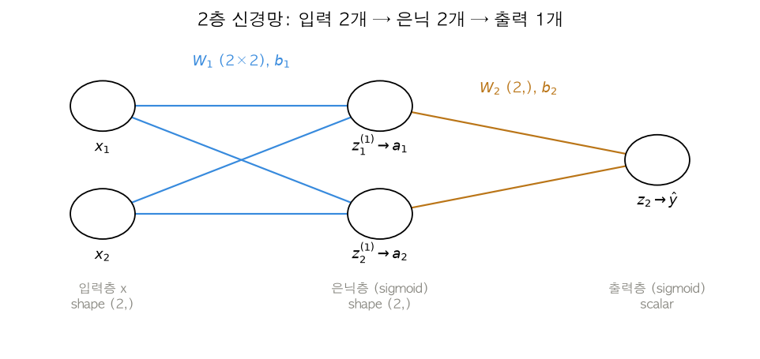

### 순전파: 입력에서 예측까지

| 단계 | 수식 | shape |
|---|---|---|
| 입력 | $x$ | (2,) |
| 은닉층 선형 결합 | $z_1 = W_1 x + b_1$ | (2,2) @ (2,) + (2,) → (2,) |
| 은닉층 활성화 | $a_1 = \sigma(z_1)$ | (2,) |
| 출력층 선형 결합 | $z_2 = W_2 \cdot a_1 + b_2$ | (2,) · (2,) + scalar → scalar |
| 출력층 활성화 | $\hat{y} = \sigma(z_2)$ | scalar |
| 손실 (BCE) | $L = -\left[ y \log \hat{y} + (1-y) \log(1-\hat{y}) \right]$ | scalar |

**활성화 함수 sigmoid**는 어떤 수든 0과 1 사이로 눌러 준다. 그래서 출력 $\hat{y}$ 을 "정답이 1일 확률"로 해석할 수 있다.

$$
\sigma(z) = \frac{1}{1 + e^{-z}}
$$

**손실 함수 BCE(Binary Cross-Entropy)** 는 정답이 1인데 $\hat{y}$ 이 0에 가까우면(틀린 쪽으로 확신하면) 손실이 매우 커진다. 이 식이 어디서 왔는지는 5장에서 다룬다.

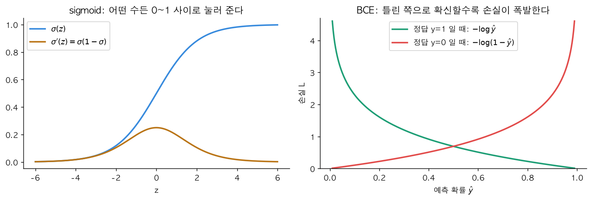

### 연쇄 법칙: 영향은 곱해서 전달된다

**직관**: 톱니바퀴 세 개가 맞물려 있다고 하자. 첫 번째가 1바퀴 돌 때 두 번째는 2바퀴, 두 번째가 1바퀴 돌 때 세 번째는 3바퀴 돈다면, 첫 번째가 1바퀴 돌 때 세 번째는 **2 × 3 = 6바퀴** 돈다.

미분도 같다. W₂가 손실 L에 주는 영향은 "W₂ → z₂", "z₂ → ŷ", "ŷ → L" 각 단계의 영향을 **곱한 것**이다.

$$
\frac{\partial L}{\partial W_2} = \frac{\partial L}{\partial \hat{y}} \cdot \frac{\partial \hat{y}}{\partial z_2} \cdot \frac{\partial z_2}{\partial W_2}
$$

역전파는 이 곱셈을 **출력 쪽에서부터 거꾸로** 진행한다. 앞에서 계산한 값을 다음 단계에서 재사용하므로 효율적이다.

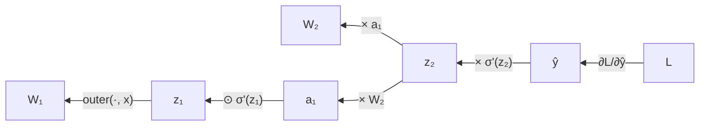

### 역전파 유도: 단계별로

**① 손실 → 예측값**

$$
\frac{\partial L}{\partial \hat{y}} = -\frac{y}{\hat{y}} + \frac{1-y}{1-\hat{y}} \qquad \text{shape: scalar}
$$

**② 예측값 → 출력층 z₂** : sigmoid의 미분이 필요하다.

$$
\sigma'(z) = \sigma(z)\,(1 - \sigma(z))
$$

이 식은 $\sigma(z) = (1 + e^{-z})^{-1}$ 을 미분하면 $\frac{e^{-z}}{(1+e^{-z})^2}$ 이 되고, 이를 $\frac{1}{1+e^{-z}} \cdot \frac{e^{-z}}{1+e^{-z}} = \sigma(z)(1-\sigma(z))$ 로 정리해서 얻는다.

①과 곱하면 놀랍도록 깔끔하게 정리된다.

$$
\frac{\partial L}{\partial z_2}
= \left( -\frac{y}{\hat{y}} + \frac{1-y}{1-\hat{y}} \right) \hat{y}(1-\hat{y})
= -y(1-\hat{y}) + (1-y)\hat{y}
= \hat{y} - y
\qquad \text{shape: scalar}
$$

**"예측 − 정답"**, 즉 틀린 만큼이 그대로 출력층의 기울기가 된다. sigmoid와 BCE를 함께 쓰는 이유 중 하나다.

**③ z₂ → W₂, b₂** : $z_2 = W_2 \cdot a_1 + b_2$ 에서 $W_2$ 의 각 원소는 $a_1$ 의 같은 위치 원소와 곱해지므로

$$
\frac{\partial L}{\partial W_2} = \frac{\partial L}{\partial z_2} \, a_1 \quad \text{shape: (2,)}, \qquad
\frac{\partial L}{\partial b_2} = \frac{\partial L}{\partial z_2} \quad \text{shape: scalar}
$$

**④ z₂ → 은닉층 출력 a₁** : 같은 식을 $a_1$ 로 미분하면

$$
\frac{\partial L}{\partial a_1} = \frac{\partial L}{\partial z_2} \, W_2 \qquad \text{shape: (2,)}
$$

**⑤ a₁ → z₁** : sigmoid가 원소별로 적용되었으므로, 기울기도 **원소별로 곱한다** (⊙: 원소별 곱).

$$
\frac{\partial L}{\partial z_1} = \frac{\partial L}{\partial a_1} \odot a_1 \odot (1 - a_1) \qquad \text{shape: (2,)}
$$

**⑥ z₁ → W₁, b₁** : $z_{1,i} = \sum_j W_{1,ij} \, x_j + b_{1,i}$ 이므로 $\frac{\partial z_{1,i}}{\partial W_{1,ij}} = x_j$ 이다. 모든 (i, j)를 모으면 **외적(outer product)** 이 된다.

$$
\frac{\partial L}{\partial W_1} = \frac{\partial L}{\partial z_1} \, x^{\top} = \text{outer}\left( \frac{\partial L}{\partial z_1}, x \right) \quad \text{shape: (2,2)}, \qquad
\frac{\partial L}{\partial b_1} = \frac{\partial L}{\partial z_1} \quad \text{shape: (2,)}
$$

> [!TIP]
> **shape 확인 규칙**: 어떤 값에 대한 기울기의 shape은 **그 값의 shape과 같다.** W₁이 (2,2)이면 ∂L/∂W₁도 (2,2)여야 한다. shape이 맞지 않으면 유도 어딘가가 틀린 것이다.

<details>
<summary><b>더 깊이 보기 (전공자용): 기울기 검증(gradient check)과 AutoGrad</b></summary>

유도한 기울기가 맞는지는 1장의 **중심차분으로 검증**할 수 있다. 가중치 하나 $w$ 를 $\pm h$ 만큼 바꿔 손실을 다시 계산하면

$$
\frac{\partial L}{\partial w} \approx \frac{L(w + h) - L(w - h)}{2h}
$$

이고, 이 값이 역전파 결과와 일치해야 한다. 이것이 딥러닝 프레임워크 개발에서 쓰는 **gradient check**다.

AutoGrad 엔진은 위 유도 과정을 자동화한 것이다. 각 연산(곱셈, 덧셈, sigmoid…)이 "자기 입력에 대한 국소 미분"만 알고 있으면, 계산 그래프를 거꾸로 따라가며 연쇄 법칙으로 곱해 나간다. 다음 미션에서 구현할 내용이다.

배치(batch) 입력 $X$ (N×2)를 쓰면 $\partial L / \partial W_1 = (\partial L / \partial Z_1)^{\top} X$ 처럼 외적의 합이 행렬 곱으로 바뀐다.

</details>

### 과제에서 할 일 (`notebooks/backprop_derivation.ipynb`)

- [x] 순전파 수식과 역전파 수식(∂L/∂ŷ, ∂L/∂z₂, ∂L/∂W₂, ∂L/∂a₁, ∂L/∂z₁, ∂L/∂W₁)을 단계별로 유도해 Markdown으로 작성한다.
- [x] 아래 고정 예제로 순전파·역전파를 **손계산**하고, 모든 중간값에 shape을 표기한다.

  | 값 | 설정 |
  |---|---|
  | 입력 x | [1, 0] |
  | W₁ | [[0.1, 0.2], [0.3, 0.4]] |
  | b₁ | [0, 0] |
  | W₂ | [0.5, 0.6] |
  | b₂ | 0 |
  | 활성화 | Sigmoid |
  | 손실 | BCE |
  | 정답 y | 1 |

- [x] NumPy로 같은 계산을 수행해 손계산 결과와 **소수점 4자리까지** 일치하는지 확인한다.

> [!WARNING]
> **직접 확인해 볼 것**
> - 체크포인트는 ∂L/∂z₂와 ∂L/∂z₁이다. 과제 명세의 결과 예시에 나온 값이 실제로 맞는지, 손계산과 NumPy 결과로 **직접** 확인한다. 예시도 사람이 쓴 것이라 틀릴 수 있다.
> - ∂L/∂W₁의 두 번째 열이 모두 0이 나오는 이유를 x = [1, 0]과 연결해서 설명할 수 있는가?

### 결과와 해석

노트북: [`notebooks/backprop_derivation.ipynb`](notebooks/backprop_derivation.ipynb) (y = 1)

| 값 | shape | 손계산 | NumPy | 과제 PDF 예시 |
|---|---|---|---|---|
| z₁ | (2,) | [0.1000, 0.3000] | [0.1000, 0.3000] | [0.1, 0.3] |
| a₁ | (2,) | [0.5250, 0.5744] | [0.5250, 0.5744] | [0.5250, 0.5744] |
| z₂ | scalar | **0.6072** | 0.6072 | 0.6071 |
| ŷ | scalar | 0.6473 | 0.6473 | 0.6473 |
| L | scalar | 0.4350 | 0.4350 | - |
| ∂L/∂ŷ | scalar | −1.5449 | −1.5449 | −1.5449 |
| ∂L/∂z₂ (체크포인트) | scalar | −0.3527 | −0.3527 | −0.3527 |
| ∂L/∂W₂ | (2,) | [−0.1852, −0.2026] | [−0.1852, −0.2026] | [−0.1852, −0.2026] |
| ∂L/∂a₁ | (2,) | [−0.1764, −0.2116] | [−0.1764, −0.2116] | [−0.1764, −0.2116] |
| ∂L/∂z₁ (체크포인트) | (2,) | [−0.0440, **−0.0517**] | [−0.0440, −0.0517] | [−0.0440, −0.0513] |
| ∂L/∂W₁ | (2,2) | [[−0.0440, 0], [−0.0517, 0]] | [[−0.0440, 0], [−0.0517, 0]] | [[−0.0440, 0], [−0.0513, 0]] |

- **손계산과 NumPy가 13개 값 모두 소수점 4자리까지 일치**했다.
- 추가로 `src/calculus.py`의 중심차분으로 9개 파라미터의 기울기를 따로 구해 역전파 결과와 비교했더니 상대 오차가 **2.0e-11**이었다. 역전파 공식이 맞다는 독립적인 증거다.
- **과제 예시와 다른 두 값**
  - z₂: 정확한 값은 0.607155라서 반올림하면 0.6072다. 예시의 0.6071은 a₁을 먼저 4자리로 반올림한 뒤 계산(0.5 × 0.5250 + 0.6 × 0.5744 = 0.60714)하면 나오는 값이다. 그래서 손계산의 중간값은 6자리로 계산했다.
  - ∂L/∂z₁의 두 번째 값: −0.211625 × σ'(0.3) = −0.211625 × 0.244458 = **−0.0517**이다. 손계산, NumPy, 중심차분이 모두 −0.0517을 가리키므로 예시의 −0.0513은 오기로 판단했다.
- **∂L/∂W₁의 두 번째 열이 0인 이유**: ∂L/∂W₁ = ∂L/∂z₁ ⊗ x 이고 x = [1, 0]이다. 두 번째 열은 x₂ = 0을 곱한 값이라 모두 0이다. 입력이 0이면 그 입력에 곱해지는 가중치를 아무리 바꿔도 z₁이 변하지 않으니 손실에도 영향이 없다.
- **기울기 부호의 의미**: ∂L/∂z₂ = ŷ − y = −0.3527 < 0 이다. 예측(0.6473)이 정답(1)보다 작다는 뜻이고, 경사하강법은 기울기의 반대 방향으로 움직이므로 W₂를 **키워서** 예측을 1 쪽으로 올리게 된다.

---

## 5. 확률·통계: 손실 함수는 어디서 왔는가

### 한눈에 보기

> MSE와 Cross-Entropy는 누군가 임의로 정한 공식이 아니다. **"데이터가 이런 확률 분포를 따른다"** 고 가정하고, **"관측된 데이터가 나올 확률을 가장 높게 만드는 모델"** 을 찾으면 자연스럽게 그 식이 나온다.
>
> 장 끝의 [손실 함수 고르기](#손실-함수-고르기-어떤-상황에-왜-이-함수를-쓰나)에서는 MSE, MAE, Huber, BCE, Cross-Entropy를 **어떤 상황에, 왜** 쓰는지 비교한다.

### 확률 분포: 값이 나올 가능성의 지도

**정규분포 N(μ, σ²)** : 키, 측정 오차처럼 평균 근처에 몰려 있고 멀어질수록 드물어지는 연속적인 값

$$
p(x) = \frac{1}{\sqrt{2\pi\sigma^2}} \exp\left( -\frac{(x - \mu)^2}{2\sigma^2} \right)
$$

- μ (뮤): 중심 위치 (평균)
- σ (시그마): 퍼진 정도 (표준편차). σ²는 분산이다.
- 연속값이라 특정 값의 "확률"이 아니라 **확률밀도(PDF)** 를 나타낸다. 곡선 아래 넓이가 확률이고, 전체 넓이는 1이다.

**베르누이 분포 B(p)** : 동전 던지기, 스팸/정상처럼 결과가 1 또는 0 두 가지뿐인 경우

$$
P(X = x) = p^{x} (1-p)^{1-x}, \quad x \in \{0, 1\}
$$

x = 1을 넣으면 p, x = 0을 넣으면 1 − p가 나온다. 두 경우를 하나의 식으로 쓴 것이다. 값이 띄엄띄엄 있으므로 **확률질량(PMF)** 이라 하고, 막대그래프로 그린다.

### 우도(likelihood)란? 확률과 무엇이 다른가

**우도(尤度)** 는 영어 likelihood를 옮긴 말로, "**그럴듯한 정도**"라는 뜻이다. 확률과 같은 식을 쓰지만 **무엇을 고정하고 무엇을 바꾸느냐**가 반대다. 동전 예시로 비교해 보자. 앞면 확률을 p라 하고, 앞면을 H, 뒷면을 T로 쓴다.

**① 확률: 동전(p)은 정해져 있고, 결과를 묻는다**

"앞면 확률이 0.5인 동전을 3번 던지면, H, H, T가 나올 확률은?"

$$
0.5 \times 0.5 \times 0.5 = 0.125
$$

동전(p = 0.5)은 고정이고, 가능한 여러 결과(HHH, HHT, …) 중 하나의 가능성을 묻는다. 모든 결과의 확률을 더하면 1이다.

**② 우도: 결과는 이미 봤고, 동전(p)을 묻는다**

"동전을 10번 던졌더니 **앞면 7번, 뒷면 3번**이 나왔다. 이 동전의 p가 얼마라고 보는 게 가장 그럴듯한가?"

결과는 이미 관측되어 **고정**이다. 이번에는 p 후보를 하나씩 넣어 보며 "p가 이 값이라면 이 결과가 나올 확률"을 계산한다. 이것이 **우도**다.

$$
\mathcal{L}(p) = p^7 (1 - p)^3
$$

(앞면 확률 p를 7번, 뒷면 확률 1 − p를 3번 곱한 것. 던진 순서는 상관없으므로 순서를 정하는 상수는 생략했다.)

| p 후보 | 우도 $p^7(1-p)^3$ | 해석 |
|---|---|---|
| 0.3 | 0.000075 | 앞면이 잘 안 나오는 동전이라면 앞면 7번은 매우 드문 일 |
| 0.5 | 0.00098 | 공평한 동전이라면 있을 수는 있지만 흔하진 않음 |
| **0.7** | **0.00222** | **가장 그럴듯함** |
| 0.9 | 0.00048 | 앞면이 너무 잘 나오는 동전이라면 뒷면 3번이 드묾 |

우도를 가장 크게 만드는 p = 0.7, 즉 관측한 비율 7/10이 가장 그럴듯한 답이다. 이렇게 **우도를 최대로 만드는 파라미터를 고르는 것**이 아래의 **최대우도추정(MLE, Maximum Likelihood Estimation)** 이다. 노트북의 [동전 실험 그림](outputs/prob_bce_mle.png)이 이 우도를 p 전체에 대해 그린 것이다.

| | 확률 | 우도 |
|---|---|---|
| 고정된 것 | 파라미터 (동전의 p) | 데이터 (관측한 결과) |
| 바꿔 보는 것 | 데이터 (어떤 결과가 나올까) | 파라미터 (어떤 p일까) |
| 묻는 것 | "이 동전이면 이 결과가 나올 가능성은?" | "이 결과를 보니 어떤 동전이 그럴듯한가?" |
| 합하면 | 모든 결과에 대해 더하면 1 | p에 대해 더해도 1이 아니다. p의 확률이 아니라 **비교용 점수**다 |

> [!NOTE]
> 우도는 "p = 0.7일 확률"이 **아니다.** "p가 0.7이라고 가정하면, 이미 본 데이터가 나올 확률"이다. 그래서 우도는 후보들끼리 **누가 더 그럴듯한지 비교**하는 데에만 쓴다.

**머신러닝과의 연결**: 동전의 p 자리에 **모델의 파라미터 θ(가중치)** 가, "앞면 7번" 자리에 **학습 데이터**가 들어간다. "이 가중치라면 우리가 가진 학습 데이터가 나올 가능성이 얼마나 되는가"가 우도다. 학습은 이 우도가 가장 큰 가중치를 찾는 일이고, 아래에서 보듯 그것이 곧 MSE나 Cross-Entropy 손실을 최소화하는 일이다.

**아래 수식에 나오는 기호**

| 기호 | 읽는 법 | 뜻 |
|---|---|---|
| $\mathcal{L}(\theta)$ | 우도 엘 | 파라미터가 θ일 때의 우도 (손실 L과 구분하려고 필기체를 쓴다) |
| $p(y \mid x)$ | 피 와이 바 엑스 | x가 **주어졌을 때** y가 나올 확률 (조건부 확률). 세로선 \| 은 "~일 때" |
| $p(y \mid x; \theta)$ | | 위와 같고, 세미콜론 뒤는 "파라미터가 θ인 모델에서" |
| $\prod_{i=1}^{n}$ | 프로덕트 (파이) | **모두 곱하라**. 합 기호 Σ의 곱셈 버전. $\prod_{i=1}^{3} a_i = a_1 \times a_2 \times a_3$ |
| $\arg\max_{\theta}$ | 아그맥스 | 뒤의 값을 **가장 크게 만드는 θ** (최댓값 자체가 아니라 그때의 θ). argmin은 가장 작게 만드는 θ |

### 최대우도추정(MLE): 데이터를 가장 잘 설명하는 모델 찾기

위 동전 예시처럼 **관측된 데이터가 나올 확률(우도)을 최대로 만드는 파라미터**를 고르는 방법이 MLE다. 데이터가 여러 개인 일반적인 경우로 쓰면 다음과 같다.

데이터 $(x_1, y_1), \dots, (x_n, y_n)$ 이 서로 독립이면 우도는 각 확률의 곱이다.

$$
\mathcal{L}(\theta) = \prod_{i=1}^{n} p(y_i \mid x_i; \theta)
$$

곱셈은 다루기 어렵고 작은 확률을 계속 곱하면 컴퓨터에서 0이 되어 버리므로, **로그**를 씌워 덧셈으로 바꾼다. 로그는 증가함수라서 최댓값의 위치는 변하지 않는다.

$$
\arg\max_{\theta} \prod_i p(y_i \mid x_i) = \arg\max_{\theta} \sum_i \log p(y_i \mid x_i)
$$

딥러닝은 "최대화"보다 "최소화"로 표현하므로, 음수를 붙인 **음의 로그우도(NLL)** 를 최소화한다. 이 NLL이 곧 손실 함수가 된다.

### MSE 최소화 = 정규분포 가정 하의 MLE

**가정**: 정답은 모델의 예측에 정규분포 잡음이 더해진 값이다.

$$
y = f(x) + \varepsilon, \quad \varepsilon \sim N(0, \sigma^2)
\quad \Rightarrow \quad
p(y \mid x) = \frac{1}{\sqrt{2\pi\sigma^2}} \exp\left( -\frac{(y - f(x))^2}{2\sigma^2} \right)
$$

**로그우도를 계산하면**

$$
\sum_{i=1}^{n} \log p(y_i \mid x_i)
= \sum_{i=1}^{n} \left[ -\frac{(y_i - f(x_i))^2}{2\sigma^2} - \log \sqrt{2\pi\sigma^2} \right]
$$

σ는 모델과 관계없는 상수이므로, 최대화에 영향을 주는 것은 첫 번째 항뿐이다.

$$
\arg\max_{f} \sum_i \log p(y_i \mid x_i)
= \arg\min_{f} \sum_i (y_i - f(x_i))^2
= \arg\min_{f} \underbrace{\frac{1}{n} \sum_i (y_i - f(x_i))^2}_{\text{MSE}}
$$

**결론**: 오차가 정규분포를 따른다고 가정하면, 우도를 최대화하는 것과 MSE를 최소화하는 것은 같다.

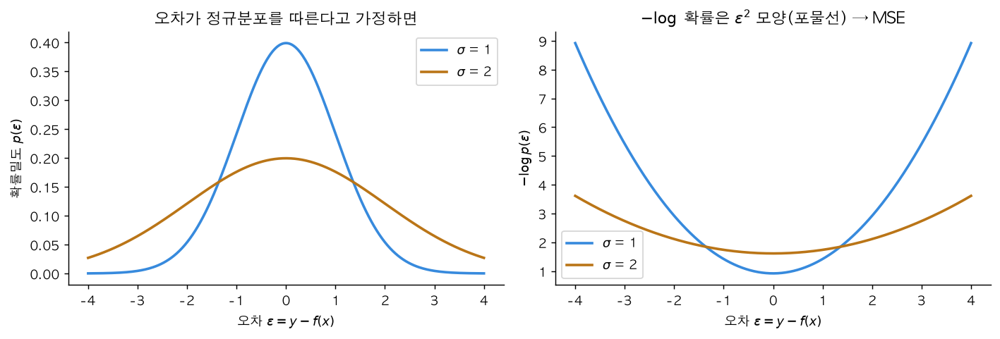

오른쪽 그래프에서 −log p(ε)가 오차 ε의 제곱 모양, 즉 포물선이 되는 것을 볼 수 있다.

### Cross-Entropy 최소화 = 베르누이/카테고리 분포 가정 하의 MLE

**이진 분류 (베르누이)**: 모델 출력 $\hat{y}$ 을 "정답이 1일 확률"로 보면, 정답 y가 나올 확률은 베르누이 분포다.

$$
p(y \mid x) = \hat{y}^{\,y} (1-\hat{y})^{1-y}
$$

로그를 씌우고 음수를 붙이면

$$
-\log p(y \mid x) = -\left[ y \log \hat{y} + (1-y) \log(1-\hat{y}) \right]
$$

이것이 4장에서 사용한 **BCE 손실**이다. 데이터 전체에 대해 더하면 NLL이 되므로, BCE 최소화 = 베르누이 가정 하의 MLE이다.

**다중 분류 (카테고리 분포)**: 클래스가 K개이고, 정답을 원-핫 벡터 $y = (0, \dots, 1, \dots, 0)$, 모델 출력을 각 클래스의 확률 $\hat{y}_k$ 로 두면

$$
p(y \mid x) = \prod_{k=1}^{K} \hat{y}_k^{\,y_k}
\quad \Rightarrow \quad
-\log p(y \mid x) = -\sum_{k=1}^{K} y_k \log \hat{y}_k
$$

이것이 **Cross-Entropy 손실**이다. 정답 클래스에 대한 $-\log(\text{확률})$ 만 남는다.

### Softmax: 점수를 확률로 바꾸기

다중 분류 모델은 각 클래스에 대한 원점수(logit) z를 출력한다. 이 점수는 음수일 수도 있고 합이 1도 아니다. **Softmax**는 이를 확률로 바꾼다.

$$
\text{softmax}(z)_k = \frac{e^{z_k}}{\sum_{j=1}^{K} e^{z_j}}
$$

- 지수함수 $e^{z}$ 는 항상 양수 → 모든 출력이 양수
- 전체 합으로 나눔 → 합이 1

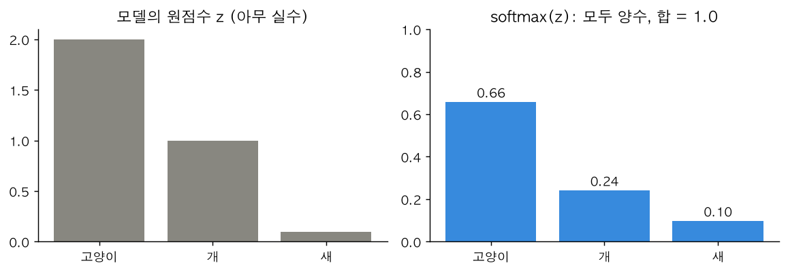

> [!TIP]
> z = [1000, 1001]처럼 큰 값을 넣으면 `np.exp(1000)`이 overflow되어 `inf`가 된다. 모든 z에서 **같은 상수(보통 max(z))를 빼도 softmax 결과는 변하지 않는다.** 분자와 분모에 똑같이 $e^{-c}$ 가 곱해져 약분되기 때문이다. 이 성질을 이용하면 수치적으로 안정한 softmax를 만들 수 있다.

<details>
<summary><b>더 깊이 보기 (전공자용): 정보 이론과의 연결 (보너스)</b></summary>

- **엔트로피** $H(p) = -\sum_k p_k \log p_k$ : 분포 p의 불확실성
- **Cross-Entropy** $H(p, q) = -\sum_k p_k \log q_k$ : 실제 분포 p를 모델 분포 q로 표현할 때의 평균 정보량
- **KL-Divergence** $D_{KL}(p \,\Vert\, q) = \sum_k p_k \log \frac{p_k}{q_k}$ : 두 분포의 차이 (항상 0 이상, p = q일 때만 0)

세 값 사이에는 $H(p, q) = H(p) + D_{KL}(p \,\Vert\, q)$ 관계가 있다. H(p)는 모델과 무관한 상수이므로, **Cross-Entropy 최소화 = KL-Divergence 최소화**, 즉 모델 분포를 실제 데이터 분포에 가깝게 만드는 것이다.

Softmax + Cross-Entropy의 gradient도 $\partial L / \partial z_k = \hat{y}_k - y_k$ 로, 4장의 sigmoid + BCE와 같은 "예측 − 정답" 형태가 된다.

</details>

### 손실 함수 고르기: 어떤 상황에, 왜 이 함수를 쓰나

위에서 MSE와 Cross-Entropy가 **어디서 왔는지**(MLE)를 봤다. 이 절은 실제로 문제를 풀 때 **무엇을 골라야 하고 왜 그런지**를 정리한다.

#### 손실 함수가 하는 세 가지 일

손실 함수는 "얼마나 틀렸나"를 숫자 하나로 바꾸는 규칙이다. 그런데 이 숫자는 단순한 점수가 아니라 학습 전체를 정한다.

1. **무엇을 "틀렸다"고 볼지 정한다.** 오차 10을 오차 1의 10배로 볼지(MAE), 100배로 볼지(MSE)가 손실 함수에 달려 있다.
2. **경사하강법이 따라갈 기울기를 만든다.** 3장의 경사하강법은 손실의 기울기만 보고 움직인다. 기울기가 너무 작거나 정해지지 않으면 학습이 멈추거나 흔들린다.
3. **모델이 결국 무엇을 예측하게 될지 정한다.** 같은 데이터라도 MSE로 학습하면 평균을, MAE로 학습하면 중앙값을 예측하게 된다(아래 이유 1).

그래서 손실 함수는 "아무거나 줄이면 되는 숫자"가 아니라, **문제에 맞는 것을 골라야 하는 설계 선택**이다.

#### 한눈에 보기: 상황별 손실 함수

| 문제 | 예시 | 출력층 | 손실 함수 | 가정하는 오차·정답 분포 | 최소화하면 예측하는 값 |
|---|---|---|---|---|---|
| 회귀 (숫자 맞히기) | 집값, 기온 | 그대로 (항등) | **MSE** | 정규분포 | 평균 |
| 회귀, 이상치가 많음 | 배달 시간, 거래 금액 | 그대로 | **MAE** | 라플라스 분포 | 중앙값 |
| 회귀, 이상치가 조금 | 센서 값, 일반적인 회귀 | 그대로 | **Huber** | 가운데는 정규, 꼬리는 라플라스 | 평균과 중앙값 사이 |
| 이진 분류 | 스팸 여부, 4장 XOR | sigmoid | **BCE** | 베르누이 분포 | 정답이 1일 확률 |
| 다중 분류 (하나만 정답) | 손글씨 0~9, 고양이/개/새 | softmax | **Cross-Entropy** | 카테고리 분포 | 각 클래스의 확률 |
| 다중 라벨 (정답이 여러 개) | 사진 태그(바다, 사람, 노을) | 라벨마다 sigmoid | 라벨마다 **BCE** | 라벨마다 베르누이 | 라벨마다 확률 |

세 가지 질문으로 고르면 된다.

- **무엇을 예측하나?** 숫자면 회귀 손실(MSE, MAE, Huber), 확률·종류면 분류 손실(BCE, Cross-Entropy).
- **이상치가 있나?** 많으면 MAE나 Huber, 거의 없으면 MSE.
- **출력층과 짝이 맞나?** sigmoid에는 BCE, softmax에는 Cross-Entropy. 이 짝일 때 기울기가 "예측 − 정답"으로 깔끔해진다(아래 이유 3).

#### 이유 1. 손실 함수가 "정답 하나"를 무엇으로 볼지 정한다

데이터가 1, 2, 3, 4, 100일 때, 이 다섯 값을 **숫자 하나 c로 대표**한다고 하자. 손실마다 가장 좋은 c가 다르다.

| 손실 | 계산 | 가장 좋은 c |
|---|---|---|
| MSE | $\frac{1}{5}\sum (y_i - c)^2$ 를 가장 작게 | **22** = 평균 |
| MAE | $\frac{1}{5}\sum \lvert y_i - c \rvert$ 를 가장 작게 | **3** = 중앙값 |

(c를 0부터 30까지 0.0001 간격으로 바꿔 가며 직접 계산해 확인한 값이다.)

100 하나 때문에 MSE의 답은 22로 끌려가지만 MAE의 답은 3에 머문다. 그래서 **"보통의 값"을 맞히고 싶고 이상치가 섞여 있으면 MAE**가 맞다. 반대로 평균이 중요하면(예: 총매출 예측) MSE가 맞다.

#### 이유 2. 큰 오차에 얼마나 벌점을 주나

| 오차 | MSE (오차²) | MAE (\|오차\|) | Huber (δ = 1) |
|---|---|---|---|
| 0.5 | 0.25 | 0.5 | 0.125 |
| 1 | 1 | 1 | 0.5 |
| 2 | 4 | 2 | 1.5 |
| 10 | **100** | 10 | 9.5 |

- **MSE**는 오차 10에 벌점 100을 준다. 그래서 모델은 그 한 점을 맞추려고 나머지를 희생한다. 기울기도 $2 \times \text{오차}$ 라서 큰 오차일수록 세게 당긴다.
- **MAE**는 오차에 비례하는 벌점이라 이상치 하나에 끌려가지 않는다. 대신 기울기가 오차 크기와 상관없이 항상 ±1이라, 정답 근처에서도 같은 보폭으로 흔들리고 오차 0에서는 기울기가 정해지지 않는다.
- **Huber**는 둘을 합쳤다. 오차가 δ(여기서는 1)보다 작으면 MSE처럼 매끄럽게, 크면 MAE처럼 직선으로 벌점을 준다. 기울기는 "오차를 −δ ~ δ로 잘라 붙인 값"이다.

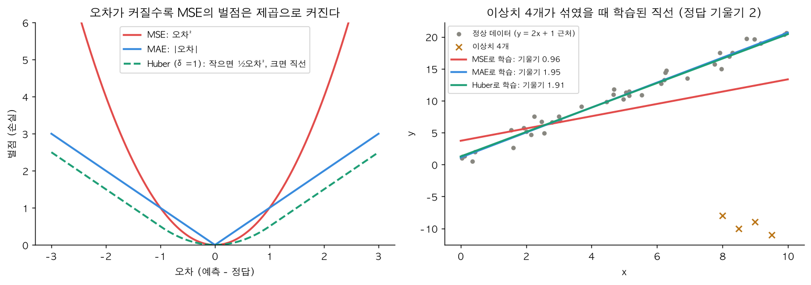

오른쪽 그림은 y = 2x + 1 근처의 데이터 40개에 이상치 4개를 섞고, 같은 경사하강법으로 직선을 학습한 결과다. **MSE로 학습한 직선은 기울기가 0.96으로 꺾였고, MAE(1.95)와 Huber(1.91)는 정답 2 근처를 지켰다.** 이상치 4개의 큰 오차가 제곱되면서 MSE 학습 전체를 끌어당긴 것이다.

#### 이유 3. 분류에서 MSE 대신 Cross-Entropy를 쓰는 이유

정답이 1인데 모델이 sigmoid로 확률 $\hat{y}$ 을 냈다고 하자.

| $\hat{y}$ (정답 1일 확률) | BCE = −log $\hat{y}$ | MSE = (1 − $\hat{y}$)² |
|---|---|---|
| 0.9 (잘 맞힘) | 0.105 | 0.010 |
| 0.6 | 0.511 | 0.160 |
| 0.1 (틀림) | 2.303 | 0.810 |
| 0.01 (확신하며 틀림) | **4.605** | 0.980 |

**첫째, 벌점의 크기**: MSE는 아무리 틀려도 최대 1이다. BCE는 틀린 쪽으로 확신할수록 끝없이 커진다. "모르겠다(0.5)"보다 "확실히 아니다(0.01)"를 훨씬 무겁게 벌한다.

**둘째, 기울기가 사라지는 문제 (이게 더 중요하다)**: 경사하강법은 sigmoid에 들어가기 전 점수 z에 대한 기울기로 움직인다.

| z | $\hat{y}$ = σ(z) | BCE의 기울기 $\hat{y} - 1$ | MSE의 기울기 $2(\hat{y} - 1) \cdot \hat{y}(1 - \hat{y})$ |
|---|---|---|---|
| −5 (확신하며 틀림) | 0.0067 | **−0.993** | **−0.013** |
| −2 | 0.119 | −0.881 | −0.185 |
| 0 | 0.5 | −0.5 | −0.25 |
| 2 (거의 맞힘) | 0.881 | −0.119 | −0.025 |

MSE의 기울기에는 sigmoid의 기울기 $\hat{y}(1 - \hat{y})$ 가 곱해진다. 크게 틀려서 $\hat{y}$ 가 0 근처에 붙으면 이 값이 0에 가까워져서, **가장 많이 고쳐야 할 때 기울기가 75배 작아진다**(z = −5에서 0.013 대 0.993). 4장에서 본 기울기 소실이 손실 함수 때문에 생기는 것이다. BCE는 −log가 sigmoid의 지수를 상쇄해서 기울기가 깔끔하게 $\hat{y} - y$ 가 된다. 틀린 만큼 그대로 고친다.


#### 이유 4. 확률로 보면 "오차가 어떻게 생겼다고 믿느냐"의 선택이다

위의 MLE 유도를 다시 보면, 각 손실 함수는 **오차나 정답이 어떤 분포를 따른다고 가정한 것**과 같다.

| 가정 | −log 확률을 정리하면 | 손실 |
|---|---|---|
| 오차가 정규분포 (가운데 몰리고 꼬리가 아주 얇음) | 오차² | MSE |
| 오차가 라플라스 분포 (가운데 뾰족하고 꼬리가 두꺼움) | \|오차\| | MAE |
| 정답이 0/1 동전 던지기 (베르누이) | −[y log ŷ + (1 − y) log(1 − ŷ)] | BCE |
| 정답이 K개 중 하나 (카테고리) | −log(정답 클래스의 확률) | Cross-Entropy |

정규분포는 꼬리가 아주 얇아서, 큰 오차는 "거의 일어날 수 없는 일"로 본다. 그래서 큰 오차가 나오면 모델을 크게 고친다(MSE가 이상치에 끌려가는 이유). 라플라스 분포는 큰 오차도 가끔 일어난다고 보기 때문에 덜 흔들린다. **손실을 고르는 것은 "내 데이터의 오차가 어떻게 생겼다고 믿느냐"를 고르는 것**이다.

#### 이 과제에서는

| 장 | 문제 | 쓴 손실 | 이유 |
|---|---|---|---|
| 3장 결과 ⑤ | 선형 회귀 (기울기 w, 절편 b) | MSE | 잡음이 정규분포로 만들어진 데이터. MSE가 2차 함수라 Newton이 한 걸음에 도착했다 |
| 4장 | XOR 분류 (출력 1개, sigmoid) | BCE | sigmoid와 짝이 맞아 ∂L/∂z₂ = ŷ − y로 깔끔하다 |
| 5장 | 정규분포·베르누이 데이터의 MLE 확인 | MSE, BCE | 가정한 분포와 손실이 같은 답(w = 2.055, p = 0.70)을 준다 |
| 5장 보너스 | softmax 출력 | Cross-Entropy | 기울기가 ŷ − y로 확인됐다 (중심차분과 차이 6.9e-12) |

#### 자주 하는 실수

- **분류에 MSE 쓰기**: 학습은 되지만, 크게 틀린 예시에서 기울기가 사라져 느리다(이유 3).
- **softmax를 두 번 적용하기**: 많은 라이브러리의 Cross-Entropy 함수는 내부에서 softmax를 계산한다. 출력층에 softmax를 또 넣으면 확률을 다시 확률로 바꾸는 셈이 된다. 라이브러리 문서에서 입력이 점수(logit)인지 확률인지 확인한다.
- **log(0)**: 예측 확률이 정확히 0이면 −log(0) = 무한대가 된다. 실무에서는 확률을 아주 작은 값(예: 1e-12)과 1 − 1e-12 사이로 자르거나, 점수 z에서 바로 계산하는 안정한 공식을 쓴다.
- **손실과 평가 지표를 헷갈리기**: 학습은 손실(BCE)로 하고, 보고는 사람이 이해하기 쉬운 지표(정확도, RMSE 등)로 한다. 정확도는 계단처럼 변해서 기울기가 거의 0이라 학습용 손실로는 쓸 수 없다. 4장의 계단 함수가 학습되지 않는 이유와 같다.

### 과제에서 할 일 (`notebooks/probability_loss.ipynb`)

- [x] 정규분포 N(0, 1)과 N(2, 0.5)의 PDF 곡선을 하나의 Figure에 비교한다.
- [x] 베르누이 분포 B(0.3)과 B(0.7)의 PMF 막대그래프를 하나의 Figure에 비교한다.
- [x] Softmax를 구현하고 출력의 합이 1.0과 **1e-6 이내**로 같은지 확인한다.
- [x] "MSE 최소화 = 정규분포 가정 하의 MLE"를 수식으로 유도해 작성한다.
- [x] "Cross-Entropy 최소화 = 베르누이/카테고리 분포 가정 하의 MLE"를 수식으로 유도해 작성한다.
- [x] (보너스) 엔트로피, KL-Divergence, Cross-Entropy를 직접 구현하고 CE = H + KL 관계를 확인한다.

> [!WARNING]
> **직접 확인해 볼 것**
> - N(2, 0.5)의 0.5는 분산(σ²)일까, 표준편차(σ)일까? 표기 관례를 찾아보고, 어떤 해석을 택했는지 노트북에 명시한다. 두 경우 곡선의 높이는 어떻게 달라지는가?
> - B(0.3)과 B(0.7)의 막대그래프는 서로 어떤 관계인가?

### 결과와 해석

노트북: [`notebooks/probability_loss.ipynb`](notebooks/probability_loss.ipynb)

**① 정규분포 PDF**


- **N(2, 0.5)의 0.5는 분산(σ²)으로 해석했다.** 통계에서 $N(\mu, \sigma^2)$ 는 두 번째 자리에 분산을 쓰는 것이 표준 표기다. 이 경우 표준편차는 √0.5 ≈ 0.707이다.
- 최고점은 N(0, 1)이 0.399, N(2, 0.5)가 0.564다. 0.5를 표준편차로 해석하면(점선) 분산이 0.25가 되어 최고점이 0.798로 더 좁고 높아진다.
- 세 곡선 모두 곡선 아래 넓이가 1.0000이다. 분산이 작으면 좁아지는 대신 높아져서 넓이가 유지된다.

**② 베르누이 PMF**


B(0.3)은 P(0) = 0.7, P(1) = 0.3이고, B(0.7)은 P(0) = 0.3, P(1) = 0.7이다. **0과 1의 확률이 서로 뒤바뀐 좌우 대칭** 관계다(B(p)와 B(1 − p)). 두 경우 모두 막대 높이의 합은 1이다.

**③ Softmax**

| 입력 | \|합 − 1\| | 결과 | 최댓값을 빼지 않은 버전 |
|---|---|---|---|
| [2, 1, 0.1] | 0 | 통과, 확률 [0.659, 0.242, 0.099] | 정상 |
| [−3, 0, 3, 1] | 1.1e-16 | 통과 | 정상 |
| [1000, 1001, 1002] | 1.1e-16 | 통과 | **nan** (e¹⁰⁰⁰ 오버플로) |
| 무작위 10개 | 1.1e-16 | 통과 | 정상 |

모든 경우 기준(1e-6)을 통과했다. 최댓값을 빼는 안정화가 없으면 큰 입력에서 계산이 망가지는 것도 확인했다.

**④ MSE 최소화 = 정규분포 가정 하의 MLE**


y = 2x + 1 + 잡음(σ = 0.5)으로 만든 데이터 50개에서 기울기 w를 바꿔 가며 계산했다. MSE가 최소인 w와 음의 로그 우도(NLL)가 최소인 w가 **둘 다 2.055로 같았다.** 또 NLL = n/(2σ²) × MSE + 상수 관계가 1e-13 오차로 성립했다. 즉 NLL은 MSE를 늘이고 위로 올린 것일 뿐이라 최솟값의 위치가 같다.

**⑤ Cross-Entropy 최소화 = 베르누이 가정 하의 MLE**


동전 10번 중 앞면 7번인 데이터에서 BCE가 최소인 p와 우도가 최대인 p가 **둘 다 0.70**으로, 표본 비율과 같았다. 또 소프트맥스 + Cross-Entropy의 기울기를 중심차분으로 구한 값이 공식 ŷ − y와 6.9e-12 차이로 일치했다. 4장의 sigmoid + BCE와 같은 "예측 − 정답" 형태다.

**⑥ (보너스) 정보 이론**: p = [0.7, 0.2, 0.1]에 대해 q를 바꿔 가며 계산했더니 모든 경우 **CE = H(p) + KL(p‖q)** 가 성립했다. q = p이면 KL = 0이고, q가 p에서 멀어질수록(q = 균등분포일 때 KL = 0.297) CE가 커졌다.

**정리**: 회귀에서 MSE, 분류에서 Cross-Entropy를 쓰는 것은 관례가 아니라, 각각 "오차는 정규분포", "정답은 베르누이/카테고리 분포"라고 가정하고 **우도를 최대화한 결과**다.

---

## 결과 요약

과제의 검증 기준과 실제 결과를 정리한다. 자세한 내용은 각 장의 "결과와 해석"에 있다.

| 항목 | 기준 | 결과 | 통과 |
|---|---|---|---|
| 수치 미분 f'(3) (f = x²) | 오차 ≤ 1e-4 | 6.0000000000, 오차 3.9e-11 (h = 1e-5) | ✅ |
| Gradient ⟂ 등고선 (x² + y²) | 시각적 확인 | 16개 점, 최대 \|cos\| = 7.1e-12 | ✅ |
| det(A)와 넓이 비율 | 오차 ≤ 1% | 회전, 스케일링, 전단, 일반 행렬(det 3) 모두 오차 0.00% | ✅ |
| Power Iteration vs `np.linalg.eig` | 오차 ≤ 5% | [[4, 1], [1, 3]]: λ = 4.6180 (21회), 오차 2.3e-13 | ✅ |
| SVD 압축 (k = 10, 50, 100) | Figure 비교 | 오차 18.3%, 0.66%, 0% (k = 100은 rank 64로 제한) | ✅ |
| Vanilla GD (x² + y², lr = 0.1, 100회) | 원점 반경 1 이내 (명세: 0.1) | 거리 1.4e-9, 두 기준 모두 통과 | ✅ |
| lr 증가 시 발산 | 그래프 확인 | lr = 0.5는 1회 만에 수렴, lr = 1.0 진동, lr = 1.05 발산 (이론 경계 lr = 1) | ✅ (명세와 차이 설명) |
| Momentum vs Vanilla GD (x² + y²) | 한 Figure에 비교 | Vanilla 1.4e-9, Momentum 2.0e-2 (원형 함수에서는 Vanilla가 유리) | ✅ |
| Momentum vs Vanilla GD (x² + 10y²) | 이점 확인 | lr = 0.01에서 422회 → 153회 (2.8배 빠름), lr = 0.05·0.09에서는 Vanilla가 빠름 | ✅ |
| (추가) GD vs SGD vs Momentum vs Adam vs Newton (선형 회귀) | 비교 | 초과 손실 0.01까지 GD 23,800개, SGD(배치 16) 1,984개 데이터 사용, 걸음 수는 Newton 1, Momentum 52, Adam 63, GD 119 | ✅ |
| (보너스) Adam, Newton | 수렴 속도 비교 | 로젠브록: GD 도달 못 함, Momentum 3458회, Adam 1050회, Newton 5회 | ✅ |
| (추가) 학습률 탐색 | 이론과 비교 | GD 발산 경계가 이론값 2/λmax(0.1, 0.170)와 일치, Adam은 약 0.003 ~ 3에서 수렴(발산 경계 없음) | ✅ |
| (추가) 옵티마이저 계보 | 직전 방법과 비교 | x²+10y²: GD 209 → Momentum 150 → Nesterov 73걸음 / 로젠브록: AdaGrad·RMSProp 도달 못 함, Adam 1938걸음 | ✅ |
| (추가) 모든 경사하강법, 두 지형 | 각자 최적 lr로 비교 | x²+10y²: Newton 1, AdaGrad 78, GD·Nesterov 81, Momentum 160, Adam 162, RMSProp 수렴 못 함 / 로젠브록: Newton 5, Momentum 647, Nesterov 1573, Adam 5003, GD 5387, AdaGrad·RMSProp 수렴 못 함 | ✅ |
| (추가) 옵티마이저 조합 | 단독과 비교 | 안장점 함수: 순수 Newton은 안장점에 멈춤, Levenberg–Marquardt 5걸음, Adam→Newton 22걸음 / Lookahead: Momentum 141→80, Adam 82→103 | ✅ |
| 역전파 NumPy 검증 | 손계산과 소수점 4자리 일치 | 13개 값 모두 일치, 중심차분 검증 상대 오차 2.0e-11 | ✅ |
| 정규분포·베르누이 시각화 | Figure 비교 | N(2, 0.5)는 분산 0.5로 해석, 곡선 넓이 1.0000 | ✅ |
| Softmax 합 | \|합 − 1\| ≤ 1e-6 | 최대 1.1e-16 ([1000, 1001, 1002] 포함) | ✅ |
| MSE = 정규분포 MLE | 수식 유도 | 유도 + 수치 확인 (두 최솟값 모두 w = 2.055) | ✅ |
| CE = 베르누이/카테고리 MLE | 수식 유도 | 유도 + 수치 확인 (두 최적값 모두 p = 0.70) | ✅ |
| (보너스) 엔트로피, KL, Cross-Entropy | 직접 구현 | 3가지 q에서 모두 CE = H + KL 성립 | ✅ |

**과제 명세와 실제 결과가 다른 점** (각 장에서 근거를 설명했다)

- 역전파 예시의 z₂는 0.6072, ∂L/∂z₁의 두 번째 값은 −0.0517이다 (명세: 0.6071, −0.0513).
- x² + y²에서 lr = 0.5는 발산하지 않고 한 걸음 만에 수렴한다. 발산은 lr > 1부터다.
- x² + 10y², lr = 0.05에서는 y 방향이 첫 걸음에 0이 되어 지그재그가 생기지 않는다. 지그재그는 0.05 < lr < 0.1에서 생긴다.
- 64×64 이미지에서 k = 100은 불가능해 rank 64로 제한했다. 또 저장량이 원본보다 작아지는 것은 k ≤ 31일 때뿐이다.

---

## 용어 사전

기호 읽는 법은 [수학 준비의 11) 기호 읽는 법](#11-기호-읽는-법)에 따로 정리했다.

**수학 기초**

| 용어 | 쉬운 설명 |
|---|---|
| 함수 | 숫자를 넣으면 정해진 규칙으로 숫자 하나를 돌려주는 규칙. 자판기와 같다 |
| 기울기 | 가로로 1 갈 때 세로로 얼마나 변하는가. 양수면 오르막, 음수면 내리막 |
| 지형 (손실 지형) | 변수 2개짜리 함수를 (위치 → 높이)로 본 것. 손실 함수를 이렇게 보면 학습은 "바닥 찾기"가 된다 |
| 등고선 | 높이가 같은 점을 이은 선. 지형을 위에서 내려다본 지도 |
| 근사 | 정확한 값 대신 충분히 가까운 값을 쓰는 것 |
| 거듭제곱 / 로그 | 같은 수를 여러 번 곱하기 / 몇 번 곱해야 하는지 거꾸로 묻기. 로그는 곱셈을 덧셈으로 바꾼다 |
| e | 약 2.718인 수. sigmoid와 정규분포 식에 나온다 |
| Σ (서메이션, 합 기호) | 여러 값을 모두 더하라는 기호. 글자는 대문자 시그마지만 소문자 σ와 구분해 "서메이션"이라 부른다 |
| 인덱스 | "몇 번째"를 뜻하는 번호. $x_i$ 의 i |

**미적분**

| 용어 | 쉬운 설명 |
|---|---|
| 미분 / 도함수 | 한 점에서의 기울기 / x를 넣으면 그 점의 기울기를 돌려주는 함수 |
| 할선 / 접선 | 곡선 위 두 점을 잇는 직선 / 곡선의 한 점에 살짝 닿는 직선. 접선의 기울기가 미분값이다 |
| 극한 (limit) | 어떤 값을 한없이 가깝게 보낼 때 결과가 다가가는 목적지. "한 점의 기울기"는 두 점 기울기의 극한이다 |
| 차분 | 두 점의 값의 차이. h를 실제 숫자로 두고 계산한 기울기로, 미분의 근사값이다 |
| 편미분 | 변수가 여러 개일 때 하나만 움직이고 나머지는 고정한 채 구한 기울기 |
| Gradient (∇f) | 모든 편미분을 모은 벡터. 가장 가파르게 오르는 방향을 가리키는 화살표 |
| 연쇄 법칙 | 여러 단계를 거친 영향은 각 단계의 영향을 곱한 것 |
| 수치 미분 | 차분으로 미분을 근사하는 방법. 단순하지만 변수마다 따로 계산해야 해서 느리다 |
| 해석적 미분 | 미분 공식(예: x² → 2x)을 구해 두고 숫자를 넣어 정확하게 계산하는 방법 |
| 자동 미분 (AutoGrad) | 계산을 작은 단계로 쪼개 각 단계의 기울기를 연쇄 법칙으로 곱하는 방법. 역전파가 여기에 속하며 딥러닝 프레임워크가 쓴다 |
| 기울기 검증 (gradient check) | 역전파나 공식으로 구한 기울기를 중심차분 값과 비교해 맞는지 확인하는 것 |

**선형대수**

| 용어 | 쉬운 설명 |
|---|---|
| 벡터 | 숫자를 순서대로 묶은 것. 그림으로는 방향과 길이를 가진 화살표 |
| 성분 | 벡터를 이루는 숫자 하나하나 |
| 스칼라 | 벡터가 아닌 숫자 하나 |
| 노름 (norm) | 벡터의 길이. 피타고라스 정리로 구한다 |
| 단위벡터 | 길이가 정확히 1인 벡터. 방향만 나타낼 때 쓴다 (예: î = (1, 0)) |
| 정규화 | 벡터를 길이로 나눠 같은 방향의 단위벡터로 만드는 것 |
| 내적 | 같은 자리끼리 곱해서 더한 숫자 하나. 가중합이자 "방향이 얼마나 같은가". 0이면 직각 |
| 행렬 / 행 / 열 | 숫자를 직사각형으로 배열한 표 / 가로줄 / 세로줄 |
| 행렬 곱 | 결과의 i행 j열 = 왼쪽 i번째 가로줄과 오른쪽 j번째 세로줄의 내적. 순서를 바꾸면 결과가 다르다 |
| 전치 | 행과 열을 맞바꾸기 |
| 단위행렬 | 곱해도 아무것도 바뀌지 않는 행렬. 대각선이 1 |
| 대각행렬 | 대각선에만 숫자가 있는 행렬. 축 방향으로 늘이기만 한다 |
| 직교 행렬 | 늘이거나 줄이지 않고 돌리거나 뒤집기만 하는 행렬 |
| 선형 변환 | 행렬이 공간을 늘이고, 돌리고, 미는 것. 직선은 직선으로, 원점은 원점으로 남는다 |
| 행렬식 (det) | 행렬이 넓이(부피)를 몇 배로 바꾸는가. 0이면 납작해지고, 음수면 뒤집힌다 |
| 고유벡터 / 고유값 | 변환 후에도 방향이 유지되는 벡터 / 그 방향으로 늘어나는 배율 |
| 공분산 행렬 | 데이터가 어느 방향으로 얼마나 퍼져 있는지 정리한 행렬 |
| PCA (주성분 분석) | 공분산 행렬의 고유벡터로 데이터가 가장 많이 퍼진 방향을 찾고, 중요한 방향만 남겨 숫자 개수(차원)를 줄이는 방법 |
| Power Iteration | 행렬을 계속 곱하면서 매번 정규화해 가장 큰 고유값과 고유벡터를 찾는 방법 |
| SVD | 행렬을 "돌리기 → 늘이기 → 돌리기"로 쪼개는 방법. 중요한 성분 순서로 정리된다 |
| 특이값 | SVD에서 각 방향으로 늘어나는 배율이자 각 성분의 중요도 |
| 랭크 (rank) | 0이 아닌 특이값의 개수. 행렬에 담긴 서로 다른 성분의 수 |
| 오버플로 | 숫자가 너무 커져서 컴퓨터가 표현할 수 없게 되는 것 (`inf`) |

**최적화와 신경망**

| 용어 | 쉬운 설명 |
|---|---|
| 파라미터 (θ) | 모델이 학습하면서 고쳐 나가는 숫자 전체 |
| 가중치 (W) / 편향 (b) | 입력마다 곱하는 중요도 / 가중합에 더하는 기본값 |
| 퍼셉트론 | 뉴런 하나. 가중합을 구한 뒤 활성화 함수를 통과시킨다 |
| 기호주의 (symbolic AI) | 사람이 지식을 규칙과 기호로 직접 적어 넣는 AI 접근. 예: 전문가 시스템 |
| 연결주의 (connectionism) | 단순한 뉴런을 많이 연결하고 연결의 세기(가중치)를 데이터로 학습하는 AI 접근. 신경망, 딥러닝 |
| XOR | 두 입력이 서로 다를 때만 1인 규칙. 직선 하나로 나눌 수 없어 단층 퍼셉트론으로는 풀 수 없다 |
| 신경-기호 AI (neuro-symbolic AI) | 신경망(인식)과 기호 추론(논리, 설명)을 합치려는 접근 |
| 층 (layer) | 뉴런 여러 개를 나란히 놓은 것. 계산은 $Wx + b$ 한 번 |
| 활성화 함수 | 층 사이에서 값을 비선형으로 바꿔 주는 함수 (예: sigmoid) |
| 계단 함수 (step function) | 0 이상이면 1, 아니면 0을 내는 함수. 원래 퍼셉트론의 활성화 함수. 기울기가 0이라 경사하강법으로 학습할 수 없다 |
| ReLU | max(0, z). 양수에서 기울기가 1이라 깊은 신경망에서도 기울기가 줄지 않는다 |
| 기울기 소실 (vanishing gradient) | 역전파에서 1보다 작은 기울기가 층마다 곱해져, 앞쪽 층의 기울기가 거의 0이 되는 현상 |
| 손실 함수 | 예측이 정답과 얼마나 다른지 나타내는 숫자. 무엇을 "틀림"으로 볼지, 학습이 따라갈 기울기, 모델이 결국 예측하는 값(평균, 중앙값, 확률)을 정한다 |
| MSE / MAE | 오차 제곱의 평균 / 오차 절댓값의 평균. MSE는 평균을, MAE는 중앙값을 예측하게 만든다. MAE가 이상치에 덜 흔들린다 |
| Huber 손실 | 작은 오차에는 MSE처럼, 큰 오차에는 MAE처럼 벌점을 주는 회귀 손실. 기준점 δ로 경계를 정한다 |
| BCE / Cross-Entropy | 이진 분류 / 다중 분류 손실. 정답 클래스 확률의 −log. sigmoid·softmax와 짝을 이루면 기울기가 "예측 − 정답"이 된다 |
| 경사하강법 | gradient의 반대 방향(내리막)으로 조금씩 움직여 손실의 바닥을 찾는 방법 |
| 학습률 (lr, η) | 경사하강법에서 한 걸음의 크기 |
| Momentum | 지난 gradient를 속도로 쌓아 관성을 주는 방법. 지그재그는 줄이고 꾸준한 방향은 빠르게 한다 |
| Batch GD / 미니배치 GD / SGD | 한 걸음에 데이터를 전부 / 무작위 B개 / 무작위 1개 써서 gradient를 구하는 경사하강법. 실무에서는 미니배치 GD도 SGD라 부른다 |
| 멈춤 조건 | 경사하강법을 끝내는 기준. 기울기가 충분히 작거나, 변화가 거의 없거나, 정해 둔 횟수를 다 쓰면 멈춘다 |
| SGD (확률적 경사하강법) | 매 걸음 데이터 일부(미니배치)만으로 gradient를 추정하는 경사하강법. 한 걸음이 싸지만 경로가 흔들린다 |
| 미니배치 / 배치 크기 | 한 걸음에 쓰는 무작위 데이터 묶음 / 그 개수 |
| 에폭 (epoch) | 전체 데이터를 한 번 다 사용하는 것 |
| Nesterov 가속 | Momentum에서 "관성으로 갈 곳"의 기울기를 미리 보고 고쳐, 바닥을 덜 지나치게 한 방법 (1983) |
| AdaGrad | 방향마다 gradient 제곱의 누적합으로 나눠 보폭을 조절하는 방법 (2011). 오래 학습하면 보폭이 0으로 줄어든다 |
| RMSProp | AdaGrad의 누적합을 이동 평균으로 바꿔 보폭이 줄어들지 않게 한 방법 (2012) |
| Adam | Momentum(관성)과 RMSProp(방향별 보폭 조절)을 합친 옵티마이저 |
| AdamW | Adam에서 가중치 감쇠(weight decay)를 gradient 계산과 분리한 변형 |
| 이동 평균 (exponential moving average) | 새 값과 이전 평균을 일정 비율로 섞어(예: 0.9 × 이전 + 0.1 × 새 값) 최근 값을 더 중시하는 평균 |
| Newton Method | 2차 미분(Hessian)으로 휘어진 정도까지 고려해 한 번에 크게 이동하는 방법. 빠르지만 한 걸음이 비싸다 |
| Hessian | 2차 미분을 모은 행렬. 지형이 방향별로 얼마나 휘어 있는지 나타낸다 |
| Lookahead | 다른 옵티마이저를 감싸서, k걸음마다 느린 가중치가 빠른 가중치 쪽으로 일부만 따라가게 하는 방법 |
| Levenberg–Marquardt | 감쇠값 λ로 GD와 Newton 사이를 자동으로 오가는 방법. 손실이 줄면 Newton 쪽, 늘면 GD 쪽 |
| SWATS / AdaBound | Adam으로 시작해 SGD로 바꾸는 방법 / 그 전환을 부드럽게 하는 방법 |
| 조건수 (condition number) | Hessian의 가장 큰 고유값 ÷ 가장 작은 고유값. 클수록 지형이 길쭉하고 학습이 어렵다 |
| 학습률 탐색 (learning rate sweep) | 학습률을 로그 간격으로 바꿔 가며 짧게 학습해 보고 가장 좋은 값을 고르는 것 |
| 학습률 스케줄 / warmup | 학습 중에 학습률을 점점 줄이는 것 / 처음 몇 걸음은 작게 시작해 키우는 것 |
| 정규화 (데이터) | 입력 특성의 평균을 0, 표준편차를 1로 맞추는 것. 손실 지형을 둥글게 만들어 학습을 쉽게 한다 |
| 길쭉한 골짜기 (ravine, ill-conditioning) | 방향마다 가파른 정도가 크게 다른 지형. 조건수(가장 큰 / 가장 작은 고유값)가 크다 |
| 볼록 함수 (convex function) | 바닥이 하나뿐인 그릇 모양 함수. 경사하강법이 반드시 바닥에 도착한다 |
| 지역 최솟값 / 전역 최솟값 | 주변보다만 낮은 바닥 / 전체에서 가장 낮은 바닥 |
| 안장점 (saddle point) | 기울기가 0이지만 한 방향으로는 바닥, 다른 방향으로는 꼭대기인 점 |
| 평탄 구간 (plateau) | 기울기가 거의 0이라 학습이 멈춘 것처럼 보이는 넓은 지역 |
| 수렴 / 발산 | 값이 한 곳으로 모여 가는 것 / 점점 멀어지는 것 |
| 순전파 / 역전파 | 입력 → 예측 계산 / 손실 → 각 가중치의 기울기 계산 |
| shape | 배열의 모양. (2,)는 길이 2인 벡터, (2,2)는 2×2 행렬 |

**확률·통계**

| 용어 | 쉬운 설명 |
|---|---|
| 확률 | 어떤 일이 일어날 가능성. 0(절대 안 일어남)부터 1(반드시 일어남)까지 |
| 평균 (μ) / 표준편차 (σ) | 값들의 중심 / 값들이 평균에서 얼마나 퍼져 있는가 |
| PDF / PMF | 연속값의 확률밀도 / 이산값의 확률 |
| 우도 (likelihood) | "그럴듯한 정도". 데이터는 고정하고 파라미터를 바꿔 가며, "파라미터가 이 값이면 관측한 데이터가 나올 확률"을 계산한 것. 파라미터의 확률이 아니라 후보 비교용 점수다 |
| 조건부 확률 p(y \| x) | x가 주어졌을 때 y가 나올 확률 |
| MLE | 우도를 최대로 만드는 파라미터를 고르는 방법 |

## 참고 자료

- 3Blue1Brown, [Essence of Calculus](https://www.youtube.com/playlist?list=PLZHQObOWTQDMsr9K-rj53DwVRMYO3t5Yr) — 미분, 테일러 전개를 그림으로 이해
- 3Blue1Brown, [Essence of Linear Algebra](https://www.youtube.com/playlist?list=PLZHQObOWTQDPD3MizzM2xVFitgF8hE_ab) — 행렬 = 공간 변환, 행렬식, 고유벡터
- 3Blue1Brown, [Neural Networks](https://www.youtube.com/playlist?list=PLZHQObOWTQDNU6R1_67000Dx_ZCJB-3pi) — 경사하강법과 역전파
- Gilbert Strang, *Introduction to Linear Algebra* — SVD와 고유값 분해
- Ian Goodfellow et al., [*Deep Learning*](https://www.deeplearningbook.org/) 4장(수치 계산), 5장(MLE), 6장(역전파)
- David E. Rumelhart, Geoffrey E. Hinton, Ronald J. Williams, "Learning representations by back-propagating errors", *Nature* 323 (1986) — 역전파
- Marvin Minsky, Seymour Papert, *Perceptrons* (1969) — 단층 퍼셉트론의 한계 (XOR)
- [Neurosymbolic AI — Why, What, and How](https://arxiv.org/abs/2305.00813) (2023) — 신경-기호 AI 개관
- Sebastian Ruder, [An overview of gradient descent optimization algorithms](https://arxiv.org/abs/1609.04747) (2016) — GD, SGD, Momentum, Adam 등 비교
- Boris T. Polyak, "Some methods of speeding up the convergence of iteration methods" (1964) — Momentum (heavy ball)
- Yurii Nesterov, "A method for solving the convex programming problem with convergence rate O(1/k²)" (1983)
- John Duchi, Elad Hazan, Yoram Singer, "Adaptive Subgradient Methods for Online Learning and Stochastic Optimization", *JMLR* (2011) — AdaGrad
- Tijmen Tieleman, Geoffrey Hinton, [Lecture 6.5 — RMSProp: Divide the gradient by a running average of its recent magnitude](https://cir.nii.ac.jp/crid/1370017282431050757), Coursera: Neural Networks for Machine Learning (2012)
- Diederik P. Kingma, Jimmy Ba, [Adam: A Method for Stochastic Optimization](https://arxiv.org/abs/1412.6980) (2015)
- Ilya Loshchilov, Frank Hutter, [Decoupled Weight Decay Regularization](https://arxiv.org/abs/1711.05101) (ICLR 2019) — AdamW
- Yann Dauphin et al., [Identifying and attacking the saddle point problem in high-dimensional non-convex optimization](https://arxiv.org/abs/1406.2572) (2014) — 고차원에서는 지역 최솟값보다 안장점이 문제
- Nitish Shirish Keskar, Richard Socher, [Improving Generalization Performance by Switching from Adam to SGD](https://arxiv.org/abs/1712.07628) (2017) — SWATS
- Liangchen Luo et al., [Adaptive Gradient Methods with Dynamic Bound of Learning Rate](https://arxiv.org/abs/1902.09843) (ICLR 2019) — AdaBound
- Michael R. Zhang et al., [Lookahead Optimizer: k steps forward, 1 step back](https://arxiv.org/abs/1907.08610) (NeurIPS 2019)
- Pavel Izmailov et al., [Averaging Weights Leads to Wider Optima and Better Generalization](https://arxiv.org/abs/1803.05407) (UAI 2018) — SWA
- Keller Jordan et al., [Muon: An optimizer for the hidden layers of neural networks](https://github.com/KellerJordan/Muon) (2024)
- [Levenberg–Marquardt algorithm](https://en.wikipedia.org/wiki/Levenberg%E2%80%93Marquardt_algorithm) (Wikipedia)